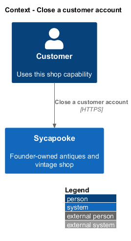
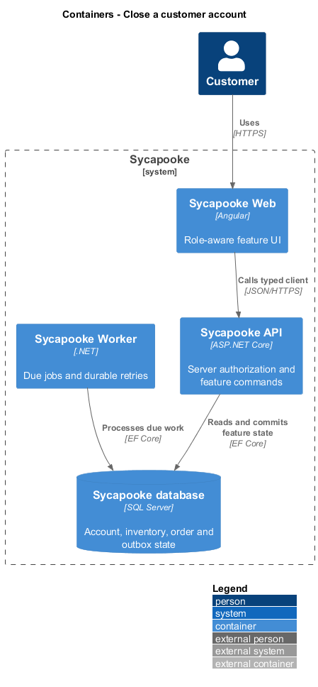
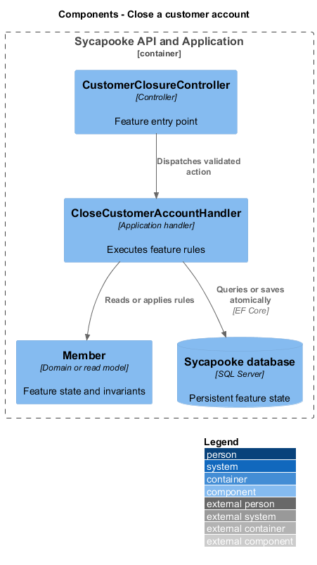
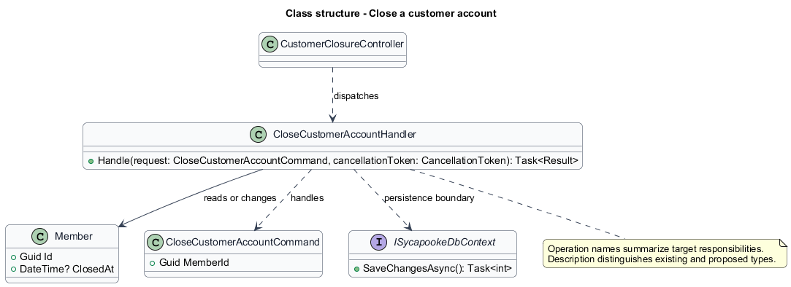
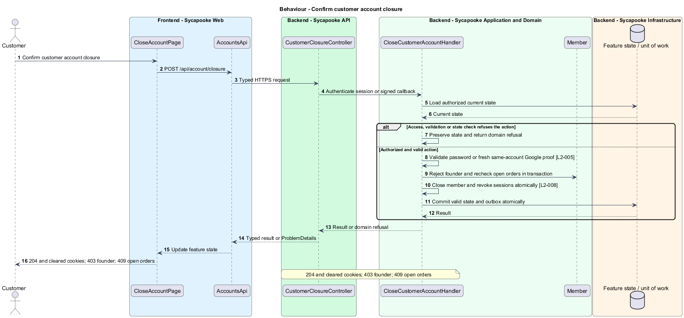
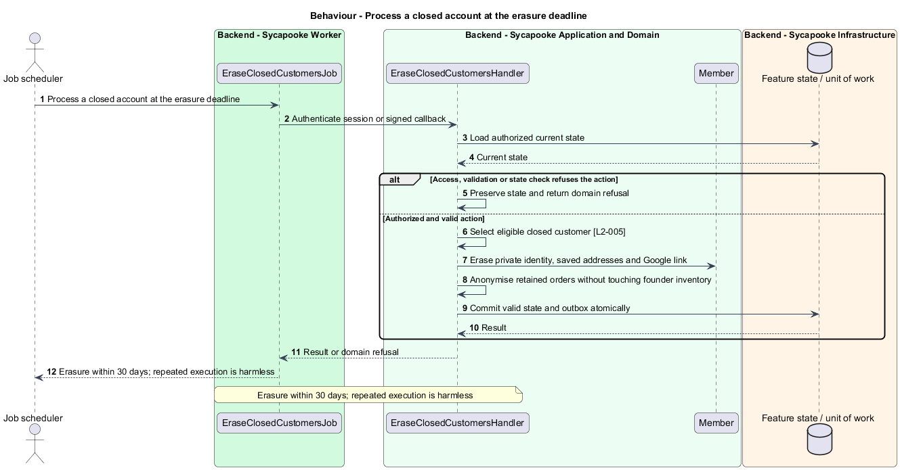

# Close a customer account

## Overview

Account closure ends customer access and erases private data after outstanding orders finish. It preserves founder inventory and anonymises retained purchase records.

Sycapooke is the shop of one older Caribbean woman, its sole seller. Her jewelry, clothing, housewares and electronics are at least 20 years old. This design refines [ADR general/0010](../../../adr/general/0010-founder-only-shop.md). Existing names identify reusable code; Description identifies target additions.

## Description

### Confirmation and closure

`CloseAccountPage`, `CustomerClosureController`, `CloseCustomerAccountHandler` and `EraseClosedCustomersJob` and `EraseClosedCustomersHandler` are proposed additions. The page uses the shared confirmation dialog and error components. `POST /api/account/closure` accepts `{ password }` for a password account. A Google-only account uses a fresh Google authentication bound to its existing immutable ID and a single-use closure proof valid for 10 minutes. That proof is scoped to closure and stored in a Secure, HttpOnly cookie, never web storage.

The handler refuses the configured founder with 403. A customer with a Paid, Shipped or Delivered order receives 409 `ACCOUNT_HAS_OPEN_ORDERS`, including only their own blocking orders. A wrong password or invalid closure proof cannot close an account. The operation rechecks orders inside the closure transaction so concurrent checkout cannot leave a closed customer with a new order.

### Sessions, data and erasure

On success, `Member.Close` sets `ClosedAt` and revokes all session families in the same unit of work. The response is 204 and clears session cookies. Sign-in, refresh, checkout and account queries reject closed accounts. Founder inventory is not selected, removed or modified.

The worker erases email, display name, saved addresses and Google links within 30 days. Required order records retain an anonymised buyer label, `Former customer`. The current `Member.Close` method alone does not provide the new session, order and erasure workflow. Erasure is idempotent and retains only the existing retention-policy records. The retention schedule for retained order records is `<TO SUPPLY>`; no new schedule is invented.

Acceptance scenarios cover both authentication methods, expired and replayed proof, founder refusal, open orders, immediate session revocation, 30-day erasure and unchanged founder inventory.

### Implementation and verification boundary

Application code and HTML mocks still require alignment with the revised requirements. UI implementation first aligns mocks, design-system components and screen composition. Backend verification uses fake ports and in-memory substitutes. Browser verification uses the built Angular app and intercepted API responses. No external system runs in tests.

### Implementation evidence

No complete target behavior is counted. Reusable implementation exists where identified, but the revised founder, privacy or infrastructure boundary and its acceptance coverage remain unfinished.

Effort in the matching estimate is the full target feature effort in developer-days, not remaining work. Completion counts whole verified behaviors and rounds to the nearest ten percent. Source and existing acceptance tests supply the evidence; this documentation refresh does not execute new target tests.

## Requirements

| L2 ID | Refines (L1) | Requirement |
| --- | --- | --- |
| `L2-005` | `L1-001` | A customer shall be able to close their private account. Closure shall be refused while they have an order that is not Completed, Cancelled or Refunded. Closure shall revoke all sessions and erase personal data within 30 days, except order records required by the existing retention rules, which shall be anonymised. Customer closure shall not remove or modify founder inventory. The founder shall not be offered customer self-service account closure; shop shutdown and operator identity changes are outside this customer journey. |
| `L2-008` | `L1-002` | Sessions shall use a short-lived access token (15 minutes) and a rotating refresh token (14 days) held in `HttpOnly`, `Secure`, `SameSite=Strict` cookies. Tokens shall never be stored in `localStorage` or `sessionStorage`. Signing out shall revoke the session on the server. |
| `L2-054` | `L1-014` | Email addresses, shipping addresses and phone numbers shall never appear in public pages or public API responses. Shipping addresses shall be encrypted at rest at the field level, and all databases, backups and photo storage shall be encrypted at rest. |

## Diagrams

### System context

The context identifies the customer and the systems used by this feature.

### Containers

The container view separates the delivery surface, application boundary and feature storage. External integrations remain behind their ports.

### Components

The component view connects `CustomerClosureController` with `CloseCustomerAccountHandler` and the relevant feature state.

### Class structure

The class view identifies the relevant fields, operation responsibilities and dependencies. It is a target responsibility model, not a claim that each addition already exists.

### Behaviour - Confirm customer account closure

204 and cleared cookies; 403 founder; 409 open orders. The sequence shows the boundary that enforces this outcome and the significant failure alternative.

### Behaviour - Process a closed account at the erasure deadline

Erasure within 30 days; repeated execution is harmless. The sequence shows the boundary that enforces this outcome and the significant failure alternative.

