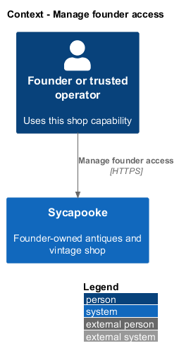
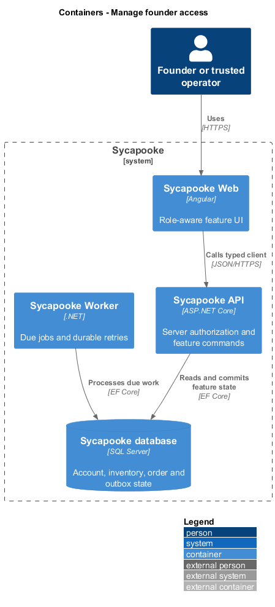
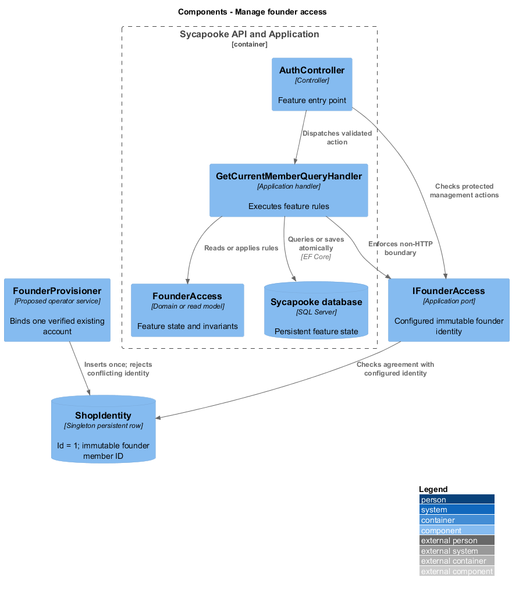
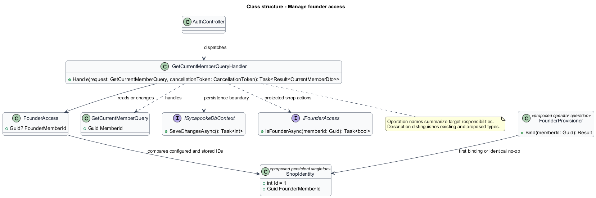
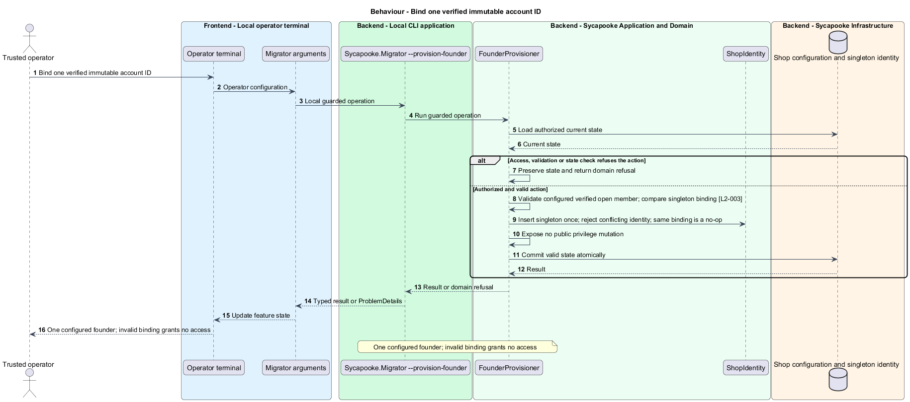
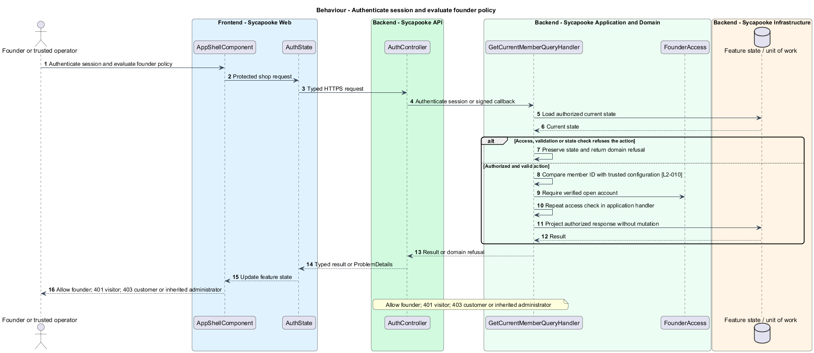
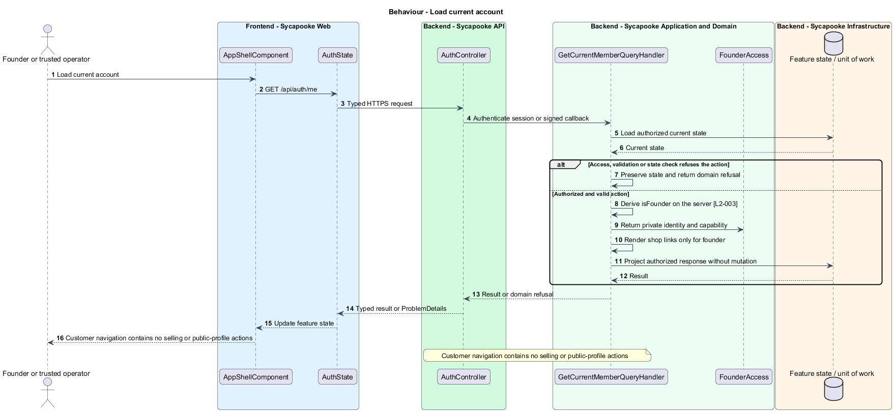

# Manage founder access

## Overview

Founder access separates the sole shop manager from private buyer accounts. A trusted operator binds one immutable account identity; public account flows cannot grant that capability.

Sycapooke is the shop of one older Caribbean woman, its sole seller. Her jewelry, clothing, housewares and electronics are at least 20 years old. This design refines [ADR general/0010](../../../adr/general/0010-founder-only-shop.md). Existing names identify reusable code; Description identifies target additions.

## Description

### Identity and provisioning

`ShopOptions` and `IFounderAccess` are proposed additions. `ShopOptions.FounderMemberId` reads the single `Shop:FounderMemberId` value from deployment configuration. `FounderAccess` compares the authenticated immutable `Member.Id` with that value and checks that the account is open and verified. Missing, malformed, unknown or closed-account configuration grants no management access.

A trusted operator first establishes and verifies the founder's ordinary account, then invokes the proposed `Sycapooke.Migrator --provision-founder` operation with `Shop:FounderMemberId`. Normal migrations and deployments do not invoke this operation. Configuration accepts one ID, not a list. Proposed `FounderProvisioner` validates the existing account and inserts a singleton `ShopIdentity` row (`Id = 1`, `FounderMemberId`) in a transaction. Repeating the same binding is a no-op; a different ID conflicts with the stored binding and is refused. `IFounderAccess` requires the configured and stored IDs to agree, so replacing a configuration value cannot promote a second person. Reapplying the same binding is idempotent. A different ID is rejected during ordinary provisioning; an operator-controlled identity recovery procedure is `<TO SUPPLY>`. No public promotion or provisioning endpoint exists. The demo seeder supplies its founder binding only to the local Development process.

### Authorization and account contract

The proposed `FounderAccessRequirement` replaces verified-email-only selling checks and separate administrator authorization for shop operations. `Policies.CanSell` remains an internal compatibility name but requires founder access. Fulfilment and support use the same check. Application handlers also receive `IFounderAccess` so non-HTTP callers cannot bypass the boundary.

`CurrentMemberDto` and the frontend `CurrentMember` gain the additive, server-derived `isFounder: boolean` field. `GetCurrentMemberQueryHandler`, sign-in, refresh and Google finish return the same capability. `AuthState.isFounder` controls navigation and route guards; it does not authorize API calls. Request bodies, token role claims, display names and email matches cannot set the binding.

Anonymous protected requests return 401. Signed-in customers and non-founder administrator identities receive 403 `FOUNDER_REQUIRED` before founder resources are loaded. Other customers' private resources remain indistinguishable 404 responses. Configuration shape is checked at startup; persisted binding checks occur on protected access so the database-free health endpoint remains available; changed bindings take effect only after controlled service restart. An old session for an unbound identity grants no founder access after restart.

### Implementation and verification boundary

Application code and HTML mocks still require alignment with the revised requirements. UI implementation first aligns mocks, design-system components and screen composition. Backend verification uses fake ports and in-memory substitutes. Browser verification uses the built Angular app and intercepted API responses. No external system runs in tests.

### Implementation evidence

Implemented and covered: the `ShopIdentity` singleton, `Shop:FounderMemberId` validation, `IFounderAccess`, `--provision-founder`, server-derived `isFounder`, founder-only navigation, `signedInGuard`/`founderGuard`, the `/403` page (`FounderAccessTests`, `ProvisionFounderTests`, `founder-navigation.spec.ts`, `manage-private-account.spec.ts`). Remaining: the `CanSell` and `Administrator` policy change and founder checks in the listing and order handlers (Phases 2 and 3).

Effort in the matching estimate is the full target feature effort in developer-days, not remaining work. Completion counts whole verified behaviors and rounds to the nearest ten percent. Source and existing acceptance tests supply the evidence; this documentation refresh does not execute new target tests.

## Requirements

| L2 ID | Refines (L1) | Requirement |
| --- | --- | --- |
| `L2-003` | `L1-001` | Public registration shall create customer accounts only. A trusted operator shall provision one founder account through a protected deployment or operator process outside public registration. The server shall bind management access to that account's immutable identity, never a display name, email supplied by the client or Google claim. Provisioning shall not create a second founder. Only the verified founder shall manage listings, photos, sales, shipping and customer problems. Customers shall have no selling links, public profile creation or management navigation. |
| `L2-010` | `L1-002` | Every API endpoint shall enforce the caller's permissions on the server. Customers shall change only their own private account and access only their own purchases, addresses and support submissions. Only the configured founder (L2-003) shall manage inventory, view shop sales, fulfil orders and resolve customer problems. There is no separate administrator decision-maker. Anonymous browsing and the public registration, verification, authentication, password-recovery and signed provider-callback flows remain available under their own validation rules. |

## Diagrams

### System context

The context identifies the founder or trusted operator and the systems used by this feature.

### Containers

The container view separates the delivery surface, application boundary and feature storage. External integrations remain behind their ports.

### Components

The component view connects `AuthController` with `GetCurrentMemberQueryHandler` and the relevant feature state.

### Class structure

The class view identifies the relevant fields, operation responsibilities and dependencies. It is a target responsibility model, not a claim that each addition already exists.

### Behaviour - Bind one verified immutable account ID

One configured founder; invalid binding grants no access. The sequence shows the boundary that enforces this outcome and the significant failure alternative.

### Behaviour - Authenticate session and evaluate founder policy

Allow founder; 401 visitor; 403 customer or inherited administrator. The sequence shows the boundary that enforces this outcome and the significant failure alternative.

### Behaviour - Load current account

Customer navigation contains no selling or public-profile actions. The sequence shows the boundary that enforces this outcome and the significant failure alternative.

