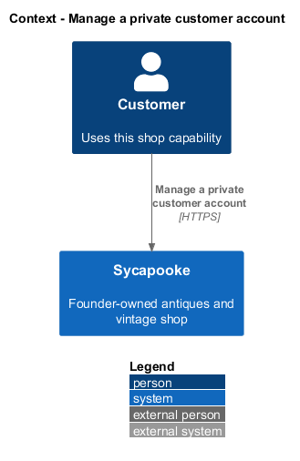
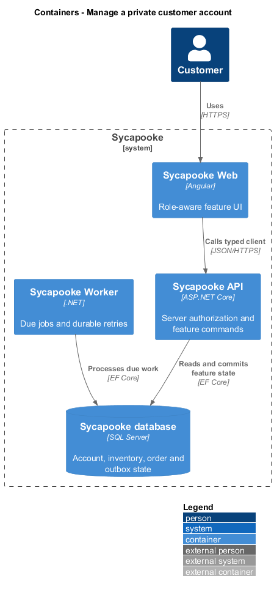
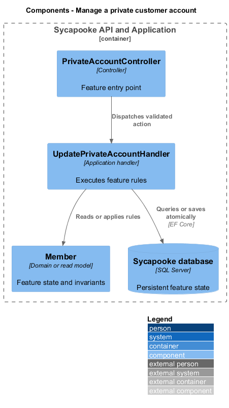
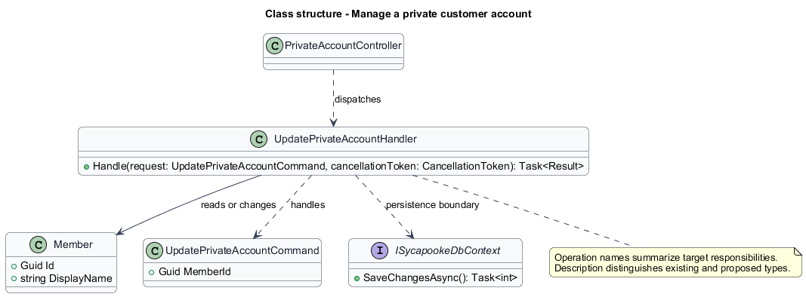
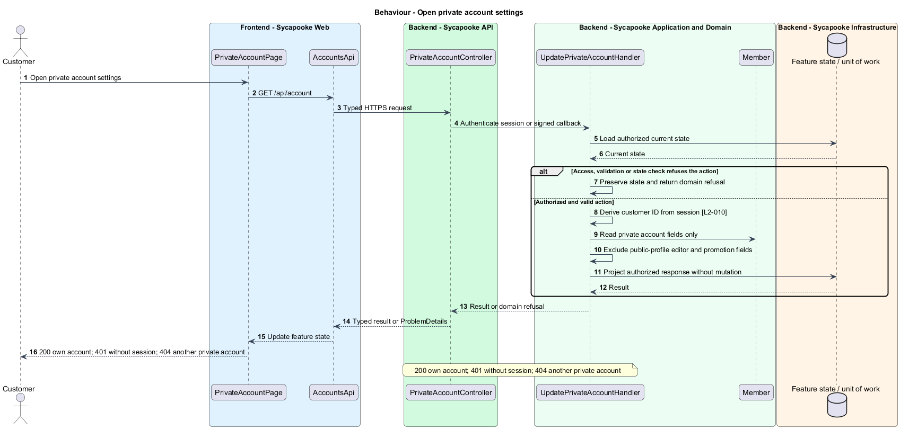
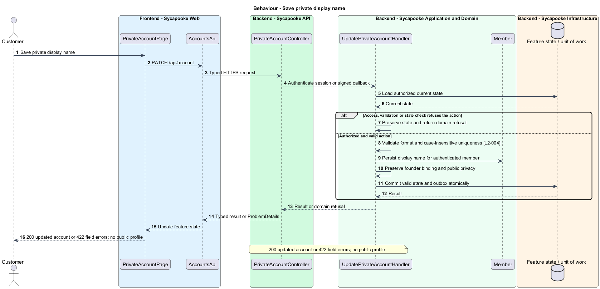

# Manage a private customer account

## Overview

Customers change their private account label without publishing a profile or acquiring selling rights.

Sycapooke is the shop of one older Caribbean woman, its sole seller. Her jewelry, clothing, housewares and electronics are at least 20 years old. This design refines [ADR general/0010](../../../adr/general/0010-founder-only-shop.md). Existing names identify reusable code; Description identifies target additions.

## Description

### Private account boundary

`PrivateAccountPage`, `PrivateAccountController` and `UpdatePrivateAccountHandler` are proposed additions. The page uses the accounts feature library and the typed `AccountsApi`; it composes the shared form, error-summary and button components. Customer display names remain private account labels. No customer bio, avatar, location, profile preview or publishing action exists.

`GET /api/account` returns only the signed-in customer's account details. `PATCH /api/account` accepts `{ displayName }` and returns the updated private account. Existing name format and case-insensitive uniqueness rules apply. Invalid names return 422 with a field error. Another account is never selected through a caller-supplied member ID; another private account reference returns 404. Founder story changes belong to the founder collection design.

### Data and privilege protection

The handler derives `Member.Id` from the session, validates the name and updates `DisplayName` and `NormalizedDisplayName` in one save. Existing `Member` and its uniqueness constraint remain. The operation neither changes the founder binding nor writes public customer fields. Attempts to update founder-only story data return 403. Protected fields in an account request never confer management access. An unchanged display name remains valid.

Acceptance scenarios cover valid and duplicate names, boundary lengths, cross-account requests, forged privilege fields and absence of customer details in public responses. Backend tests use an in-memory substitute and browser tests intercept all API calls.

### Implementation and verification boundary

Application code and HTML mocks still require alignment with the revised requirements. UI implementation first aligns mocks, design-system components and screen composition. Backend verification uses fake ports and in-memory substitutes. Browser verification uses the built Angular app and intercepted API responses. No external system runs in tests.

### Implementation evidence

Implemented and covered: `GET`/`PATCH /api/account`, change password, sign-out-everywhere, and the account, details and settings pages with both dialogs (`PrivateAccountTests`, `ChangePasswordTests`, `SignOutEverywhereTests`, `manage-private-account.spec.ts`). Remaining: the purchase counts on the overview and the Cookies and Close account rows.

Effort in the matching estimate is the full target feature effort in developer-days, not remaining work. Completion counts whole verified behaviors and rounds to the nearest ten percent. Source and existing acceptance tests supply the evidence; this documentation refresh does not execute new target tests.

## Requirements

| L2 ID | Refines (L1) | Requirement |
| --- | --- | --- |
| `L2-004` | `L1-001` | Customers shall be able to change their private display name under the rules of L2-001. Customer details shall not be published, and customers shall have no bio, avatar, public location or public profile editor. Only the founder shall edit the portrait, display name, story (up to 500 characters) and optional city and state or region shown on her public story page (L2-041). Her portrait shall follow the upload validation and metadata-stripping rules of L2-017. Account edits shall not change founder privileges. |
| `L2-010` | `L1-002` | Every API endpoint shall enforce the caller's permissions on the server. Customers shall change only their own private account and access only their own purchases, addresses and support submissions. Only the configured founder (L2-003) shall manage inventory, view shop sales, fulfil orders and resolve customer problems. There is no separate administrator decision-maker. Anonymous browsing and the public registration, verification, authentication, password-recovery and signed provider-callback flows remain available under their own validation rules. |

## Diagrams

### System context

The context identifies the customer and the systems used by this feature.

### Containers

The container view separates the delivery surface, application boundary and feature storage. External integrations remain behind their ports.

### Components

The component view connects `PrivateAccountController` with `UpdatePrivateAccountHandler` and the relevant feature state.

### Class structure

The class view identifies the relevant fields, operation responsibilities and dependencies. It is a target responsibility model, not a claim that each addition already exists.

### Behaviour - Open private account settings

200 own account; 401 without session; 404 another private account. The sequence shows the boundary that enforces this outcome and the significant failure alternative.

### Behaviour - Save private display name

200 updated account or 422 field errors; no public profile. The sequence shows the boundary that enforces this outcome and the significant failure alternative.

