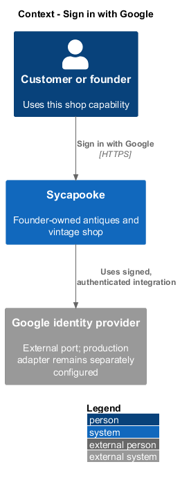
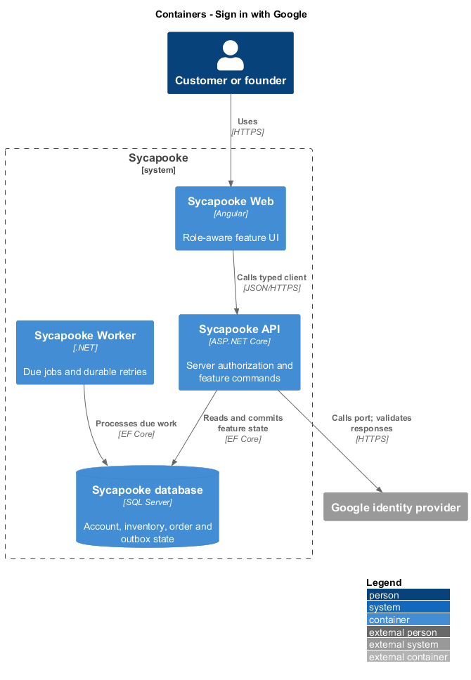
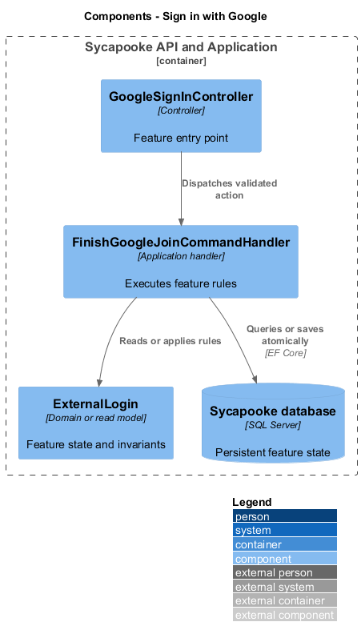
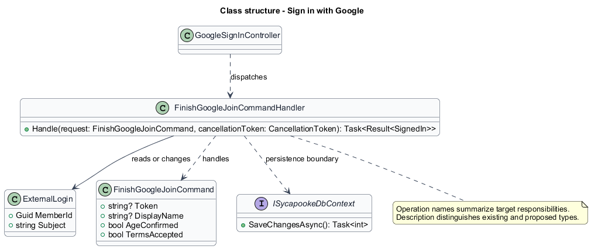
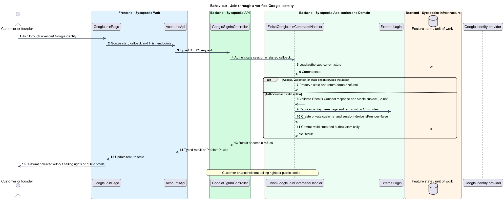
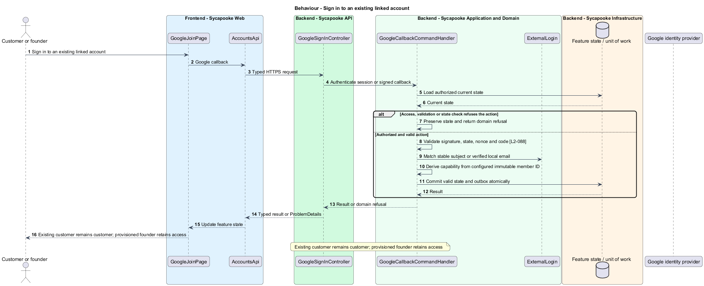
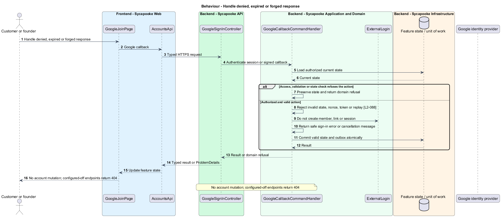

# Sign in with Google

## Overview

Google provides an alternative authentication method. New joins become private customers, while existing shop privileges remain bound to the provisioned account identity.

Sycapooke is the shop of one older Caribbean woman, its sole seller. Her jewelry, clothing, housewares and electronics are at least 20 years old. This design refines [ADR general/0010](../../../adr/general/0010-founder-only-shop.md). Existing names identify reusable code; Description identifies target additions.

## Description

### Existing server flow

`GoogleSignInController`, `GoogleFlowCookie`, `GoogleIdentityProvider`, `ExternalLogin` and `PendingExternalJoin` implement the server OpenID Connect flow. `SignInPage`, `JoinPage` and `GoogleJoinPage` use `AccountsApi` and `AuthState`. Existing Google start, callback, finish and provider-discovery endpoint names remain. The server validates PKCE, state, nonce, issuer, audience, signature, expiry and verified email.

### Private joins and unchanged privileges

A new Google identity reaches the display-name, age and terms step. Completion creates a private customer account, never a public profile or founder binding. Pending joins expire after 10 minutes and are single use. Existing verified-email matching and stable Google-subject linking remain. An unverified matching local account is refused until its owner signs in and verifies it.

Every resulting session obtains `isFounder` from the same trusted identity service as password sign-in. Google claims, email spelling, finish-join fields and a client-supplied founder ID cannot grant access. A previously provisioned founder keeps access because her account ID remains bound, not because Google issues a role.

The existing 10-minute flow cookie remains Secure, HttpOnly and SameSite=Lax, scoped to Google endpoints. Tokens and codes never enter logs or web storage. Missing Google configuration hides controls and returns 404 on its endpoints. Cancellation and invalid callbacks create no session. Customer closure removes the Google link; the closure-specific fresh authentication is specified by `close-customer-account`.

### Implementation and verification boundary

Application code and HTML mocks still require alignment with the revised requirements. UI implementation first aligns mocks, design-system components and screen composition. Backend verification uses fake ports and in-memory substitutes. Browser verification uses the built Angular app and intercepted API responses. No external system runs in tests.

### Implementation evidence

Completed behavior evidence: `reject-google-callback` in `src/backend/Sycapooke.Application/Accounts/GoogleSignIn.cs` and `src/frontend/e2e/tests/sign-in-with-google.spec.ts`. 1 of 3 target behaviors are counted. Remaining target behavior and acceptance checks are not counted merely because older marketplace tests pass.

Effort in the matching estimate is the full target feature effort in developer-days, not remaining work. Completion counts whole verified behaviors and rounds to the nearest ten percent. Source and existing acceptance tests supply the evidence; this documentation refresh does not execute new target tests.

## Requirements

| L2 ID | Refines (L1) | Requirement |
| --- | --- | --- |
| `L2-001` | `L1-001` | A visitor shall be able to register a private customer account with a display name, an email address and a password. Registration shall never create founder access or a public profile. The display name shall be 3 to 30 characters of letters, digits, underscores or hyphens and unique ignoring case. The email address shall be a valid address unique ignoring case. The password shall be 12 to 128 characters and shall not appear in a list of known breached passwords. The visitor shall confirm they are 18 or older and accept the terms of service. |
| `L2-002` | `L1-001` | A new account shall be verified by a single-use link emailed to the member. The link shall expire 24 hours after it is sent. Unverified customers shall be able to browse but not buy. Verification shall not grant selling rights; only the verified founder may manage listings under L2-003. |
| `L2-006` | `L1-002` | A member shall be able to sign in with their email and password. The error shown for an unknown email and for a wrong password shall be identical. |
| `L2-008` | `L1-002` | Sessions shall use a short-lived access token (15 minutes) and a rotating refresh token (14 days) held in `HttpOnly`, `Secure`, `SameSite=Strict` cookies. Tokens shall never be stored in `localStorage` or `sessionStorage`. Signing out shall revoke the session on the server. |
| `L2-088` | `L1-002` | A visitor shall be able to choose "Continue with Google" on the sign-in page and on the join page of the full application and come back signed in with the same session as a password sign-in (`L2-008`), returned to the same-site `returnUrl` as in `L2-006`. New Google joins shall create private customer accounts only. Linking or signing in through Google shall never grant founder access; an existing founder retains access only because her immutable account identity was already provisioned under L2-003. The API shall run the OpenID Connect authorization code flow with PKCE on the server: the browser leaves for Google from an API start endpoint and returns to an API callback on the same origin, and the API shall validate the `state`, the nonce, the ID token's signature, issuer, audience and expiry, and `email_verified` before it trusts the identity. Google's stable subject (`sub`), never the email, shall identify a linked Google account; only the subject and the email shall be stored. A member whose email Google has verified needs no verification link (`L2-002`). A new person shall still give a display name, confirm they are 18 or older and accept the terms under the rules of `L2-001`. A Google account whose verified email matches a member whose own email is verified shall sign in to that member and link to it; one that matches a member whose email is not verified shall be refused, so that an account registered with someone else's email cannot be taken over through it. A member with only a Google login shall be able to try a password sign-in and get exactly the answer of `L2-006` criterion 2. The Google endpoints shall carry the sign-in limits of `L2-007` and `L2-051`. When no Google client is configured, nothing about Google shall show and the Google endpoints shall answer HTTP 404. Closing a customer account (`L2-005`) shall remove its Google link. Founder identity and privilege changes remain outside public account flows. |

## Diagrams

### System context

The context identifies the customer or founder and the systems used by this feature.

### Containers

The container view separates the delivery surface, application boundary and feature storage. External integrations remain behind their ports.

### Components

The component view connects `GoogleSignInController` with `FinishGoogleJoinCommandHandler` and the relevant feature state.

### Class structure

The class view identifies the relevant fields, operation responsibilities and dependencies. It is a target responsibility model, not a claim that each addition already exists.

### Behaviour - Join through a verified Google identity

Customer created without selling rights or public profile. The sequence shows the boundary that enforces this outcome and the significant failure alternative.

### Behaviour - Sign in to an existing linked account

Existing customer remains customer; provisioned founder retains access. The sequence shows the boundary that enforces this outcome and the significant failure alternative.

### Behaviour - Handle denied, expired or forged response

No account mutation; configured-off endpoints return 404. The sequence shows the boundary that enforces this outcome and the significant failure alternative.

