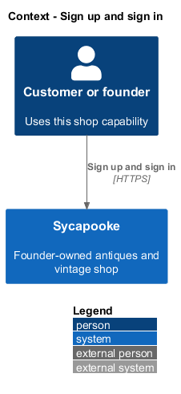
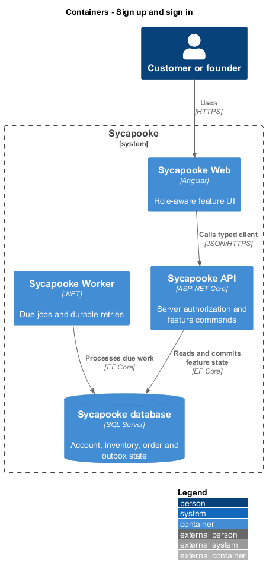
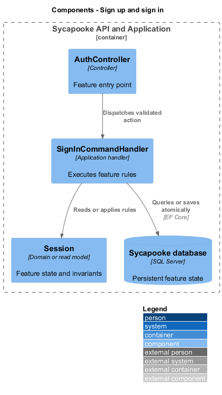
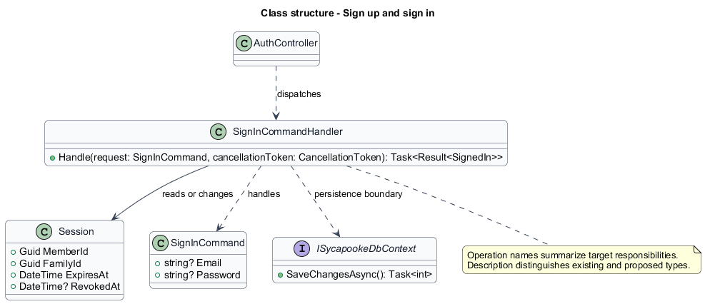
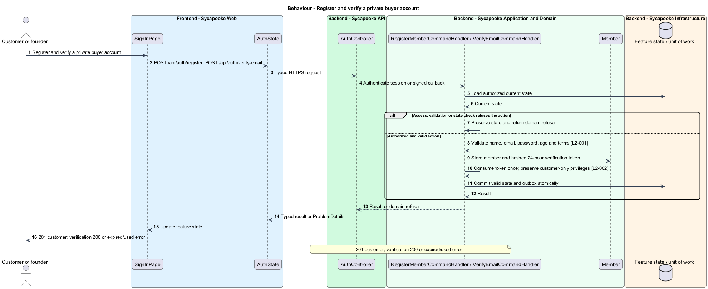
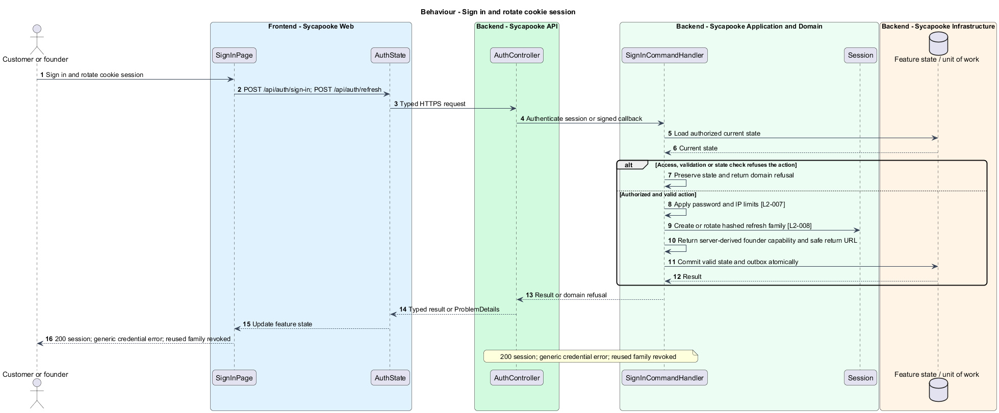
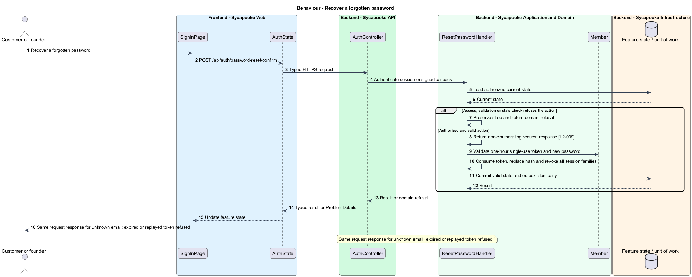
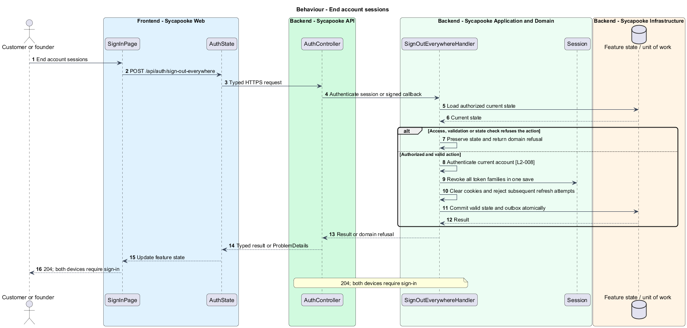

# Sign up and sign in

## Overview

Authentication provides private purchase access to customers and shop access to the separately provisioned founder. Joining and verification never permit selling.

Sycapooke is the shop of one older Caribbean woman, its sole seller. Her jewelry, clothing, housewares and electronics are at least 20 years old. This design refines [ADR general/0010](../../../adr/general/0010-founder-only-shop.md). Existing names identify reusable code; Description identifies target additions.

## Description

### Existing authentication and target permissions

`JoinPage`, `VerifyEmailPage`, `SignInPage`, `AuthController`, `RegisterMemberCommandHandler`, `VerifyEmailCommandHandler`, `Session` and `AuthState` already implement the core password and cookie flows. The target registration creates private buyer accounts only. Join copy describes shopping; display names are not advertised as public. Verification offers shopping and sign-in, without selling invitations.

The existing endpoints remain: `POST /api/auth/register`, `/verify-email`, `/verification-email`, `/sign-in`, `/refresh`, `/sign-out` and `GET /api/auth/me`. Registration returns 201 or 422 field errors. Verification links expire after 24 hours and a new link revokes previous unused links. Resend is capped at three links per hour and does not reveal whether an account exists. The founder capability is derived through `IFounderAccess`, never registration or verification input.

### Sessions and recovery

Access cookies last 15 minutes; rotating refresh families last 14 days. Both cookies remain Secure and HttpOnly, with SameSite=Strict. The existing interceptor shares one refresh across concurrent requests. `SignOutEverywhereHandler` and `POST /api/auth/sign-out-everywhere` are proposed additions that revokes every family for the caller. Replayed refresh tokens revoke their family. Closed accounts cannot refresh.

Proposed `RequestPasswordResetHandler` and `ResetPasswordHandler` expose `POST /api/auth/password-reset` and `POST /api/auth/password-reset/confirm`. A single-use hashed reset token lasts one hour. The request response is generic for unknown and known addresses; no more than three emails per address are sent each hour. Reset validates the existing password rules, consumes the token and revokes all sessions atomically.

Five failed attempts in 15 minutes lock an account for 15 minutes and enqueue the account-security email. Sign-in is limited to 20 attempts per IP per 15 minutes. `SignInCommandHandler` requires the new lockout persistence and checks. These recovery, lockout and global-revocation changes are target additions, not completed implementations.

### Failure and verification boundaries

Sign-in errors remain identical for unknown email and wrong credentials. Same-origin return URLs are enforced. Founder access checks follow `manage-founder-access`; verifying a customer never permits listing creation. Tests fake passwords, clock, email and external ports; Playwright serves authentication results through routes.

### Implementation and verification boundary

Application code and HTML mocks still require alignment with the revised requirements. UI implementation first aligns mocks, design-system components and screen composition. Backend verification uses fake ports and in-memory substitutes. Browser verification uses the built Angular app and intercepted API responses. No external system runs in tests.

### Implementation evidence

No complete target behavior is counted. Reusable implementation exists where identified, but the revised founder, privacy or infrastructure boundary and its acceptance coverage remain unfinished.

Effort in the matching estimate is the full target feature effort in developer-days, not remaining work. Completion counts whole verified behaviors and rounds to the nearest ten percent. Source and existing acceptance tests supply the evidence; this documentation refresh does not execute new target tests.

## Requirements

| L2 ID | Refines (L1) | Requirement |
| --- | --- | --- |
| `L2-001` | `L1-001` | A visitor shall be able to register a private customer account with a display name, an email address and a password. Registration shall never create founder access or a public profile. The display name shall be 3 to 30 characters of letters, digits, underscores or hyphens and unique ignoring case. The email address shall be a valid address unique ignoring case. The password shall be 12 to 128 characters and shall not appear in a list of known breached passwords. The visitor shall confirm they are 18 or older and accept the terms of service. |
| `L2-002` | `L1-001` | A new account shall be verified by a single-use link emailed to the member. The link shall expire 24 hours after it is sent. Unverified customers shall be able to browse but not buy. Verification shall not grant selling rights; only the verified founder may manage listings under L2-003. |
| `L2-006` | `L1-002` | A member shall be able to sign in with their email and password. The error shown for an unknown email and for a wrong password shall be identical. |
| `L2-007` | `L1-002` | After 5 failed sign-in attempts for one account within 15 minutes, the account shall be locked for 15 minutes. Sign-in attempts from one IP address shall be limited to 20 per 15 minutes. |
| `L2-008` | `L1-002` | Sessions shall use a short-lived access token (15 minutes) and a rotating refresh token (14 days) held in `HttpOnly`, `Secure`, `SameSite=Strict` cookies. Tokens shall never be stored in `localStorage` or `sessionStorage`. Signing out shall revoke the session on the server. |
| `L2-009` | `L1-002` | A member shall be able to reset a forgotten password through a single-use emailed link that expires after 1 hour. The response to a reset request shall not reveal whether the email is registered. Resetting the password shall revoke all of the member's sessions. |
| `L2-010` | `L1-002` | Every API endpoint shall enforce the caller's permissions on the server. Customers shall change only their own private account and access only their own purchases, addresses and support submissions. Only the configured founder (L2-003) shall manage inventory, view shop sales, fulfil orders and resolve customer problems. There is no separate administrator decision-maker. Anonymous browsing and the public registration, verification, authentication, password-recovery and signed provider-callback flows remain available under their own validation rules. |

## Diagrams

### System context

The context identifies the customer or founder and the systems used by this feature.

### Containers

The container view separates the delivery surface, application boundary and feature storage. External integrations remain behind their ports.

### Components

The component view connects `AuthController` with `SignInCommandHandler` and the relevant feature state.

### Class structure

The class view identifies the relevant fields, operation responsibilities and dependencies. It is a target responsibility model, not a claim that each addition already exists.

### Behaviour - Register and verify a private buyer account

201 customer; verification 200 or expired/used error. The sequence shows the boundary that enforces this outcome and the significant failure alternative.

### Behaviour - Sign in and rotate cookie session

200 session; generic credential error; reused family revoked. The sequence shows the boundary that enforces this outcome and the significant failure alternative.

### Behaviour - Recover a forgotten password

Same request response for unknown email; expired or replayed token refused. The sequence shows the boundary that enforces this outcome and the significant failure alternative.

### Behaviour - End account sessions

204; both devices require sign-in. The sequence shows the boundary that enforces this outcome and the significant failure alternative.

