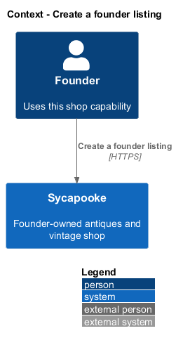
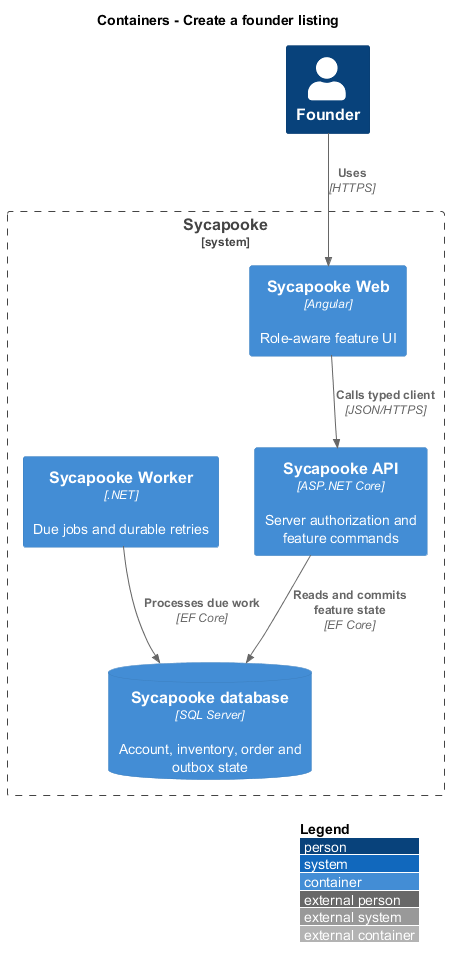
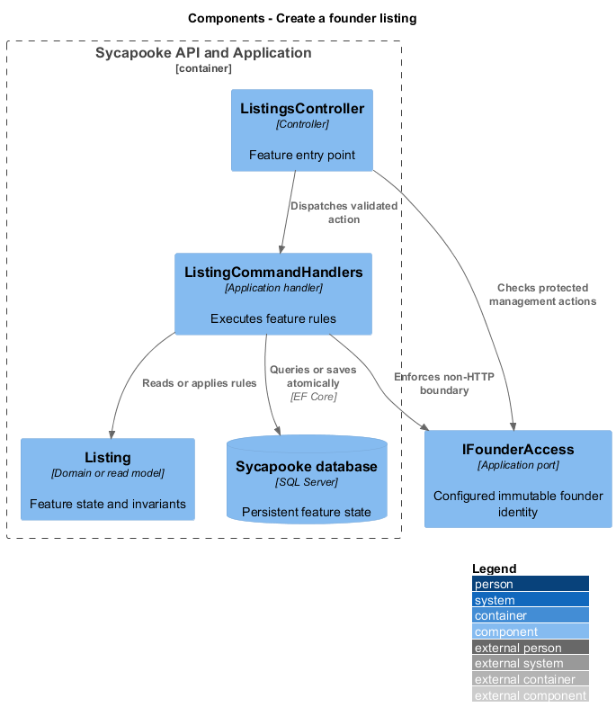
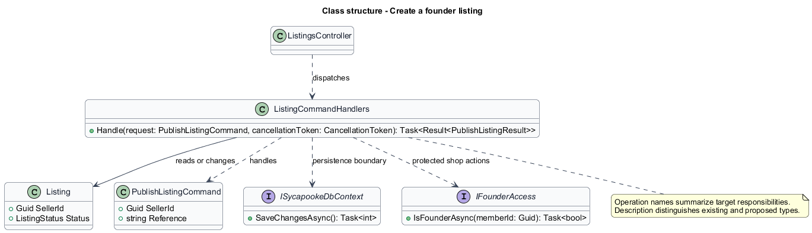
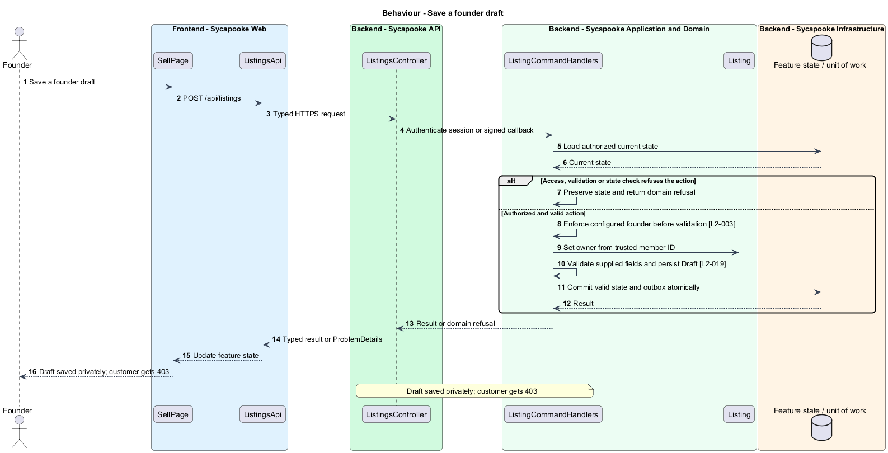
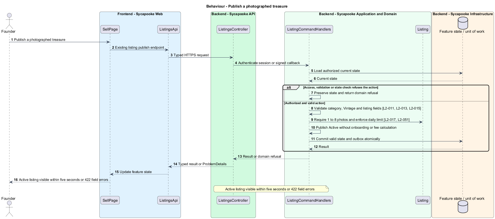
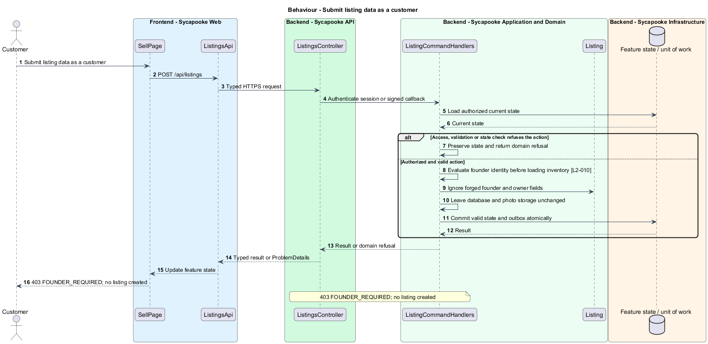

# Create a founder listing

## Overview

The founder creates private drafts and publishes validated treasures with their stories. Active listings become available to customers.

Sycapooke is the shop of one older Caribbean woman, its sole seller. Her jewelry, clothing, housewares and electronics are at least 20 years old. This design refines [ADR general/0010](../../../adr/general/0010-founder-only-shop.md). Existing names identify reusable code; Description identifies target additions.

## Description

### Form and API

`SellPage`, `ListingsApi`, `ListingsController`, `Listing`, `ListingDetails` and `CategoryCatalog` remain the slice's building blocks. The page composes the shared inputs, select, photo uploader and error summary. Customer navigation has no sell link; direct customer requests fail with 403 `FOUNDER_REQUIRED` before field validation. `CanSell` now evaluates `IFounderAccess` in the API and application handlers.

Retain the existing category, create-draft and publish route paths and applicable item fields. The target `PublishListingResult` removes `PayoutOnboardingRequired`; `SellingOptionsDto` removes `FeePercent`. The frontend no longer consumes those fields. `SellingOptions.PlatformFeePercent` is removed from the target configuration contract. The server sets `SellerId` from the configured founder identity, ignoring caller-supplied ownership. All four categories retain fixed size Vintage. The description contains the piece's story. Conditions and their flaws rule, title and description lengths, price and flat shipping limits remain those in the Requirements table.

### Drafts, publication and payments

Drafts require a category and validate supplied fields without demanding every publication field. Publication requires all required fields and 1 to 8 accepted photos. Active listings become visible within five seconds; Draft listings remain private. Publishing observes the existing database-counted per-day limit.

Remove `ISellerPayoutAccountReader`, payout setup prompts, fee previews and earnings calculations from the target publication flow. Publication has no merchant-onboarding dependency. Payment configuration belongs to checkout, not the form. Existing field and business-validation errors remain; rate-limit failures return 429 with Retry-After.

Acceptance tests prove customer denial even for valid payloads, founder publication, fixed Vintage enforcement, partial-draft validation, photo requirements and day-boundary rate limits. Backend tests fake all external ports and browser tests route every API request.

### Implementation and verification boundary

Application code and HTML mocks still require alignment with the revised requirements. UI implementation first aligns mocks, design-system components and screen composition. Backend verification uses fake ports and in-memory substitutes. Browser verification uses the built Angular app and intercepted API responses. No external system runs in tests.

### Implementation evidence

No complete target behavior is counted. Reusable implementation exists where identified, but the revised founder, privacy or infrastructure boundary and its acceptance coverage remain unfinished.

Effort in the matching estimate is the full target feature effort in developer-days, not remaining work. Completion counts whole verified behaviors and rounds to the nearest ten percent. Source and existing acceptance tests supply the evidence; this documentation refresh does not execute new target tests.

## Requirements

| L2 ID | Refines (L1) | Requirement |
| --- | --- | --- |
| `L2-003` | `L1-001` | Public registration shall create customer accounts only. A trusted operator shall provision one founder account through a protected deployment or operator process outside public registration. The server shall bind management access to that account's immutable identity, never a display name, email supplied by the client or Google claim. Provisioning shall not create a second founder. Only the verified founder shall manage listings, photos, sales, shipping and customer problems. Customers shall have no selling links, public profile creation or management navigation. |
| `L2-010` | `L1-002` | Every API endpoint shall enforce the caller's permissions on the server. Customers shall change only their own private account and access only their own purchases, addresses and support submissions. Only the configured founder (L2-003) shall manage inventory, view shop sales, fulfil orders and resolve customer problems. There is no separate administrator decision-maker. Anonymous browsing and the public registration, verification, authentication, password-recovery and signed provider-callback flows remain available under their own validation rules. |
| `L2-011` | `L1-003` | Sycapooke shall accept only the categories and sizes in this table. The list is held on the server and served to the client.  \| Category \| Subcategories \| Accepted size \| \| --- \| --- \| --- \| \| Jewelry \| Necklaces, Brooches and pins, Earrings, Bracelets, Rings, Watches \| Vintage \| \| Clothing \| Dresses, Coats and jackets, Knitwear, Shirts and blouses, Skirts and trousers, Hats and accessories \| Vintage \| \| Housewares \| Tableware, Glassware, Ceramics and pottery, Lighting, Linens, Decor \| Vintage \| \| Electronics \| Radios, Cameras, Audio, Telephones, Clocks, Typewriters and office \| Vintage \|  Vintage is a vintage lock, not a fit: every piece is at least 20 years old, whatever its category ([ADR general/0006](../../../adr/general/0006-vintage-only.md)). |
| `L2-012` | `L1-003` | The listing form shall not offer a size choice. Once the founder picks a category, the form shall show the accepted size for that category as fixed, read-only text. |
| `L2-013` | `L1-003` | Only authorised founder requests may reach listing validation (L2-010). The API shall be the source of truth for the size rule. It shall reject any listing create or update request whose size does not match the accepted size for its category, whatever the client sends. The stored size shall always be set by the server from the category. |
| `L2-015` | `L1-004` | A listing shall have a title (5 to 80 characters), a description including the piece's story (20 to 2,000 characters), a category and subcategory (L2-011), a brand (1 to 50 characters, chosen from a suggested list or typed freely), a condition (L2-016), 1 to 8 photos (L2-017), a price and a shipping cost (L2-018). All text shall be trimmed and stored as plain text. |
| `L2-016` | `L1-004` | The founder shall choose one condition: New with tags, New without tags, Used - Excellent, Used - Good, or Used - Fair. A Used - Fair listing shall include a description of its flaws of at least 10 characters. |
| `L2-017` | `L1-004` | A listing shall have 1 to 8 photos. Each photo shall be JPEG, PNG or WebP, at most 10 MB, and at least 800 pixels on its shortest side. The file type shall be checked from the file's content, not its name. The server shall strip all metadata (including GPS location), re-encode the image and produce thumbnail (400px), medium (800px) and large (1600px) versions. The first photo is the cover and the founder can reorder photos. |
| `L2-018` | `L1-004` | The item price shall be between $1.00 and $5,000.00 inclusive, with at most two decimal places. The founder shall set a flat shipping cost between $0.00 and $100.00 inclusive. Sycapooke shall operate in the United States only, in US dollars. |
| `L2-019` | `L1-004` | A listing shall have one of these statuses: Draft, Active, Reserved, Sold or Removed. The founder shall be able to save an incomplete listing as a Draft and publish it later. Only Active and Reserved listings appear in the catalog. Validation rules L2-015 to L2-018 apply when publishing; drafts only need a category, and any field a draft does contain must be within its limits. |
| `L2-051` | `L1-013` | The API shall limit requests to 120 per minute per IP address for anonymous callers and 300 per minute per member, with stricter limits for sign-in (L2-007), registration (5 per hour per IP) and listing creation (20 published listings by the founder per UTC day; saving drafts is not limited). Callers over a limit shall receive HTTP 429 with a `Retry-After` header. |

## Diagrams

### System context

The context identifies the founder and the systems used by this feature.

### Containers

The container view separates the delivery surface, application boundary and feature storage. External integrations remain behind their ports.

### Components

The component view connects `ListingsController` with `ListingCommandHandlers` and the relevant feature state.

### Class structure

The class view identifies the relevant fields, operation responsibilities and dependencies. It is a target responsibility model, not a claim that each addition already exists.

### Behaviour - Save a founder draft

Draft saved privately; customer gets 403. The sequence shows the boundary that enforces this outcome and the significant failure alternative.

### Behaviour - Publish a photographed treasure

Active listing visible within five seconds or 422 field errors. The sequence shows the boundary that enforces this outcome and the significant failure alternative.

### Behaviour - Submit listing data as a customer

403 FOUNDER_REQUIRED; no listing created. The sequence shows the boundary that enforces this outcome and the significant failure alternative.

