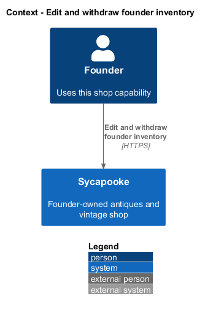
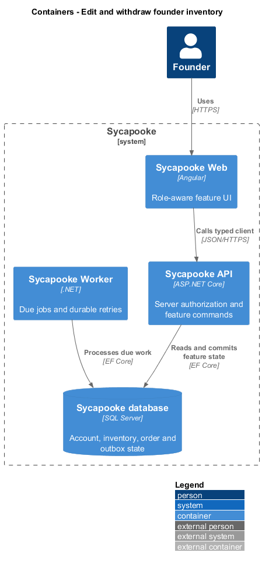
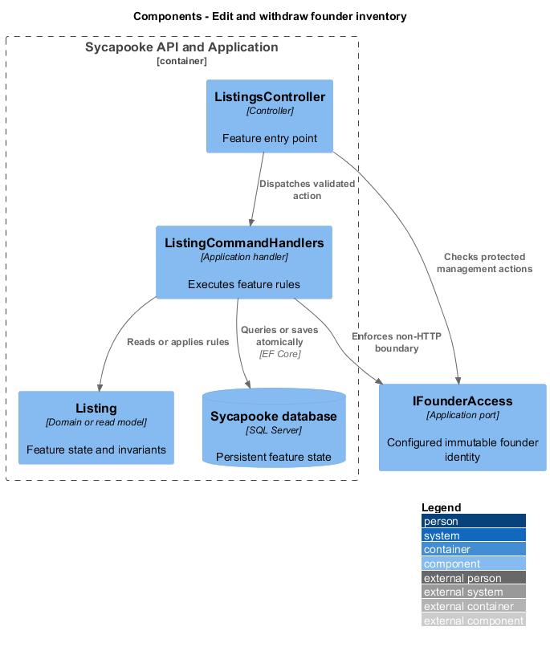
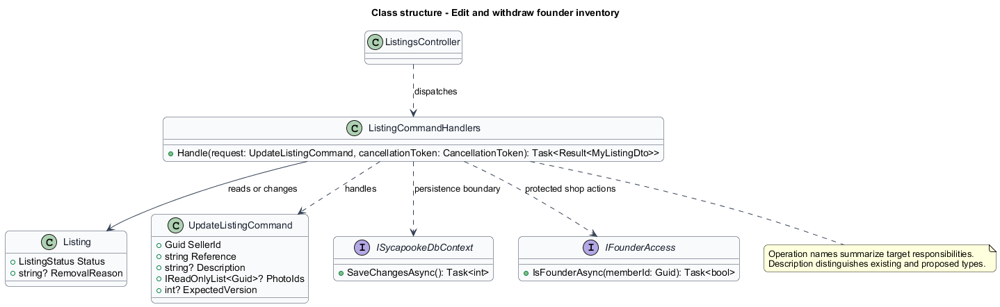
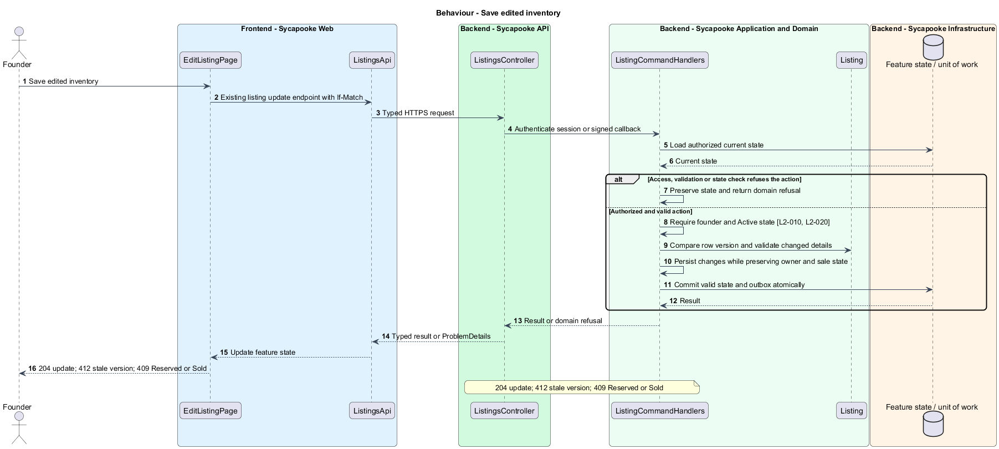
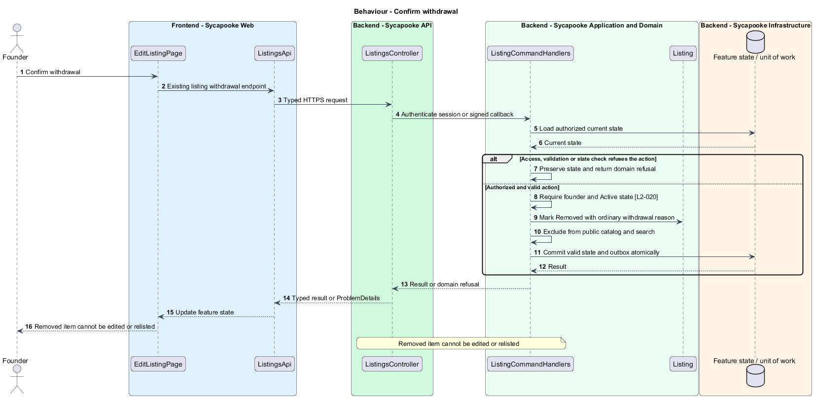
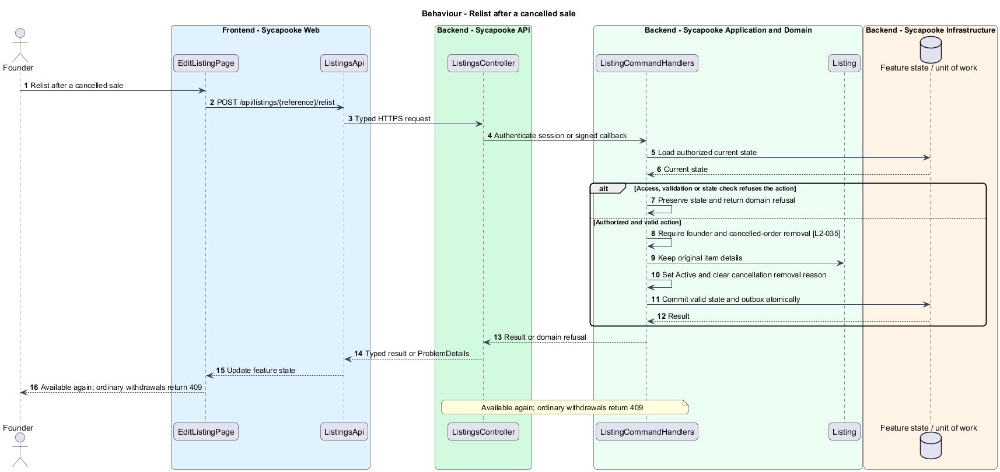

# Edit and withdraw founder inventory

## Overview

The founder keeps available inventory accurate and withdraws treasures she no longer offers. Reservations and sales protect customers from conflicting edits.

Sycapooke is the shop of one older Caribbean woman, its sole seller. Her jewelry, clothing, housewares and electronics are at least 20 years old. This design refines [ADR general/0010](../../../adr/general/0010-founder-only-shop.md). Existing names identify reusable code; Description identifies target additions.

## Description

### Editing contract

`EditListingPage`, `ListingFormComponent`, `WithdrawListingDialog`, `RelistDialog`, `GetMyListingQuery`, `UpdateListingCommand` and `WithdrawListingCommand` retain their existing roles. `ListingsApi` is the only HTTP boundary. The API and handlers enforce founder access before reading editable inventory, so customers receive 403 even for a known listing reference.

Retain existing get-own-listing, update, withdraw and relist routes. Updates use the existing optimistic-concurrency version and If-Match contract. Active inventory accepts validated details and photos; Reserved and Sold inventory returns 409. A stale version returns 412 `LISTING_CHANGED` and offers reload without overwriting changes. Server ownership and status fields never come from an editable request.

### Withdrawal and cancellation relisting

Withdrawal requires confirmation, changes Active to Removed and removes the item from public search. Ordinary withdrawn listings remain Removed and cannot be edited or republished. The separate cancellation path retains `RemovalReason = OrderCancelled`; only that path permits `Listing.Relist` to restore Active with the original details. The founder authorizes relisting from the cancelled sale.

No fee preview or payout setup is part of editing or relisting. Existing condition, Vintage and price validation stays intact. Tests cover customer denial, reservation races, stale versions, forbidden Sold edits, ordinary withdrawal versus cancellation removal and unchanged payment records.

### Implementation and verification boundary

Application code and HTML mocks still require alignment with the revised requirements. UI implementation first aligns mocks, design-system components and screen composition. Backend verification uses fake ports and in-memory substitutes. Browser verification uses the built Angular app and intercepted API responses. No external system runs in tests.

### Implementation evidence

Implemented and covered: edit and withdraw require founder access (`EditListingTests`, `WithdrawListingTests`, `edit-and-withdraw-listing.spec.ts`). Remaining: visual comparison with the mocks.

Effort in the matching estimate is the full target feature effort in developer-days, not remaining work. Completion counts whole verified behaviors and rounds to the nearest ten percent. Source and existing acceptance tests supply the evidence; this documentation refresh does not execute new target tests.

## Requirements

| L2 ID | Refines (L1) | Requirement |
| --- | --- | --- |
| `L2-003` | `L1-001` | Public registration shall create customer accounts only. A trusted operator shall provision one founder account through a protected deployment or operator process outside public registration. The server shall bind management access to that account's immutable identity, never a display name, email supplied by the client or Google claim. Provisioning shall not create a second founder. Only the verified founder shall manage listings, photos, sales, shipping and customer problems. Customers shall have no selling links, public profile creation or management navigation. |
| `L2-010` | `L1-002` | Every API endpoint shall enforce the caller's permissions on the server. Customers shall change only their own private account and access only their own purchases, addresses and support submissions. Only the configured founder (L2-003) shall manage inventory, view shop sales, fulfil orders and resolve customer problems. There is no separate administrator decision-maker. Anonymous browsing and the public registration, verification, authentication, password-recovery and signed provider-callback flows remain available under their own validation rules. |
| `L2-013` | `L1-003` | Only authorised founder requests may reach listing validation (L2-010). The API shall be the source of truth for the size rule. It shall reject any listing create or update request whose size does not match the accepted size for its category, whatever the client sends. The stored size shall always be set by the server from the category. |
| `L2-020` | `L1-004` | The founder shall be able to edit or withdraw an Active listing. A Reserved or Sold listing shall not be editable or withdrawable. A withdrawn listing shall become Removed and leave the catalog. |
| `L2-035` | `L1-008` | Before an order is Shipped, the founder shall be able to cancel it, and the buyer shall be able to ask the founder to cancel it. A cancelled order shall be refunded in full and its listing shall not return to the catalog unless the founder relists it. |
| `L2-049` | `L1-013` | The API shall validate every input on the server for type, length, range and format, whatever the client checks. Database access shall use parameterised queries only. User content shall be encoded on output. Unknown fields in a request body shall be ignored and shall never change protected fields such as owner, status or price paid (mass assignment). |

## Diagrams

### System context

The context identifies the founder and the systems used by this feature.

### Containers

The container view separates the delivery surface, application boundary and feature storage. External integrations remain behind their ports.

### Components

The component view connects `ListingsController` with `ListingCommandHandlers` and the relevant feature state.

### Class structure

The class view identifies the relevant fields, operation responsibilities and dependencies. It is a target responsibility model, not a claim that each addition already exists.

### Behaviour - Save edited inventory

204 update; 412 stale version; 409 Reserved or Sold. The sequence shows the boundary that enforces this outcome and the significant failure alternative.

### Behaviour - Confirm withdrawal

Removed item cannot be edited or relisted. The sequence shows the boundary that enforces this outcome and the significant failure alternative.

### Behaviour - Relist after a cancelled sale

Available again; ordinary withdrawals return 409. The sequence shows the boundary that enforces this outcome and the significant failure alternative.

