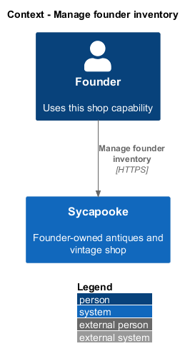
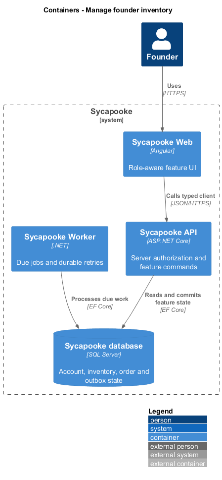
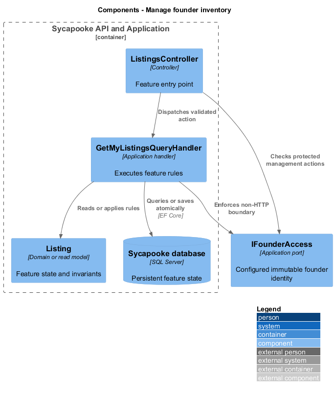
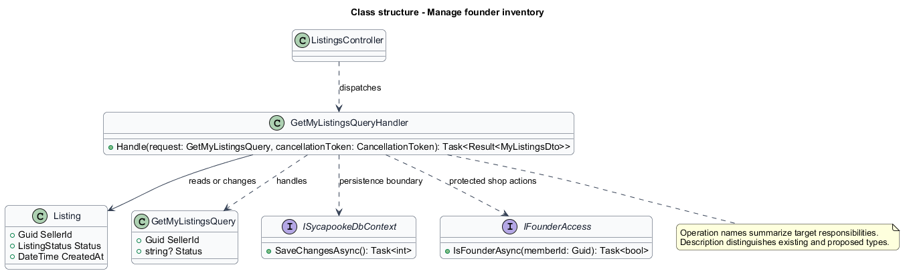
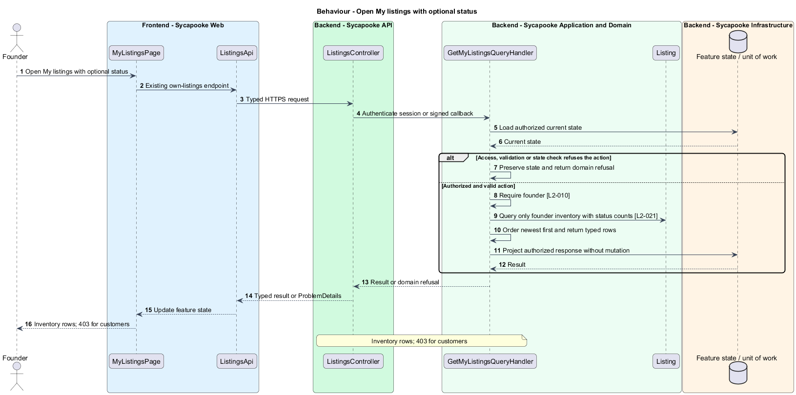
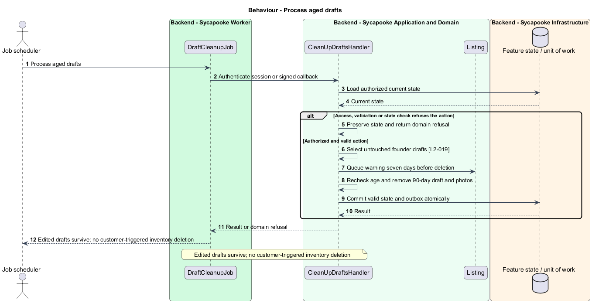

# Manage founder inventory

## Overview

The founder sees drafts and published inventory in one protected workspace. Customers have purchase history but no inventory workspace.

Sycapooke is the shop of one older Caribbean woman, its sole seller. Her jewelry, clothing, housewares and electronics are at least 20 years old. This design refines [ADR general/0010](../../../adr/general/0010-founder-only-shop.md). Existing names identify reusable code; Description identifies target additions.

## Description

### Protected inventory list

`MyListingsPage`, `ListingsApi.mine`, `GetMyListingsQueryHandler`, `MyListingRowDto` and `MyListingCountsDto` remain. Only the founder opens My listings. The API and query filter by the configured founder identity; a customer receives 403 rather than an empty personal-selling dashboard.

The existing own-listings endpoint returns cover, title, price, status, date and status counts. The optional status filter persists in the route query. Results sort newest first. Draft entries open the listing form, Active entries open detail, and Sold entries open the sale. An empty founder list offers creation; public catalog empty states invite browsing later rather than selling.

### Draft lifecycle

`DraftCleanupJob` selects founder drafts not edited for 90 days. It queues the existing seven-day warning and removes eligible draft records and photos. The worker checks the latest modification time before deletion, so editing after a warning prevents premature cleanup. Customer account closure never selects shop inventory. Worker ownership checks use the configured shop identity rather than public member eligibility.

Acceptance scenarios cover founder filters and counts, persisted status, customer denial, correct destinations and warning/deletion timing. The UI uses the library listing grid, status chips, loading and empty components; no alternative inventory markup is introduced.

### Implementation and verification boundary

Application code and HTML mocks still require alignment with the revised requirements. UI implementation first aligns mocks, design-system components and screen composition. Backend verification uses fake ports and in-memory substitutes. Browser verification uses the built Angular app and intercepted API responses. No external system runs in tests.

### Implementation evidence

No complete target behavior is counted. Reusable implementation exists where identified, but the revised founder, privacy or infrastructure boundary and its acceptance coverage remain unfinished.

Effort in the matching estimate is the full target feature effort in developer-days, not remaining work. Completion counts whole verified behaviors and rounds to the nearest ten percent. Source and existing acceptance tests supply the evidence; this documentation refresh does not execute new target tests.

## Requirements

| L2 ID | Refines (L1) | Requirement |
| --- | --- | --- |
| `L2-003` | `L1-001` | Public registration shall create customer accounts only. A trusted operator shall provision one founder account through a protected deployment or operator process outside public registration. The server shall bind management access to that account's immutable identity, never a display name, email supplied by the client or Google claim. Provisioning shall not create a second founder. Only the verified founder shall manage listings, photos, sales, shipping and customer problems. Customers shall have no selling links, public profile creation or management navigation. |
| `L2-010` | `L1-002` | Every API endpoint shall enforce the caller's permissions on the server. Customers shall change only their own private account and access only their own purchases, addresses and support submissions. Only the configured founder (L2-003) shall manage inventory, view shop sales, fulfil orders and resolve customer problems. There is no separate administrator decision-maker. Anonymous browsing and the public registration, verification, authentication, password-recovery and signed provider-callback flows remain available under their own validation rules. |
| `L2-015` | `L1-004` | A listing shall have a title (5 to 80 characters), a description including the piece's story (20 to 2,000 characters), a category and subcategory (L2-011), a brand (1 to 50 characters, chosen from a suggested list or typed freely), a condition (L2-016), 1 to 8 photos (L2-017), a price and a shipping cost (L2-018). All text shall be trimmed and stored as plain text. |
| `L2-018` | `L1-004` | The item price shall be between $1.00 and $5,000.00 inclusive, with at most two decimal places. The founder shall set a flat shipping cost between $0.00 and $100.00 inclusive. Sycapooke shall operate in the United States only, in US dollars. |
| `L2-019` | `L1-004` | A listing shall have one of these statuses: Draft, Active, Reserved, Sold or Removed. The founder shall be able to save an incomplete listing as a Draft and publish it later. Only Active and Reserved listings appear in the catalog. Validation rules L2-015 to L2-018 apply when publishing; drafts only need a category, and any field a draft does contain must be within its limits. |
| `L2-021` | `L1-004` | The founder shall have a "My listings" page showing all of their listings with cover photo, title, price, status and date, filterable by status and sorted newest first. |
| `L2-042` | `L1-011` | The system shall send email for: email verification, password reset, account lockout, purchase confirmation (to the customer), a new sale (to the founder), shipping with tracking (to the buyer), delivery, cancellation, refund, ship-by reminders, and customer problems reported and resolved. Only the founder shall receive shop sale, inventory and ship-by notifications; customers shall receive only their own account and order messages. Emails shall be sent within 2 minutes of the event and shall not contain passwords or full card details. |

## Diagrams

### System context

The context identifies the founder and the systems used by this feature.

### Containers

The container view separates the delivery surface, application boundary and feature storage. External integrations remain behind their ports.

### Components

The component view connects `ListingsController` with `GetMyListingsQueryHandler` and the relevant feature state.

### Class structure

The class view identifies the relevant fields, operation responsibilities and dependencies. It is a target responsibility model, not a claim that each addition already exists.

### Behaviour - Open My listings with optional status

Inventory rows; 403 for customers. The sequence shows the boundary that enforces this outcome and the significant failure alternative.

### Behaviour - Process aged drafts

Edited drafts survive; no customer-triggered inventory deletion. The sequence shows the boundary that enforces this outcome and the significant failure alternative.

