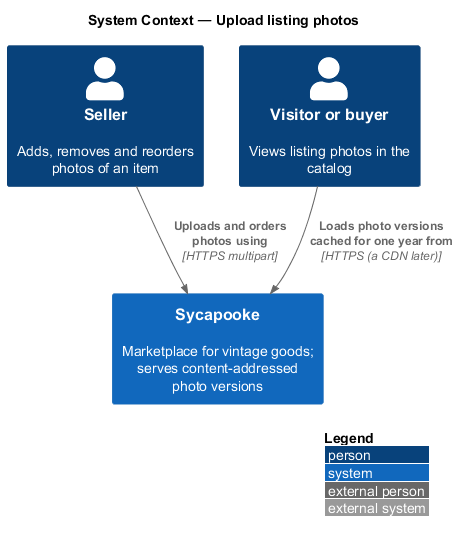
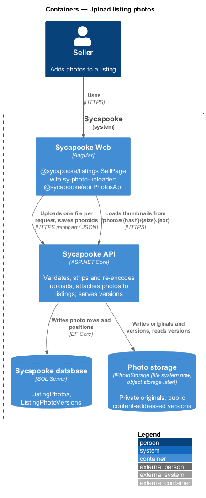
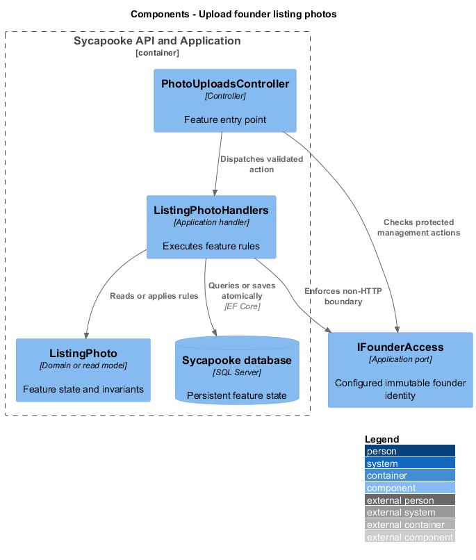
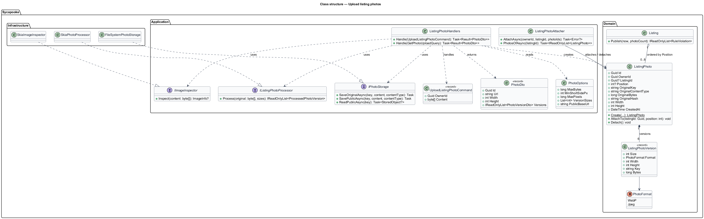
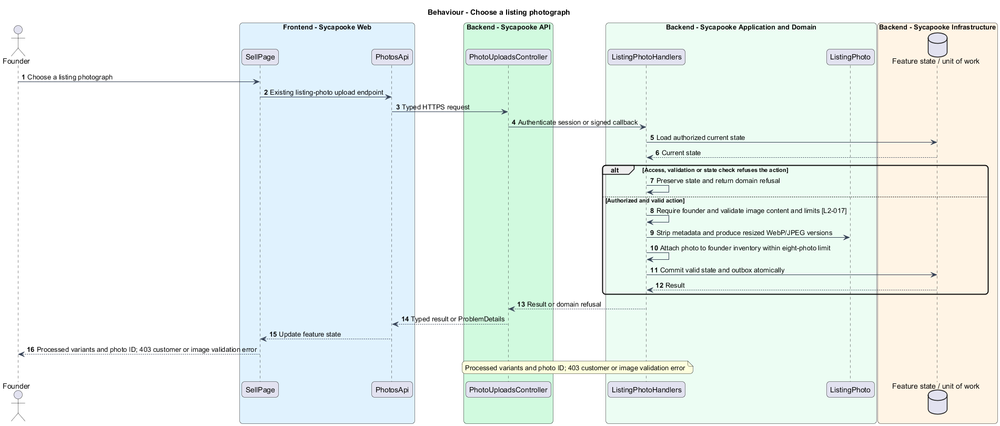
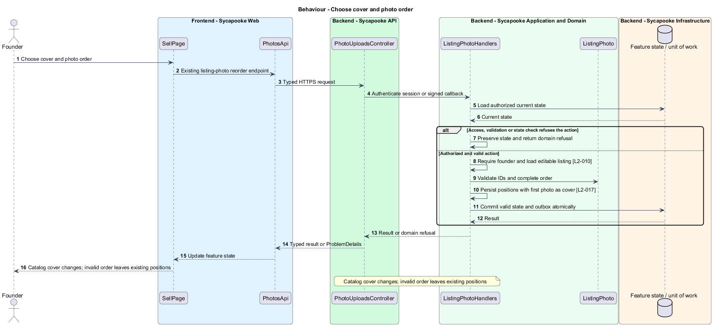

# Upload founder listing photos

## Overview

The founder adds photographs so customers can assess treasures. Processing removes private metadata and photo order determines the cover.

Sycapooke is the shop of one older Caribbean woman, its sole seller. Her jewelry, clothing, housewares and electronics are at least 20 years old. This design refines [ADR general/0010](../../../adr/general/0010-founder-only-shop.md). Existing names identify reusable code; Description identifies target additions.

## Description

### Existing upload pipeline and target gate

`sy-photo-uploader`, `PhotosApi`, `PhotoUploadsController`, `UploadListingPhotoCommand`, `ListingPhotoHandlers`, `SkiaImageInspector`, `SkiaPhotoProcessor` and `FileSystemPhotoStorage` remain. Founder access replaces verified-member-only selling access before files are buffered or processed. Only founder-owned draft or editable inventory accepts new listing photos. Customers receive 403 even when they know a listing reference.

Retain existing upload, attachment and reorder endpoints and their DTOs. Each JPEG, PNG or WebP is at most 10 MB and has a shortest edge of at least 800 pixels. Content inspection determines type. The processor strips metadata and creates the existing 400, 800 and 1600 pixel WebP/JPEG variants without upscaling. Private originals stay outside the public CDN; processed listing variants remain content-addressed and immutable.

### Attachment and cover order

A listing contains 1 to 8 photos when published. The attachment command checks listing state and count before committing. Reordering validates a complete, duplicate-free photo ID list belonging to that listing and persists positions atomically; position one becomes the cover. Upload failures preserve already attached photos and expose the existing field or size error. A customer upload creates neither temporary objects nor attachments.

Private support photos use the separate protected order-photo endpoint, not the public listing-photo route. Screen-reader labels and keyboard reordering retain the existing components. Tests cover malformed files, stripped GPS, exact size bounds, ninth-photo rejection, ownership spoofing and cover order.

### Implementation and verification boundary

Application code and HTML mocks still require alignment with the revised requirements. UI implementation first aligns mocks, design-system components and screen composition. Backend verification uses fake ports and in-memory substitutes. Browser verification uses the built Angular app and intercepted API responses. No external system runs in tests.

### Implementation evidence

Implemented and covered: uploads need founder access before the body is read (`PhotoUploadTests`, `FounderInventoryTests`, `upload-listing-photos.spec.ts`). Remaining: visual comparison with the mocks.

Effort in the matching estimate is the full target feature effort in developer-days, not remaining work. Completion counts whole verified behaviors and rounds to the nearest ten percent. Source and existing acceptance tests supply the evidence; this documentation refresh does not execute new target tests.

## Requirements

| L2 ID | Refines (L1) | Requirement |
| --- | --- | --- |
| `L2-003` | `L1-001` | Public registration shall create customer accounts only. A trusted operator shall provision one founder account through a protected deployment or operator process outside public registration. The server shall bind management access to that account's immutable identity, never a display name, email supplied by the client or Google claim. Provisioning shall not create a second founder. Only the verified founder shall manage listings, photos, sales, shipping and customer problems. Customers shall have no selling links, public profile creation or management navigation. |
| `L2-010` | `L1-002` | Every API endpoint shall enforce the caller's permissions on the server. Customers shall change only their own private account and access only their own purchases, addresses and support submissions. Only the configured founder (L2-003) shall manage inventory, view shop sales, fulfil orders and resolve customer problems. There is no separate administrator decision-maker. Anonymous browsing and the public registration, verification, authentication, password-recovery and signed provider-callback flows remain available under their own validation rules. |
| `L2-017` | `L1-004` | A listing shall have 1 to 8 photos. Each photo shall be JPEG, PNG or WebP, at most 10 MB, and at least 800 pixels on its shortest side. The file type shall be checked from the file's content, not its name. The server shall strip all metadata (including GPS location), re-encode the image and produce thumbnail (400px), medium (800px) and large (1600px) versions. The first photo is the cover and the founder can reorder photos. |
| `L2-059` | `L1-015` | Photos shall be served from a CDN in WebP with a JPEG fallback, sized to the space they fill using `srcset`, with explicit width and height to avoid layout shift. Photos below the first screen shall be lazy loaded. Photo URLs shall be content-addressed and cached for at least one year. |
| `L2-065` | `L1-017` | Every function shall be usable with a keyboard alone, with a visible focus indicator and a logical focus order. Dialogs shall trap focus and return it on close. Every photo shall have alt text, every form field a visible label, and errors shall be announced to screen readers. |

## Diagrams

### System context

The context identifies the founder and the systems used by this feature.

### Containers

The container view separates the delivery surface, application boundary and feature storage. External integrations remain behind their ports.

### Components

The component view connects `PhotoUploadsController` with `ListingPhotoHandlers` and the relevant feature state.

### Class structure

The class view identifies the relevant fields, operation responsibilities and dependencies. It is a target responsibility model, not a claim that each addition already exists.

### Behaviour - Choose a listing photograph

Processed variants and photo ID; 403 customer or image validation error. The sequence shows the boundary that enforces this outcome and the significant failure alternative.

### Behaviour - Choose cover and photo order

Catalog cover changes; invalid order leaves existing positions. The sequence shows the boundary that enforces this outcome and the significant failure alternative.

