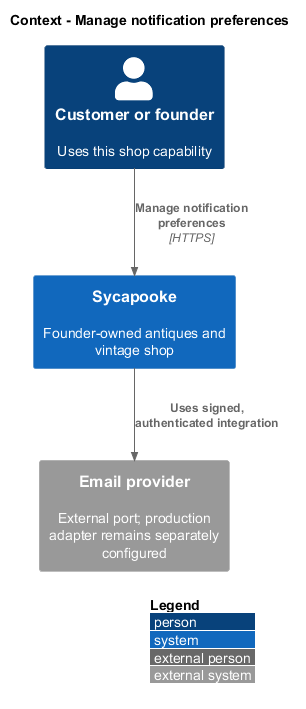
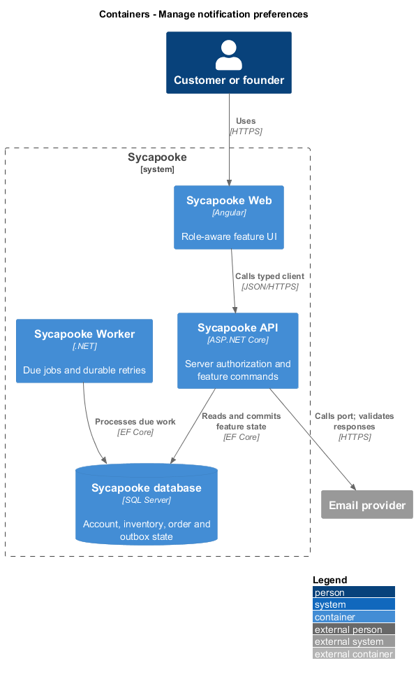
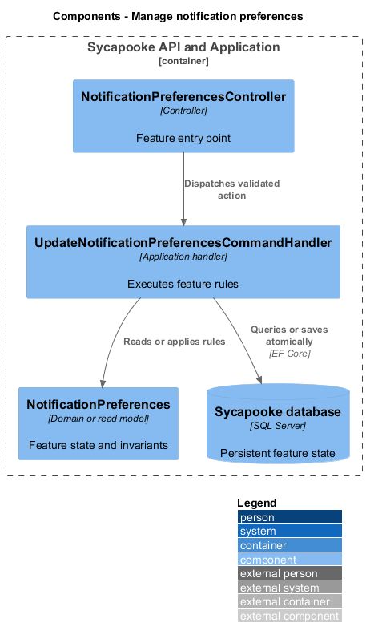
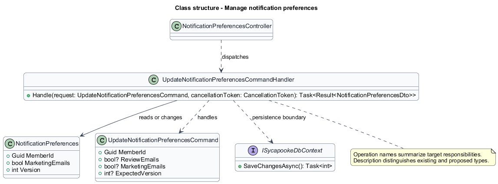
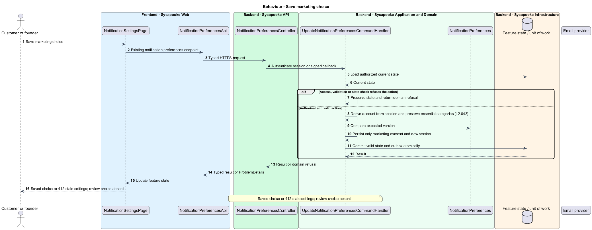
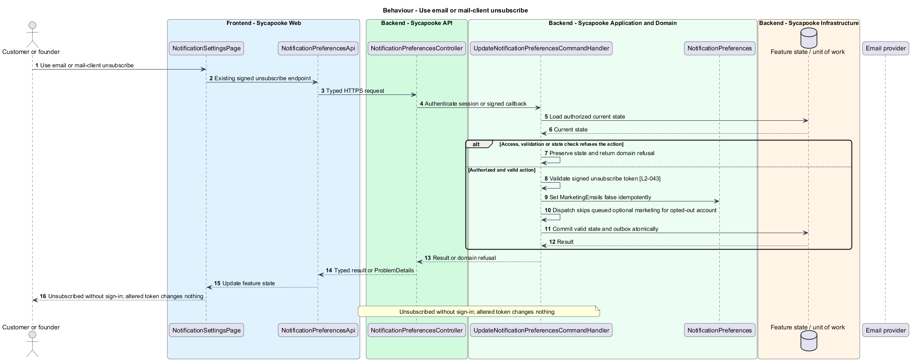

# Manage notification preferences

## Overview

Account holders choose optional marketing while retaining security and order messages. Signed unsubscribe links allow consent withdrawal without sign-in.

Sycapooke is the shop of one older Caribbean woman, its sole seller. Her jewelry, clothing, housewares and electronics are at least 20 years old. This design refines [ADR general/0010](../../../adr/general/0010-founder-only-shop.md). Existing names identify reusable code; Description identifies target additions.

## Description

### Settings and contract

`NotificationSettingsPage`, `NotificationPreferencesApi`, `NotificationPreferencesController`, `UpdateNotificationPreferencesCommandHandler`, `UnsubscribeTokens` and `UnsubscribeCommandHandler` remain. The settings response contains locked account-security and relevant order categories plus editable Marketing. The target request accepts only `marketingEmails` and the existing version/If-Match concurrency value. Remove `reviewEmails` from the editable contract and controls without reintroducing review notifications.

New accounts have Marketing disabled. Security and order messages cannot be disabled through hidden request fields. Preferences belong to the session member; account IDs in a request do not select another account. A stale version returns 412 and preserves the current settings. Successful saves update the version and the UI confirmation through existing toast services.

### Unsubscribe and dispatch

Retain the existing signed unsubscribe endpoint and page. Marketing email carries List-Unsubscribe and List-Unsubscribe-Post headers. A valid link or mail-client POST disables marketing without sign-in; repeated unsubscribe is harmless. Altered tokens are refused. `NotificationPreferenceReader` checks consent again at dispatch, so a queued marketing message does not bypass a later opt-out.

Customers receive no shop inventory or other-customer order messages. The founder's essential sales, shipping and support notifications remain enabled. Existing unsubscribe token lifetime and key rotation choices remain `<TO SUPPLY>` where the current ADR leaves them open.

Tests cover initial opt-out, attempted disabling of essential categories, removed review field, version conflicts, forged tokens and queued marketing after opt-out.

### Implementation and verification boundary

Application code and HTML mocks still require alignment with the revised requirements. UI implementation first aligns mocks, design-system components and screen composition. Backend verification uses fake ports and in-memory substitutes. Browser verification uses the built Angular app and intercepted API responses. No external system runs in tests.

### Implementation evidence

Completed behavior evidence: `unsubscribe-marketing` in `src/backend/Sycapooke.Application/Notifications/NotificationPreferencesCommands.cs` and `src/frontend/e2e/tests/unsubscribe.spec.ts`. 1 of 2 target behaviors are counted. Remaining target behavior and acceptance checks are not counted merely because older marketplace tests pass.

Effort in the matching estimate is the full target feature effort in developer-days, not remaining work. Completion counts whole verified behaviors and rounds to the nearest ten percent. Source and existing acceptance tests supply the evidence; this documentation refresh does not execute new target tests.

## Requirements

| L2 ID | Refines (L1) | Requirement |
| --- | --- | --- |
| `L2-043` | `L1-011` | Account security and order emails shall always be sent to the relevant customer or founder. Optional shop marketing emails shall be off until the account holder opts in, and every marketing email shall include a one-click unsubscribe link. No review-email preference shall be offered under the existing deferral. |

## Diagrams

### System context

The context identifies the customer or founder and the systems used by this feature.

### Containers

The container view separates the delivery surface, application boundary and feature storage. External integrations remain behind their ports.

### Components

The component view connects `NotificationPreferencesController` with `UpdateNotificationPreferencesCommandHandler` and the relevant feature state.

### Class structure

The class view identifies the relevant fields, operation responsibilities and dependencies. It is a target responsibility model, not a claim that each addition already exists.

### Behaviour - Save marketing choice

Saved choice or 412 stale settings; review choice absent. The sequence shows the boundary that enforces this outcome and the significant failure alternative.

### Behaviour - Use email or mail-client unsubscribe

Unsubscribed without sign-in; altered token changes nothing. The sequence shows the boundary that enforces this outcome and the significant failure alternative.

