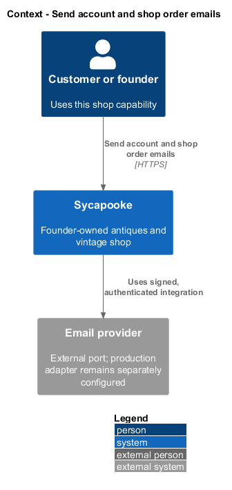
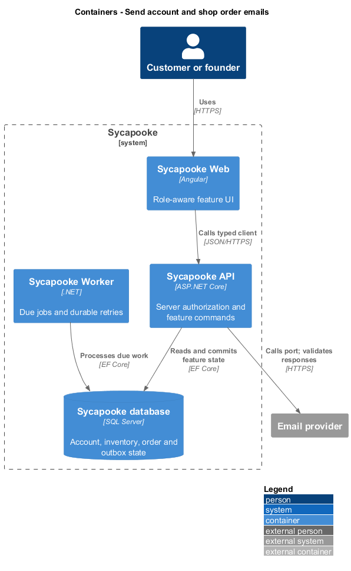
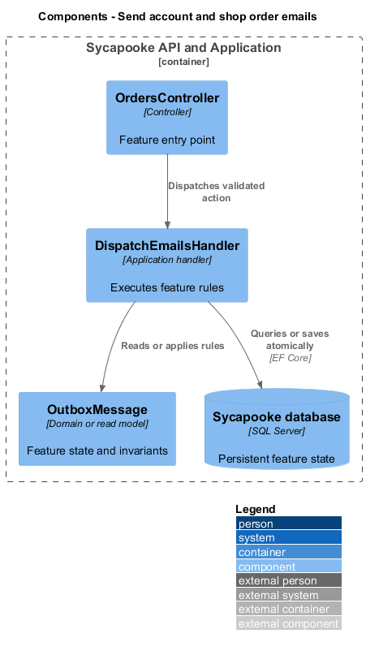
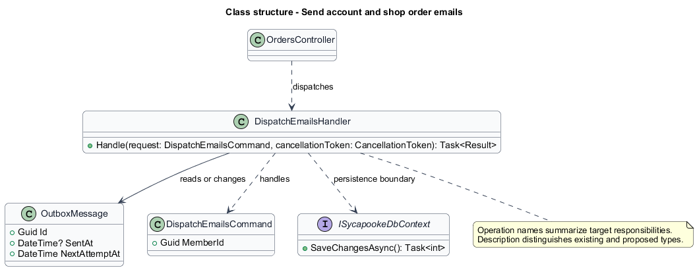
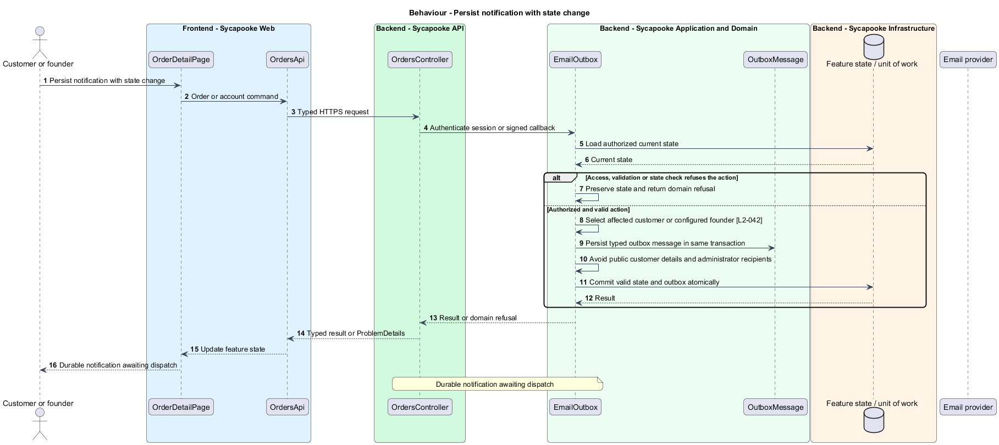
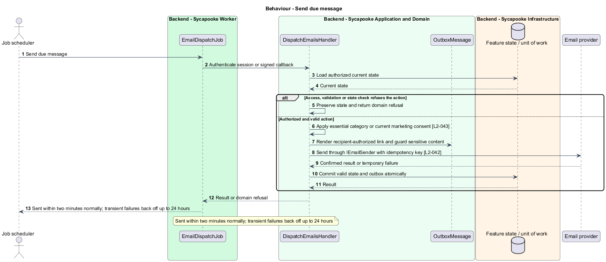

# Send account and shop order emails

## Overview

Account and order messages inform the affected customer and founder. An outbox is a durable message committed with a business change and dispatched separately.

Sycapooke is the shop of one older Caribbean woman, its sole seller. Her jewelry, clothing, housewares and electronics are at least 20 years old. This design refines [ADR general/0010](../../../adr/general/0010-founder-only-shop.md). Existing names identify reusable code; Description identifies target additions.

## Description

### Event production and recipients

`IEmailOutbox`, `EmailOutbox`, `EmailDispatchJob`, `DispatchEmailsHandler`, `EmailTemplates`, `EmailContentGuard` and `IEmailSender` remain. Account events target the affected account. Successful payment queues a customer purchase confirmation and founder sale notice in the order transaction. Shipping, delivery, cancellation, confirmed refund and support outcomes target the order customer; sale, ship-by, draft and support-action notices target the founder. No message iterates over administrators or recruits sellers.

Target notification types remove ReviewReceived and connected-payout notices. Retain account verification, reset, lockout, purchase, fulfilment and support types. Essential AccountSecurity and Order categories always send; only Marketing checks opt-in. Customers never receive other-customer identities or order details. Each notification link resolves to the recipient's authorized customer or founder page.

### Dispatch and reliability

The handler and domain-state transaction persist the typed notification and idempotency key together. The worker dispatches within two minutes under normal provider availability. Transient provider failures retry with the existing back-off for up to 24 hours; permanent address rejection and sensitive-content failures do not retry. `EmailContentGuard` blocks passwords, full card numbers and security codes and logs no rejected body.

`NotificationPreferenceReader` applies current marketing consent before each optional send. Signed one-click unsubscribe headers remain. Refund confirmation email follows provider confirmation, not merely refund authorization. The concrete email provider, production templates and credentials remain `<TO SUPPLY>` under existing decisions.

Tests fake the sender and clock and verify recipient selection, payment receipt plus founder notice, retry boundaries, duplicate dispatch keys, essential messages despite marketing opt-out and private links.

### Implementation and verification boundary

Application code and HTML mocks still require alignment with the revised requirements. UI implementation first aligns mocks, design-system components and screen composition. Backend verification uses fake ports and in-memory substitutes. Browser verification uses the built Angular app and intercepted API responses. No external system runs in tests.

### Implementation evidence

Completed behavior evidence: `dispatch-email` in `src/backend/Sycapooke.Application/Notifications/DispatchEmails.cs` and `tests/Sycapooke.Api.Tests/EmailNotificationTests.cs`. 1 of 2 target behaviors are counted. Other behavior remains uncounted until its target implementation and acceptance coverage exist.

Effort in the matching estimate is the full target feature effort in developer-days, not remaining work. Completion counts whole verified behaviors and rounds to the nearest ten percent. Source and existing acceptance tests supply the evidence; this documentation refresh does not execute new target tests.

## Requirements

| L2 ID | Refines (L1) | Requirement |
| --- | --- | --- |
| `L2-002` | `L1-001` | A new account shall be verified by a single-use link emailed to the member. The link shall expire 24 hours after it is sent. Unverified customers shall be able to browse but not buy. Verification shall not grant selling rights; only the verified founder may manage listings under L2-003. |
| `L2-007` | `L1-002` | After 5 failed sign-in attempts for one account within 15 minutes, the account shall be locked for 15 minutes. Sign-in attempts from one IP address shall be limited to 20 per 15 minutes. |
| `L2-009` | `L1-002` | A member shall be able to reset a forgotten password through a single-use emailed link that expires after 1 hour. The response to a reset request shall not reveal whether the email is registered. Resetting the password shall revoke all of the member's sessions. |
| `L2-019` | `L1-004` | A listing shall have one of these statuses: Draft, Active, Reserved, Sold or Removed. The founder shall be able to save an incomplete listing as a Draft and publish it later. Only Active and Reserved listings appear in the catalog. Validation rules L2-015 to L2-018 apply when publishing; drafts only need a category, and any field a draft does contain must be within its limits. |
| `L2-030` | `L1-007` | Payment shall be taken through a PCI DSS compliant third-party payment provider using the provider's hosted fields or hosted page. Card numbers and security codes shall never pass through or be stored on Sycapooke servers. Sycapooke shall store only the provider's payment reference, card brand and last four digits. Payments shall be processed for the founder's shop merchant account, with provider-managed settlement independent of order completion. Sycapooke shall not charge a marketplace commission, create connected seller accounts, onboard sellers or schedule per-order payout releases. Provider processing fees and settlement timing shall follow the shop's provider agreement. Payment results shall be confirmed from the provider's signed webhook, not from the browser. |
| `L2-033` | `L1-008` | The founder shall ship within 5 business days of payment and enter a carrier and tracking number. If no tracking is added in that time, the order shall be cancelled and the buyer fully refunded. The founder shall be able to see the buyer's shipping address for their order. |
| `L2-035` | `L1-008` | Before an order is Shipped, the founder shall be able to cancel it, and the buyer shall be able to ask the founder to cancel it. A cancelled order shall be refunded in full and its listing shall not return to the catalog unless the founder relists it. |
| `L2-036` | `L1-008` | A customer shall be able to report a problem on their own Shipped or Delivered order until 3 days after delivery, using the reasons not received, not as described, wrong size or counterfeit, a description and up to 4 private photos. An open problem shall pause automatic order completion, not provider settlement. The founder shall respond and resolve it through protected shop management with either a full refund of the original payment or closure without a refund, completing the order. The customer shall see the outcome and explanation. This is shop customer support, not independent arbitration; partial refunds remain outside the existing scope. Support photos shall be visible only to that customer and the founder and follow L2-017 upload validation and metadata-stripping rules. |
| `L2-042` | `L1-011` | The system shall send email for: email verification, password reset, account lockout, purchase confirmation (to the customer), a new sale (to the founder), shipping with tracking (to the buyer), delivery, cancellation, refund, ship-by reminders, and customer problems reported and resolved. Only the founder shall receive shop sale, inventory and ship-by notifications; customers shall receive only their own account and order messages. Emails shall be sent within 2 minutes of the event and shall not contain passwords or full card details. |
| `L2-043` | `L1-011` | Account security and order emails shall always be sent to the relevant customer or founder. Optional shop marketing emails shall be off until the account holder opts in, and every marketing email shall include a one-click unsubscribe link. No review-email preference shall be offered under the existing deferral. |

## Diagrams

### System context

The context identifies the customer or founder and the systems used by this feature.

### Containers

The container view separates the delivery surface, application boundary and feature storage. External integrations remain behind their ports.

### Components

The component view connects `OrdersController` with `DispatchEmailsHandler` and the relevant feature state.

### Class structure

The class view identifies the relevant fields, operation responsibilities and dependencies. It is a target responsibility model, not a claim that each addition already exists.

### Behaviour - Persist notification with state change

Durable notification awaiting dispatch. The sequence shows the boundary that enforces this outcome and the significant failure alternative.

### Behaviour - Send due message

Sent within two minutes normally; transient failures back off up to 24 hours. The sequence shows the boundary that enforces this outcome and the significant failure alternative.

