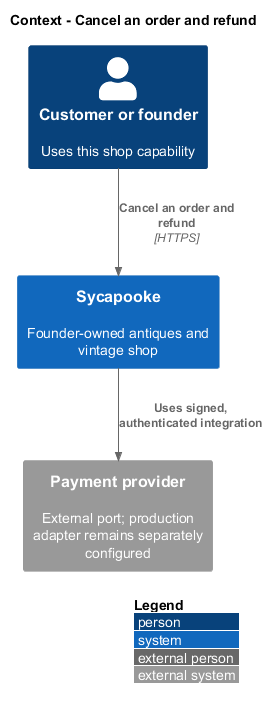
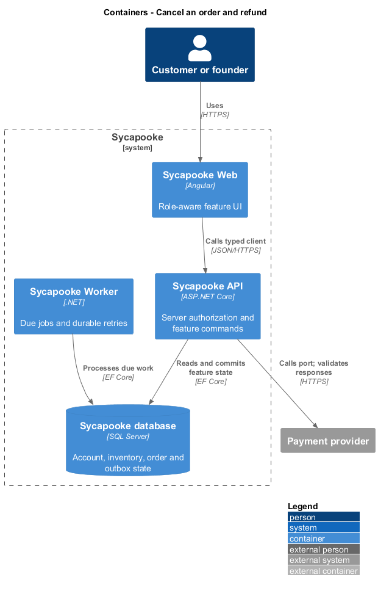
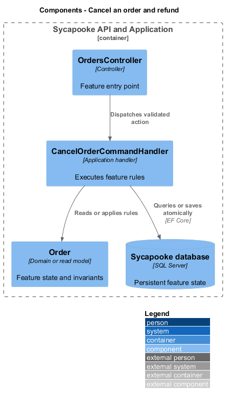
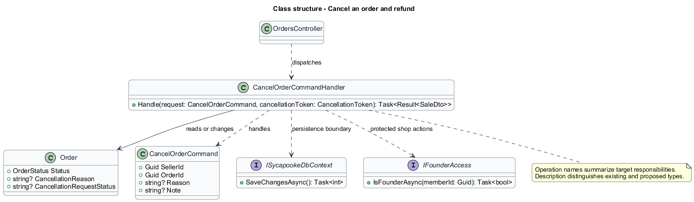
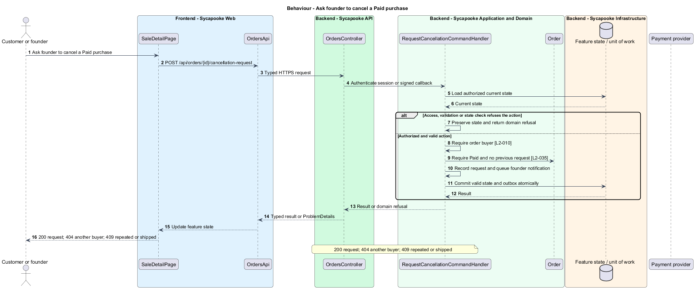
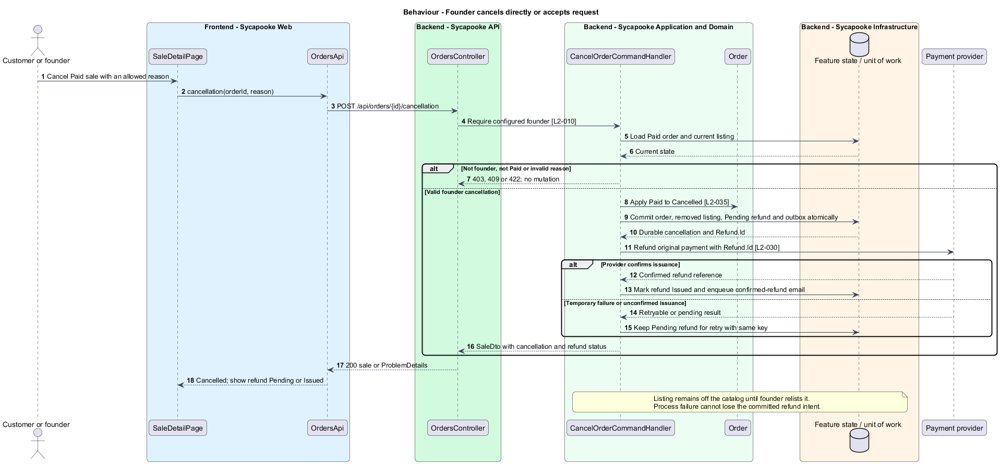
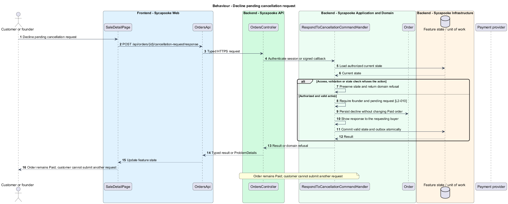

# Cancel an order and refund

## Overview

The customer requests cancellation before shipping, or the founder cancels a Paid sale. Cancellation removes the item from sale and requests one full refund.

Sycapooke is the shop of one older Caribbean woman, its sole seller. Her jewelry, clothing, housewares and electronics are at least 20 years old. This design refines [ADR general/0010](../../../adr/general/0010-founder-only-shop.md). Existing names identify reusable code; Description identifies target additions.

## Description

### Existing cancellation commands

`CancelOrderDialog`, `RequestCancellationDialog`, `RespondCancellationDialog`, `RelistDialog`, `OrderCancellation`, `RequestCancellationCommandHandler`, `RespondToCancellationCommandHandler` and `RelistListingCommandHandler` remain. Customers may request cancellation of their own Paid order once. Only the founder cancels directly or accepts and declines a request.

Keep `POST /api/orders/{id}/cancellation` with `{ reason, note }`, `/cancellation-request` with `{ message }`, and `/cancellation-request/response` with `{ decision }`. Founder-only commands require the shared capability before loading a sale. The customer request derives the buyer from the session and returns 404 for another buyer. A Shipped order or repeated request returns 409.

### Atomic state and asynchronous refund

`OrderCancellation.CancelAsync` changes Paid to Cancelled, records the approved reason, removes the listing with `RemovalReason = OrderCancelled`, persists a full `Refund` and queues notifications in one transaction. Allowed founder reasons remain the four values in L2-035. The existing ship-deadline path uses the same cancellation operation.

The provider receives the original payment reference and the refund ID as idempotency key. Temporary failure leaves a pending refund for `RetryPendingRefundsJob`; the page does not claim a completed refund before provider confirmation. No held payout record participates. A decline leaves Paid and records the response. The removed listing stays off the catalog until the founder explicitly relists it under the inventory design.

Tests cover customer ownership, founder-only response, cancellation races with shipping, reason validation, repeated refund issuance and pending versus confirmed refund display.

### Implementation and verification boundary

Application code and HTML mocks still require alignment with the revised requirements. UI implementation first aligns mocks, design-system components and screen composition. Backend verification uses fake ports and in-memory substitutes. Browser verification uses the built Angular app and intercepted API responses. No external system runs in tests.

### Implementation evidence

No complete target behavior is counted. Reusable implementation exists where identified, but the revised founder, privacy or infrastructure boundary and its acceptance coverage remain unfinished.

Effort in the matching estimate is the full target feature effort in developer-days, not remaining work. Completion counts whole verified behaviors and rounds to the nearest ten percent. Source and existing acceptance tests supply the evidence; this documentation refresh does not execute new target tests.

## Requirements

| L2 ID | Refines (L1) | Requirement |
| --- | --- | --- |
| `L2-010` | `L1-002` | Every API endpoint shall enforce the caller's permissions on the server. Customers shall change only their own private account and access only their own purchases, addresses and support submissions. Only the configured founder (L2-003) shall manage inventory, view shop sales, fulfil orders and resolve customer problems. There is no separate administrator decision-maker. Anonymous browsing and the public registration, verification, authentication, password-recovery and signed provider-callback flows remain available under their own validation rules. |
| `L2-030` | `L1-007` | Payment shall be taken through a PCI DSS compliant third-party payment provider using the provider's hosted fields or hosted page. Card numbers and security codes shall never pass through or be stored on Sycapooke servers. Sycapooke shall store only the provider's payment reference, card brand and last four digits. Payments shall be processed for the founder's shop merchant account, with provider-managed settlement independent of order completion. Sycapooke shall not charge a marketplace commission, create connected seller accounts, onboard sellers or schedule per-order payout releases. Provider processing fees and settlement timing shall follow the shop's provider agreement. Payment results shall be confirmed from the provider's signed webhook, not from the browser. |
| `L2-035` | `L1-008` | Before an order is Shipped, the founder shall be able to cancel it, and the buyer shall be able to ask the founder to cancel it. A cancelled order shall be refunded in full and its listing shall not return to the catalog unless the founder relists it. |
| `L2-042` | `L1-011` | The system shall send email for: email verification, password reset, account lockout, purchase confirmation (to the customer), a new sale (to the founder), shipping with tracking (to the buyer), delivery, cancellation, refund, ship-by reminders, and customer problems reported and resolved. Only the founder shall receive shop sale, inventory and ship-by notifications; customers shall receive only their own account and order messages. Emails shall be sent within 2 minutes of the event and shall not contain passwords or full card details. |

## Diagrams

### System context

The context identifies the customer or founder and the systems used by this feature.

### Containers

The container view separates the delivery surface, application boundary and feature storage. External integrations remain behind their ports.

### Components

The component view connects `OrdersController` with `CancelOrderCommandHandler` and the relevant feature state.

### Class structure

The class view identifies the relevant fields, operation responsibilities and dependencies. It is a target responsibility model, not a claim that each addition already exists.

### Behaviour - Ask founder to cancel a Paid purchase

200 request; 404 another buyer; 409 repeated or shipped. The sequence shows the boundary that enforces this outcome and the significant failure alternative.

### Behaviour - Founder cancels directly or accepts request

Cancelled once; refund confirmed or pending retry; no automatic relist. The sequence shows the boundary that enforces this outcome and the significant failure alternative.

### Behaviour - Decline pending cancellation request

Order remains Paid; customer cannot submit another request. The sequence shows the boundary that enforces this outcome and the significant failure alternative.

