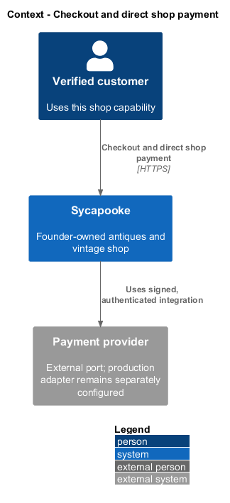
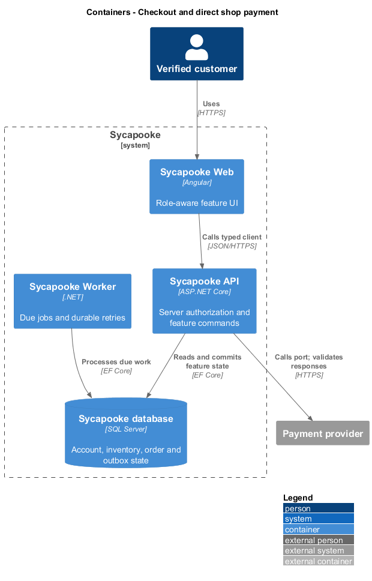
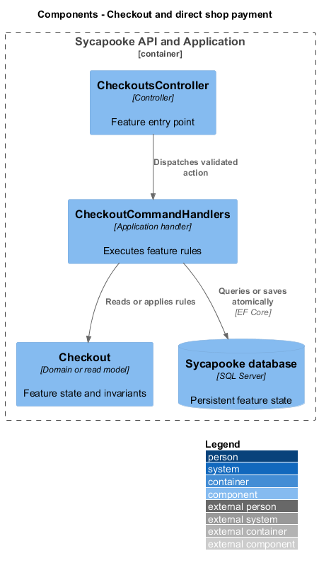
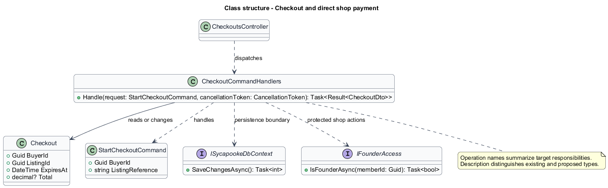
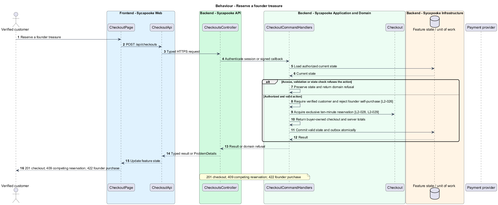
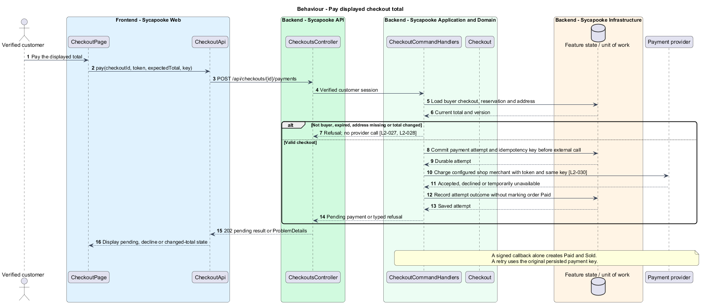
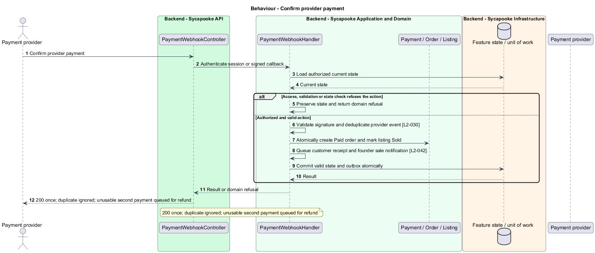
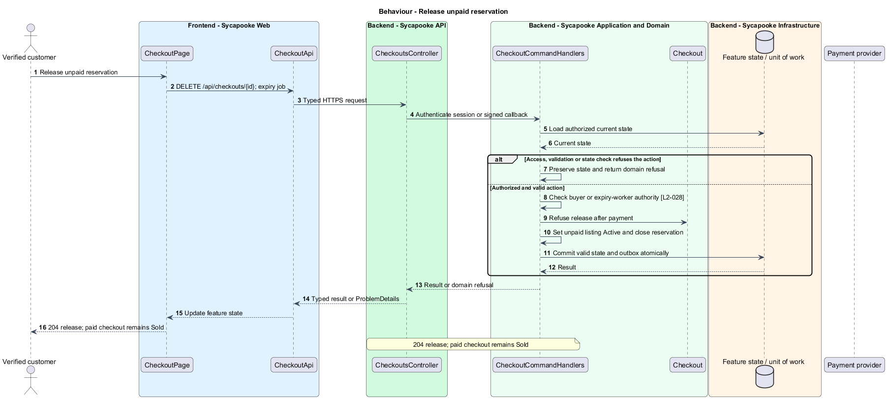
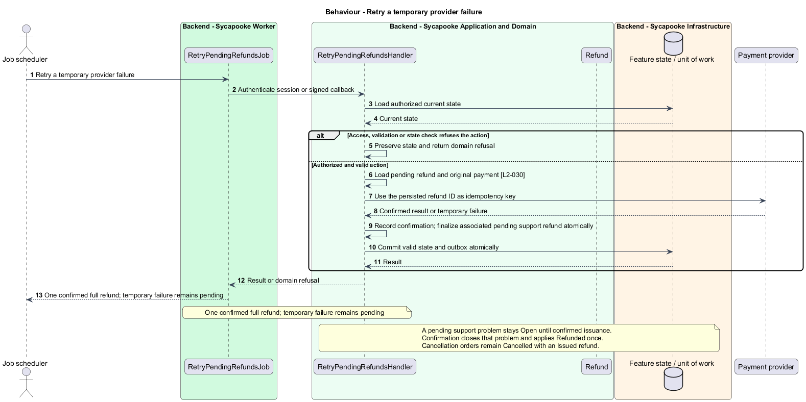

# Checkout and direct shop payment

## Overview

A verified customer buys one treasure through hosted payment fields. A reservation protects the item while settlement belongs to the shop merchant account.

Sycapooke is the shop of one older Caribbean woman, its sole seller. Her jewelry, clothing, housewares and electronics are at least 20 years old. This design refines [ADR general/0010](../../../adr/general/0010-founder-only-shop.md). Existing names identify reusable code; Description identifies target additions.

## Description

### Existing checkout and payment boundaries

`CheckoutPage`, `CheckoutStore`, `HostedCardFieldsComponent`, `CheckoutApi`, `CheckoutsController`, `CheckoutCommandHandlers` and `PaymentWebhookHandler` remain the slice's concrete parts. Customers buy one Active founder listing at a time. The founder cannot buy shop inventory. The server reserves the item for ten minutes and database concurrency permits only one active purchase attempt. Expiry or cancellation releases an unpaid reservation.

Retain `POST /api/checkouts`, `GET /api/checkouts/{id}`, `PUT /api/checkouts/{id}/address`, `POST /api/checkouts/{id}/payments` and `DELETE /api/checkouts/{id}`. The handler commits the payment-attempt record and idempotency key before calling the provider, so a callback or crash cannot lose the attempt. The payment request retains `{ paymentMethodToken, expectedTotal }` and a UUID `Idempotency-Key`. Private checkout responses remain visible only to their buyer. A US address is required; changed tax requires showing the revised total and a second explicit Pay action. The UI keeps the existing reservation timer, summary, hosted-field boundary and accessible failure states.

### Direct merchant payment

`IPaymentProvider` remains the payment and refund port. Its target configuration identifies the founder's shop merchant account. Caller-supplied owner or merchant fields never select a payment destination. The provider's hosted fields handle card data; Sycapooke stores only the existing payment reference, card brand and last four digits. Concrete provider and credentials are `<TO SUPPLY>` under the existing provider decision.

`POST /api/payments/webhook` validates the raw-body signature and deduplicates events. Only a successful provider confirmation creates Paid and changes the listing to Sold. Duplicate callbacks are harmless. Late or duplicate successful payments that cannot own the listing are refunded through the original-payment reference. No commission, connected account, onboarding or completion-triggered transfer participates in the target flow.

### Refund reliability and compatibility

`Refund` and `OrderCancellation` retain an idempotency key per refund. Proposed `RetryPendingRefundsJob` and `RetryPendingRefundsHandler` retry temporary failures with the same key and only marks issuance after provider confirmation. The UI distinguishes requested and confirmed refunds. Completion or a support hold creates no provider transfer. Existing payout tables and historical records require a separate implementation migration; this design does not delete financial history.

Tests use a fake provider and clock and cover concurrent reservations, displayed totals, forged signatures, callback replay, changed merchant fields, full-refund retry and absence of settlement operations on completion.

### Implementation and verification boundary

Application code and HTML mocks still require alignment with the revised requirements. UI implementation first aligns mocks, design-system components and screen composition. Backend verification uses fake ports and in-memory substitutes. Browser verification uses the built Angular app and intercepted API responses. No external system runs in tests.

### Implementation evidence

Completed behavior evidence: `release-reservation` in `src/backend/Sycapooke.Application/Checkouts/CheckoutCommands.cs` and `src/frontend/e2e/tests/checkout-and-pay.spec.ts`. 1 of 5 target behaviors are counted. Remaining target behavior and acceptance checks are not counted merely because older marketplace tests pass.

Effort in the matching estimate is the full target feature effort in developer-days, not remaining work. Completion counts whole verified behaviors and rounds to the nearest ten percent. Source and existing acceptance tests supply the evidence; this documentation refresh does not execute new target tests.

## Requirements

| L2 ID | Refines (L1) | Requirement |
| --- | --- | --- |
| `L2-026` | `L1-006` | The founder shall not be able to purchase her own shop inventory. Only verified customers may buy. An anonymous visitor who chooses "Buy now" shall be sent to sign in and then returned to the listing. |
| `L2-027` | `L1-007` | A verified customer shall be able to buy one Active founder listing at a time. Checkout shall collect a US shipping address and show the item price, shipping cost, sales tax where it applies, and the total before payment. |
| `L2-028` | `L1-007` | When a buyer starts checkout, the listing shall become Reserved for that buyer for 10 minutes. While Reserved, no other member shall be able to start checkout for it. If payment does not succeed within 10 minutes, the listing shall return to Active. |
| `L2-029` | `L1-007` | Concurrent purchase attempts for the same listing shall result in exactly one order. This shall be guaranteed by the database (for example by optimistic concurrency on the listing), not by the client. |
| `L2-030` | `L1-007` | Payment shall be taken through a PCI DSS compliant third-party payment provider using the provider's hosted fields or hosted page. Card numbers and security codes shall never pass through or be stored on Sycapooke servers. Sycapooke shall store only the provider's payment reference, card brand and last four digits. Payments shall be processed for the founder's shop merchant account, with provider-managed settlement independent of order completion. Sycapooke shall not charge a marketplace commission, create connected seller accounts, onboard sellers or schedule per-order payout releases. Provider processing fees and settlement timing shall follow the shop's provider agreement. Payment results shall be confirmed from the provider's signed webhook, not from the browser. |
| `L2-054` | `L1-014` | Email addresses, shipping addresses and phone numbers shall never appear in public pages or public API responses. Shipping addresses shall be encrypted at rest at the field level, and all databases, backups and photo storage shall be encrypted at rest. |

## Diagrams

### System context

The context identifies the verified customer and the systems used by this feature.

### Containers

The container view separates the delivery surface, application boundary and feature storage. External integrations remain behind their ports.

### Components

The component view connects `CheckoutsController` with `CheckoutCommandHandlers` and the relevant feature state.

### Class structure

The class view identifies the relevant fields, operation responsibilities and dependencies. It is a target responsibility model, not a claim that each addition already exists.

### Behaviour - Reserve a founder treasure

201 checkout; 409 competing reservation; 422 founder purchase. The sequence shows the boundary that enforces this outcome and the significant failure alternative.

### Behaviour - Pay displayed checkout total

202 pending result; changed total requires another Pay action. The sequence shows the boundary that enforces this outcome and the significant failure alternative.

### Behaviour - Confirm provider payment

200 once; duplicate ignored; unusable second payment queued for refund. The sequence shows the boundary that enforces this outcome and the significant failure alternative.

### Behaviour - Release unpaid reservation

204 release; paid checkout remains Sold. The sequence shows the boundary that enforces this outcome and the significant failure alternative.

### Behaviour - Retry a temporary provider failure

One confirmed full refund; temporary failure remains pending. The sequence shows the boundary that enforces this outcome and the significant failure alternative.

