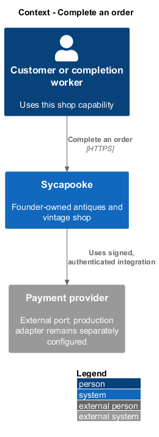
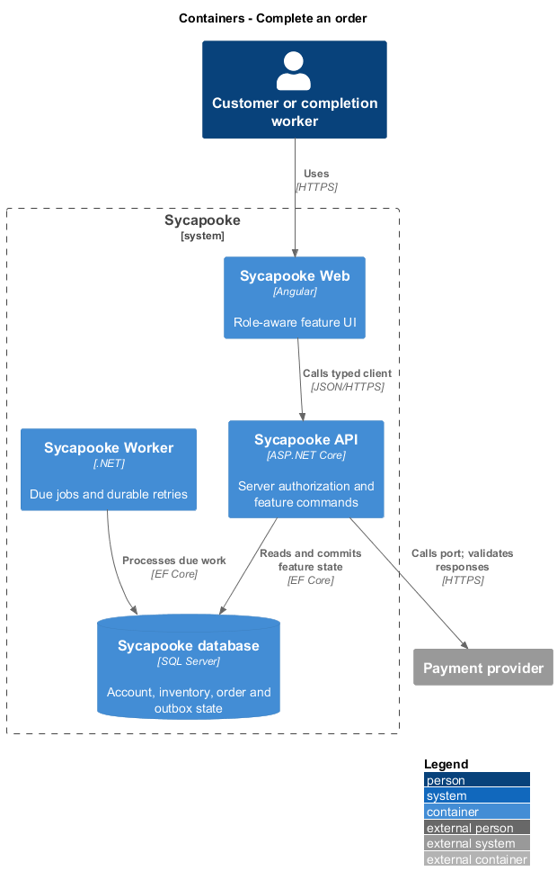
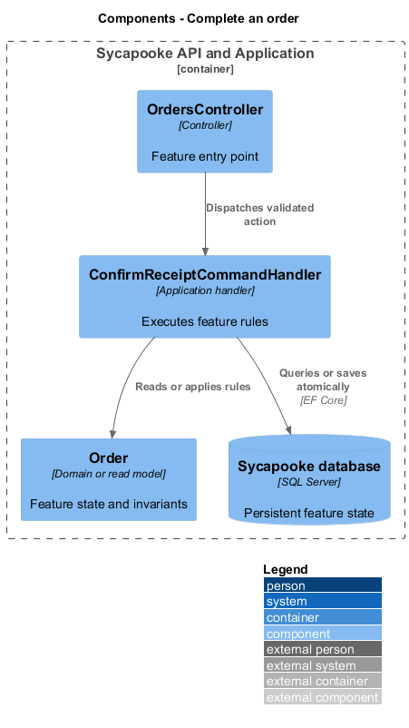
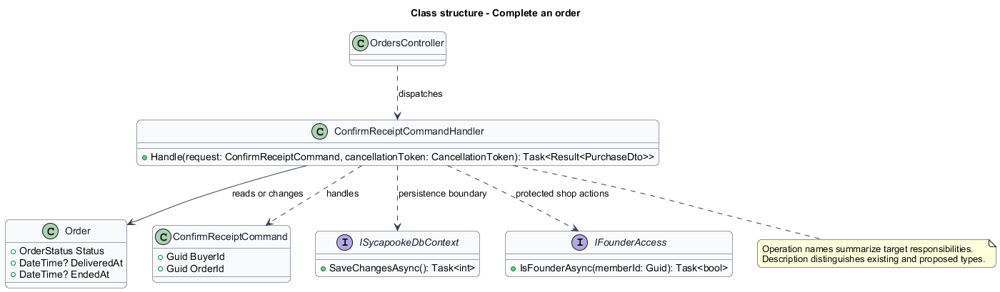
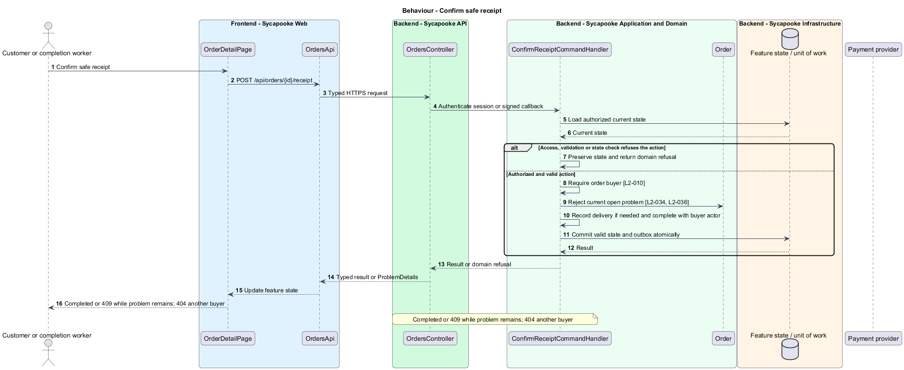
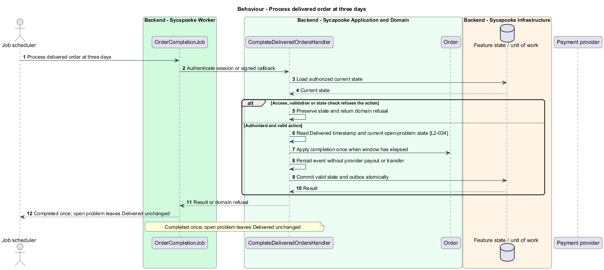

# Complete an order

## Overview

Completion records the end of the delivery window. Customer confirmation and automatic completion both wait while an order problem remains open.

Sycapooke is the shop of one older Caribbean woman, its sole seller. Her jewelry, clothing, housewares and electronics are at least 20 years old. This design refines [ADR general/0010](../../../adr/general/0010-founder-only-shop.md). Existing names identify reusable code; Description identifies target additions.

## Description

### Receipt confirmation

`OrderDetailPage`, `ConfirmReceiptDialog`, `OrdersApi`, `OrdersController`, `ConfirmReceiptCommandHandler`, `CompleteDeliveredOrdersHandler` and `Order` remain. `POST /api/orders/{id}/receipt` is buyer-only; another customer's order returns 404. Receipt on Shipped records Shipped to Delivered and Delivered to Completed with the buyer as actor. Receipt on Delivered records completion. Other states return 409 `ORDER_INVALID_TRANSITION`.

### Open-problem and time guards

Both receipt and `OrderCompletionJob` check the current problem state inside the same unit of work as completion. Any open problem blocks the transition, including receipt on a Shipped order. The page shows the automatic completion date only without an open problem; otherwise it explains that completion is paused while the founder handles support.

The worker completes an order three days after delivery when no problem exists. Repeated runs do not duplicate completion history or notifications. Founder resolution without refund uses the separate support command and the explicit support transition in L2-032; this is not customer receipt confirmation.

`OrderCompleted` remains a domain event for order state and notifications. Its target subscribers contain no payout creator or release handler. Provider settlement already belongs to the shop merchant account. Tests check exact deadline, receipt in both allowed states, open-problem races, invalid transitions, event idempotency and absence of financial transfers on completion.

### Implementation and verification boundary

Application code and HTML mocks still require alignment with the revised requirements. UI implementation first aligns mocks, design-system components and screen composition. Backend verification uses fake ports and in-memory substitutes. Browser verification uses the built Angular app and intercepted API responses. No external system runs in tests.

### Implementation evidence

No complete target behavior is counted. Reusable implementation exists where identified, but the revised founder, privacy or infrastructure boundary and its acceptance coverage remain unfinished.

Effort in the matching estimate is the full target feature effort in developer-days, not remaining work. Completion counts whole verified behaviors and rounds to the nearest ten percent. Source and existing acceptance tests supply the evidence; this documentation refresh does not execute new target tests.

## Requirements

| L2 ID | Refines (L1) | Requirement |
| --- | --- | --- |
| `L2-010` | `L1-002` | Every API endpoint shall enforce the caller's permissions on the server. Customers shall change only their own private account and access only their own purchases, addresses and support submissions. Only the configured founder (L2-003) shall manage inventory, view shop sales, fulfil orders and resolve customer problems. There is no separate administrator decision-maker. Anonymous browsing and the public registration, verification, authentication, password-recovery and signed provider-callback flows remain available under their own validation rules. |
| `L2-032` | `L1-008` | An order shall move through the statuses Paid, Shipped, Delivered and Completed, or end as Cancelled or Refunded. Only the transitions in this requirement shall be allowed, and every transition shall be recorded with its time and the actor.  \| From \| To \| Triggered by \| \| --- \| --- \| --- \| \| Paid \| Shipped \| Founder adds tracking \| \| Paid \| Cancelled \| Founder cancels, or ship deadline passes \| \| Shipped \| Delivered \| Carrier reports delivery, or buyer confirms receipt \| \| Delivered \| Completed \| Buyer confirms receipt, or 3 days pass with no open problem \| \| Shipped, Delivered \| Completed \| Founder closes an open customer problem without a refund and supplies an explanation \| \| Shipped, Delivered \| Refunded \| Provider confirms a full refund authorized by the founder for a customer problem \| |
| `L2-034` | `L1-008` | The buyer shall be able to confirm receipt of a Shipped or Delivered order. An order shall complete automatically 3 days after it becomes Delivered unless the buyer has reported a problem. |
| `L2-036` | `L1-008` | A customer shall be able to report a problem on their own Shipped or Delivered order until 3 days after delivery, using the reasons not received, not as described, wrong size or counterfeit, a description and up to 4 private photos. An open problem shall pause automatic order completion, not provider settlement. The founder shall respond and resolve it through protected shop management with either a full refund of the original payment or closure without a refund, completing the order. The customer shall see the outcome and explanation. This is shop customer support, not independent arbitration; partial refunds remain outside the existing scope. Support photos shall be visible only to that customer and the founder and follow L2-017 upload validation and metadata-stripping rules. |

## Diagrams

### System context

The context identifies the customer or completion worker and the systems used by this feature.

### Containers

The container view separates the delivery surface, application boundary and feature storage. External integrations remain behind their ports.

### Components

The component view connects `OrdersController` with `ConfirmReceiptCommandHandler` and the relevant feature state.

### Class structure

The class view identifies the relevant fields, operation responsibilities and dependencies. It is a target responsibility model, not a claim that each addition already exists.

### Behaviour - Confirm safe receipt

Completed or 409 while problem remains; 404 another buyer. The sequence shows the boundary that enforces this outcome and the significant failure alternative.

### Behaviour - Process delivered order at three days

Completed once; open problem leaves Delivered unchanged. The sequence shows the boundary that enforces this outcome and the significant failure alternative.

