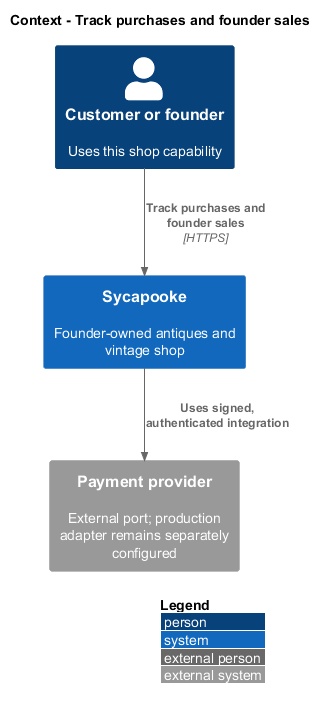
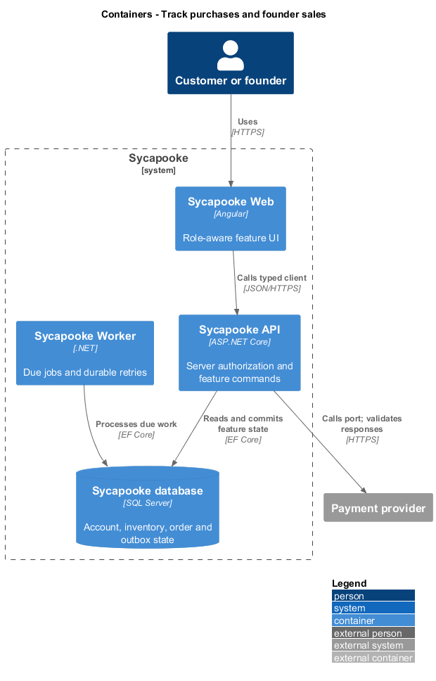
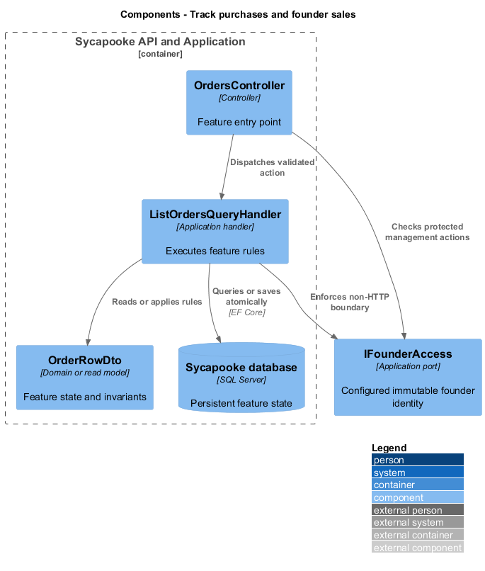
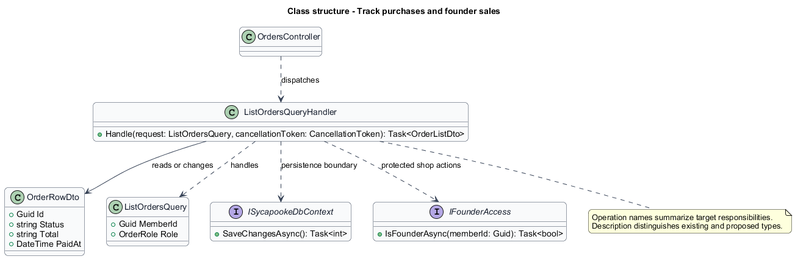
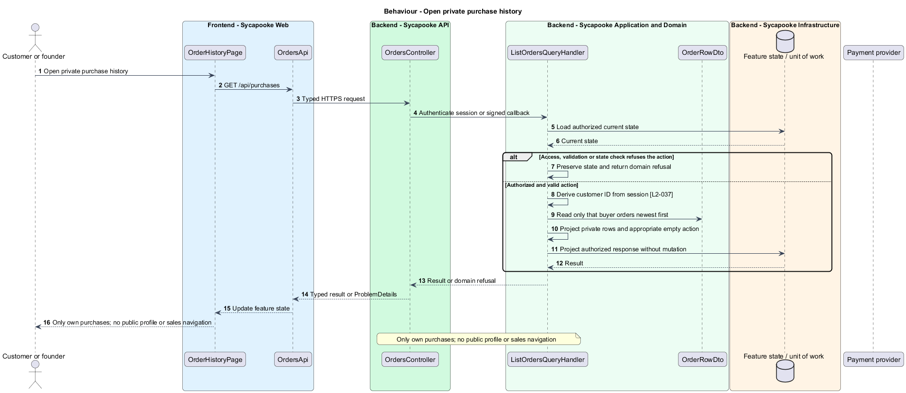
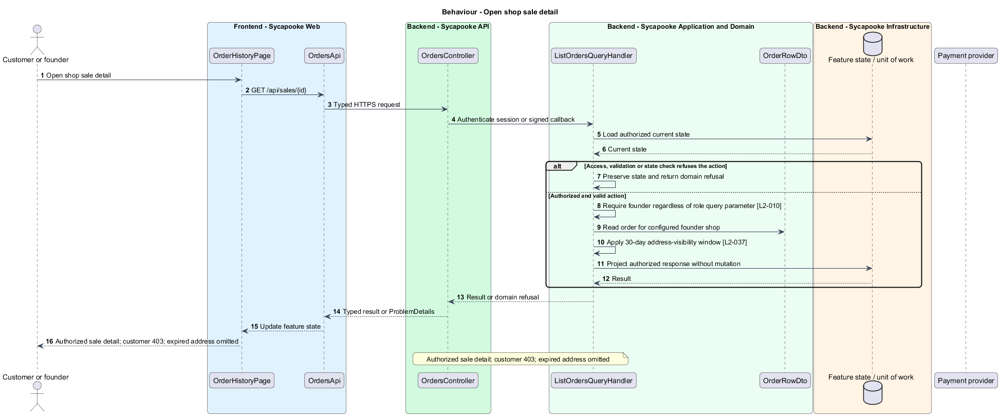

# Track purchases and founder sales

## Overview

Customers privately track their purchases. The founder manages shop sales and sees delivery details only within the fulfilment retention window.

Sycapooke is the shop of one older Caribbean woman, its sole seller. Her jewelry, clothing, housewares and electronics are at least 20 years old. This design refines [ADR general/0010](../../../adr/general/0010-founder-only-shop.md). Existing names identify reusable code; Description identifies target additions.

## Description

### Read models and access

`OrderHistoryPage`, `OrderDetailPage`, `SaleDetailPage`, `OrdersApi`, `OrdersController`, `ListOrdersQueryHandler`, `OrderRowDto` and `OrderListDto` remain. `GET /api/purchases` returns only the authenticated customer's orders. `GET /api/purchases/{id}` remains buyer-only. `GET /api/sales` and `/api/sales/{id}` now require the configured founder; customers receive 403 before sale data is read.

`ListOrdersQuery` keeps its internal Buyer/Seller role distinction, but that value does not grant permissions. The API selects buyer history from the session and founder sales from the trusted founder identity. Orders sort newest first by payment time and ID. Rows retain item, total, status, date and relevant party display label. Public pages never receive buyer identities or history.

The target `SaleDto` removes its `Payout` property. Purchase and sale detail gain an optional `refund` projection with `status` (`Pending` or `Issued`) and the original-payment amount, reusing `RefundStatus`. That projection reports requested versus provider-confirmed full refunds without a seller earnings panel.

### Address and navigation privacy

`ShippingAddressVisibility.IsVisibleToSeller` retains its existing name but applies only after founder authorization. An address remains visible at exactly 30 days after order end and disappears after that point. The customer's own order address remains private to them. Customer navigation omits Sales and all selling prompts; empty Purchases offers browsing the catalog. Founder navigation offers shop sales and inventory.

History paging remains outside the existing specified contract; this design introduces no page-size policy. Tests cover every private read boundary, role-parameter spoofing, correct empty states, deterministic ordering and address-window edges.

### Implementation and verification boundary

Application code and HTML mocks still require alignment with the revised requirements. UI implementation first aligns mocks, design-system components and screen composition. Backend verification uses fake ports and in-memory substitutes. Browser verification uses the built Angular app and intercepted API responses. No external system runs in tests.

### Implementation evidence

No complete target behavior is counted. Reusable implementation exists where identified, but the revised founder, privacy or infrastructure boundary and its acceptance coverage remain unfinished.

Effort in the matching estimate is the full target feature effort in developer-days, not remaining work. Completion counts whole verified behaviors and rounds to the nearest ten percent. Source and existing acceptance tests supply the evidence; this documentation refresh does not execute new target tests.

## Requirements

| L2 ID | Refines (L1) | Requirement |
| --- | --- | --- |
| `L2-003` | `L1-001` | Public registration shall create customer accounts only. A trusted operator shall provision one founder account through a protected deployment or operator process outside public registration. The server shall bind management access to that account's immutable identity, never a display name, email supplied by the client or Google claim. Provisioning shall not create a second founder. Only the verified founder shall manage listings, photos, sales, shipping and customer problems. Customers shall have no selling links, public profile creation or management navigation. |
| `L2-010` | `L1-002` | Every API endpoint shall enforce the caller's permissions on the server. Customers shall change only their own private account and access only their own purchases, addresses and support submissions. Only the configured founder (L2-003) shall manage inventory, view shop sales, fulfil orders and resolve customer problems. There is no separate administrator decision-maker. Anonymous browsing and the public registration, verification, authentication, password-recovery and signed provider-callback flows remain available under their own validation rules. |
| `L2-037` | `L1-008` | Customers shall have a private "Purchases" page listing only their own orders, newest first, with item, total, status and date. Only the founder shall have a "Sales" page listing the shop's orders with the buyer and sale detail. Customers shall have no sales page or sales API access. The customer may view their own order address; the founder may view it only for fulfilment until 30 days after the order ends. |
| `L2-054` | `L1-014` | Email addresses, shipping addresses and phone numbers shall never appear in public pages or public API responses. Shipping addresses shall be encrypted at rest at the field level, and all databases, backups and photo storage shall be encrypted at rest. |

## Diagrams

### System context

The context identifies the customer or founder and the systems used by this feature.

### Containers

The container view separates the delivery surface, application boundary and feature storage. External integrations remain behind their ports.

### Components

The component view connects `OrdersController` with `ListOrdersQueryHandler` and the relevant feature state.

### Class structure

The class view identifies the relevant fields, operation responsibilities and dependencies. It is a target responsibility model, not a claim that each addition already exists.

### Behaviour - Open private purchase history

Only own purchases; no public profile or sales navigation. The sequence shows the boundary that enforces this outcome and the significant failure alternative.

### Behaviour - Open shop sale detail

Authorized sale detail; customer 403; expired address omitted. The sequence shows the boundary that enforces this outcome and the significant failure alternative.

