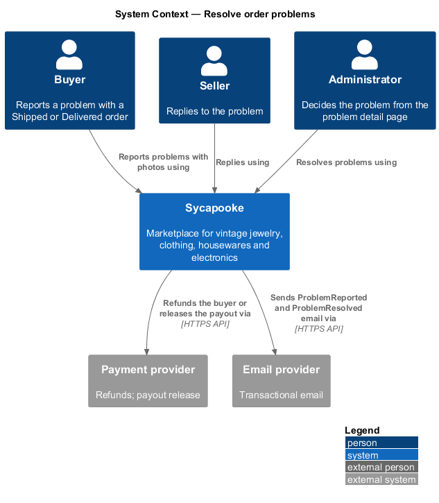
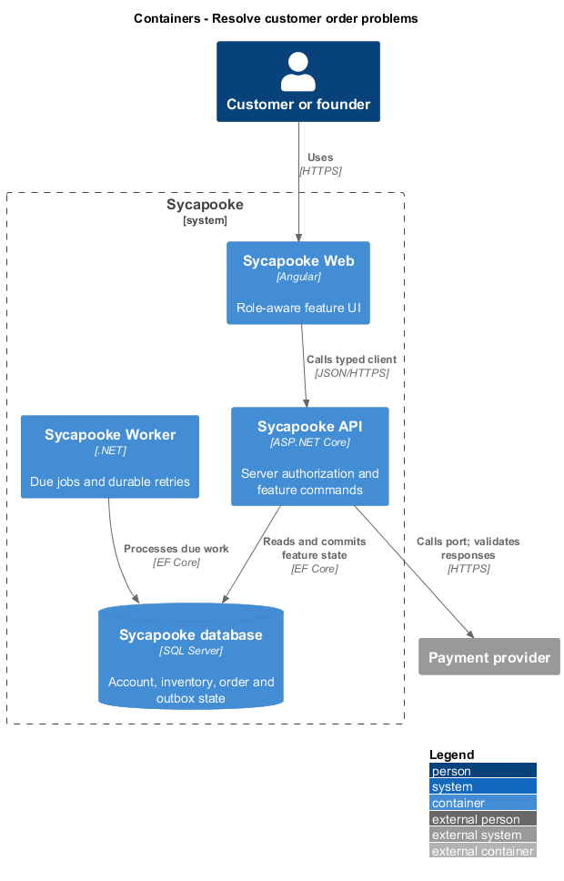
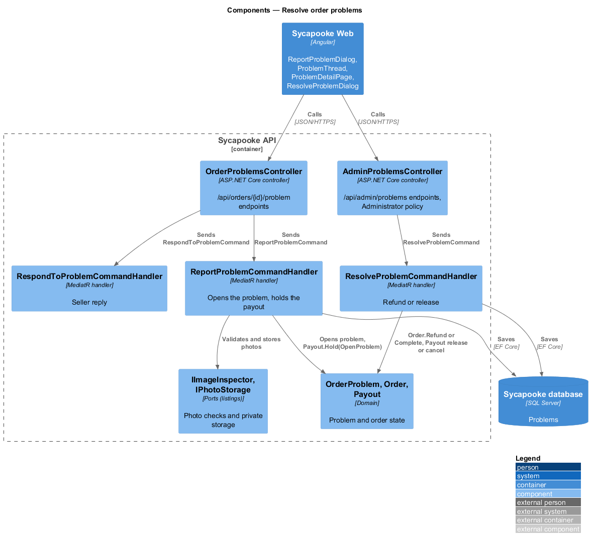
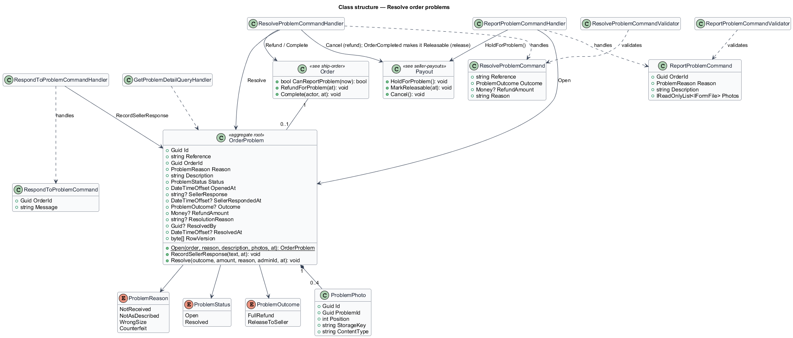
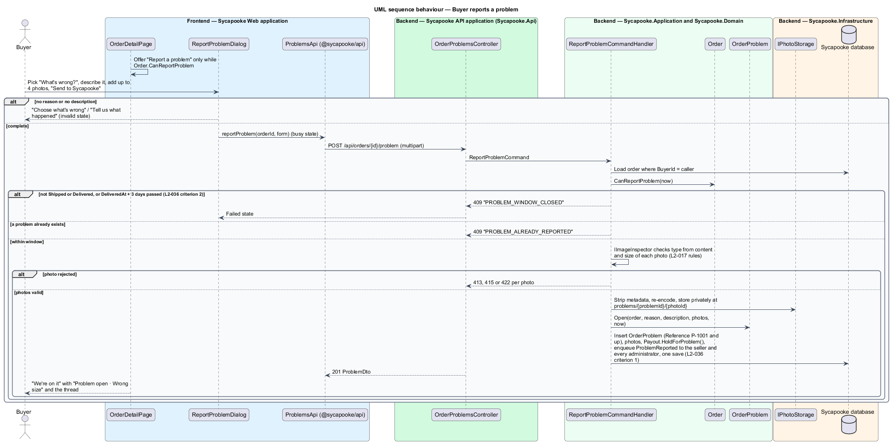
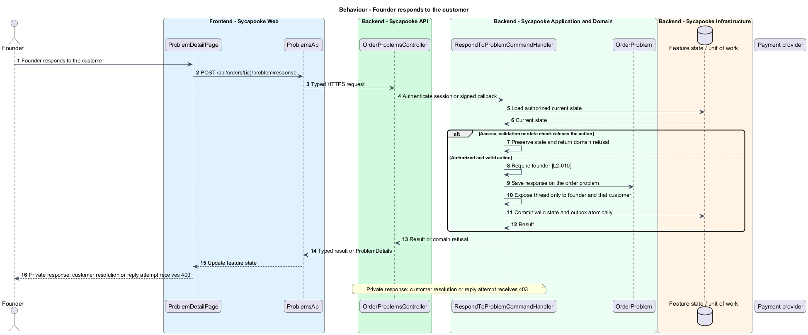
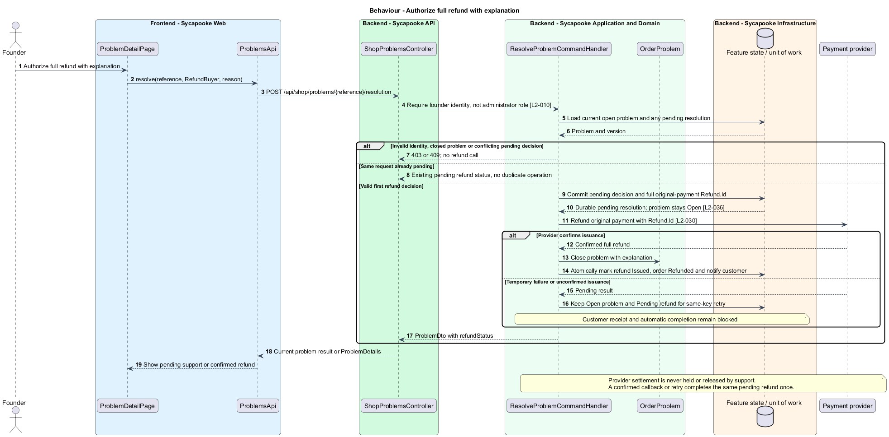
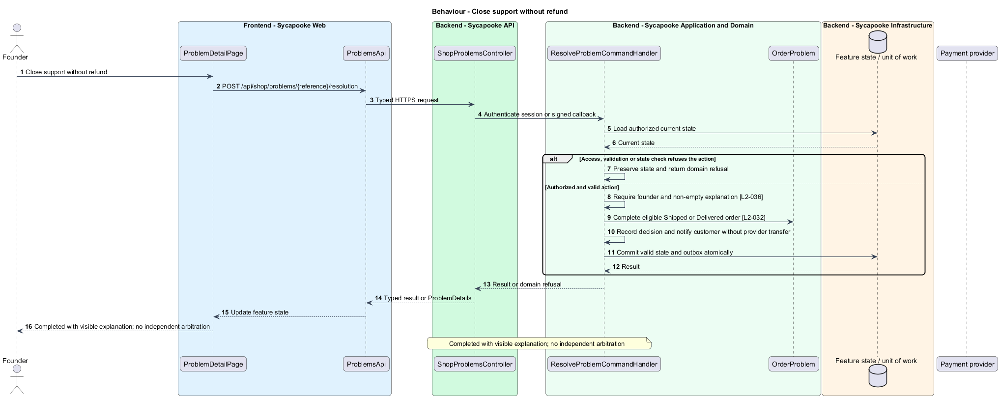

# Resolve customer order problems

## Overview

Customers report problems with their own orders. The founder responds and decides the shop outcome, including a full refund when appropriate.

Sycapooke is the shop of one older Caribbean woman, its sole seller. Her jewelry, clothing, housewares and electronics are at least 20 years old. This design refines [ADR general/0010](../../../adr/general/0010-founder-only-shop.md). Existing names identify reusable code; Description identifies target additions.

## Description

### Reporting and private evidence

`ReportProblemDialog`, `OrderDetailPage`, `SaleDetailPage`, `ProblemDetailPage`, `ResolveProblemDialog`, `OrderProblemsController`, `OrderProblem` and the existing report/response/resolution handlers remain the starting points. Customers report only their own Shipped order or Delivered order within three days. Existing `POST /api/orders/{id}/problem` accepts reason, description and up to four photos; the response route remains `/problem/response` for the founder.

All support photos now follow the L2-017 size, content, minimum-dimension and metadata rules and stay in private storage. The existing protected photo endpoint returns `Cache-Control: private, no-store` only to that order's customer or the founder. Another customer's request returns 404. The public listing CDN never serves evidence.

### Founder support contract

Proposed `ShopProblemsController` and `ShopProblemsApi` replace the administrator-facing controller/client. Target routes are `GET /api/shop/problems/{reference}` and `POST /api/shop/problems/{reference}/resolution` with `{ outcome, reason }`. The old `/api/admin/problems` endpoints are removed with no authorization-preserving alias. The frontend target route is `/shop/problems/:reference`, guarded by founder capability, with no separate administrator shell.

`ResolveProblemCommandHandler` requires `IFounderAccess`. The target outcome values are `RefundBuyer` and `CloseWithoutRefund`; both require an explanation. Historical `ReleaseToSeller` outcomes project as `CloseWithoutRefund` on reads; new resolution requests accept only the target values. `Member.IsAdministrator` and forged role input confer no access. The founder's response and outcome appear to the customer as shop support, not independent arbitration.

### Completion and money

Reporting a problem pauses automatic and customer-confirmed completion without touching provider settlement. A full-refund decision commits a pending resolution and original-payment refund before calling the provider. The problem remains Open with `PendingRefundId`, requested outcome/reason and request time until issuance is confirmed. `ProblemDto` adds nullable `refundStatus` (`Pending` or `Issued`). Repeating the same pending request returns its current result; a conflicting decision returns 409. Closure without refund is refused while a refund is pending. A conditional update or concurrency token serializes competing resolutions. Provider confirmation applies Refunded and closes the problem once; temporary failure retains the completion hold and retry state. Closure without refund completes Shipped or Delivered directly through the explicit support transition and records the explanation. A completion worker checks the same current problem state.

Tests cover reporting-window edges, private photo access, founder-only responses and resolution, inherited administrator denial, pending refund failure/retry and duplicate outcomes. Partial refunds stay outside the existing scope.

### Implementation and verification boundary

Application code and HTML mocks still require alignment with the revised requirements. UI implementation first aligns mocks, design-system components and screen composition. Backend verification uses fake ports and in-memory substitutes. Browser verification uses the built Angular app and intercepted API responses. No external system runs in tests.

### Implementation evidence

The founder model is implemented and tested: `ShopProblemsController` (`GET /api/shop/support`, `GET /api/shop/problems/{reference}`, `POST .../resolution` with `RefundBuyer` or `CloseWithoutRefund`), the refund retry (`RetryPendingRefundsCommand`, `RefundRetryJob`) and the `refund` projection are covered by `ResolveOrderProblemsTests`; the support queue, problem page and Resolve dialog by `support-queue.spec.ts` and `resolve-order-problems.spec.ts`. Not yet built: the founder's reply form on the problem page (she replies from the sale page).

Effort in the matching estimate is the full target feature effort in developer-days, not remaining work. Completion counts whole verified behaviors and rounds to the nearest ten percent. Source and existing acceptance tests supply the evidence; this documentation refresh does not execute new target tests.

## Requirements

| L2 ID | Refines (L1) | Requirement |
| --- | --- | --- |
| `L2-010` | `L1-002` | Every API endpoint shall enforce the caller's permissions on the server. Customers shall change only their own private account and access only their own purchases, addresses and support submissions. Only the configured founder (L2-003) shall manage inventory, view shop sales, fulfil orders and resolve customer problems. There is no separate administrator decision-maker. Anonymous browsing and the public registration, verification, authentication, password-recovery and signed provider-callback flows remain available under their own validation rules. |
| `L2-017` | `L1-004` | A listing shall have 1 to 8 photos. Each photo shall be JPEG, PNG or WebP, at most 10 MB, and at least 800 pixels on its shortest side. The file type shall be checked from the file's content, not its name. The server shall strip all metadata (including GPS location), re-encode the image and produce thumbnail (400px), medium (800px) and large (1600px) versions. The first photo is the cover and the founder can reorder photos. |
| `L2-030` | `L1-007` | Payment shall be taken through a PCI DSS compliant third-party payment provider using the provider's hosted fields or hosted page. Card numbers and security codes shall never pass through or be stored on Sycapooke servers. Sycapooke shall store only the provider's payment reference, card brand and last four digits. Payments shall be processed for the founder's shop merchant account, with provider-managed settlement independent of order completion. Sycapooke shall not charge a marketplace commission, create connected seller accounts, onboard sellers or schedule per-order payout releases. Provider processing fees and settlement timing shall follow the shop's provider agreement. Payment results shall be confirmed from the provider's signed webhook, not from the browser. |
| `L2-032` | `L1-008` | An order shall move through the statuses Paid, Shipped, Delivered and Completed, or end as Cancelled or Refunded. Only the transitions in this requirement shall be allowed, and every transition shall be recorded with its time and the actor.  \| From \| To \| Triggered by \| \| --- \| --- \| --- \| \| Paid \| Shipped \| Founder adds tracking \| \| Paid \| Cancelled \| Founder cancels, or ship deadline passes \| \| Shipped \| Delivered \| Carrier reports delivery, or buyer confirms receipt \| \| Delivered \| Completed \| Buyer confirms receipt, or 3 days pass with no open problem \| \| Shipped, Delivered \| Completed \| Founder closes an open customer problem without a refund and supplies an explanation \| \| Shipped, Delivered \| Refunded \| Provider confirms a full refund authorized by the founder for a customer problem \| |
| `L2-034` | `L1-008` | The buyer shall be able to confirm receipt of a Shipped or Delivered order. An order shall complete automatically 3 days after it becomes Delivered unless the buyer has reported a problem. |
| `L2-036` | `L1-008` | A customer shall be able to report a problem on their own Shipped or Delivered order until 3 days after delivery, using the reasons not received, not as described, wrong size or counterfeit, a description and up to 4 private photos. An open problem shall pause automatic order completion, not provider settlement. The founder shall respond and resolve it through protected shop management with either a full refund of the original payment or closure without a refund, completing the order. The customer shall see the outcome and explanation. This is shop customer support, not independent arbitration; partial refunds remain outside the existing scope. Support photos shall be visible only to that customer and the founder and follow L2-017 upload validation and metadata-stripping rules. |
| `L2-054` | `L1-014` | Email addresses, shipping addresses and phone numbers shall never appear in public pages or public API responses. Shipping addresses shall be encrypted at rest at the field level, and all databases, backups and photo storage shall be encrypted at rest. |

## Diagrams

### System context

The context identifies the customer or founder and the systems used by this feature.

### Containers

The container view separates the delivery surface, application boundary and feature storage. External integrations remain behind their ports.

### Components

The component view connects `ShopProblemsController` with `ResolveProblemCommandHandler` and the relevant feature state.

### Class structure

The class view identifies the relevant fields, operation responsibilities and dependencies. It is a target responsibility model, not a claim that each addition already exists.

### Behaviour - Report a purchase problem

201 problem; 404 other buyer; 409 closed reporting window. The sequence shows the boundary that enforces this outcome and the significant failure alternative.

### Behaviour - Founder responds to the customer

Private response; customer resolution or reply attempt receives 403. The sequence shows the boundary that enforces this outcome and the significant failure alternative.

### Behaviour - Authorize full refund with explanation

Refunded once; temporary failure keeps problem and completion hold. The sequence shows the boundary that enforces this outcome and the significant failure alternative.

### Behaviour - Close support without refund

Completed with visible explanation; no independent arbitration. The sequence shows the boundary that enforces this outcome and the significant failure alternative.

