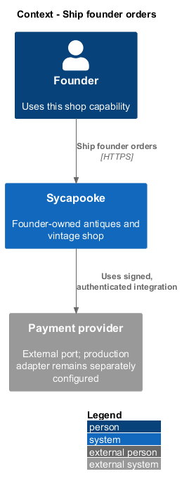
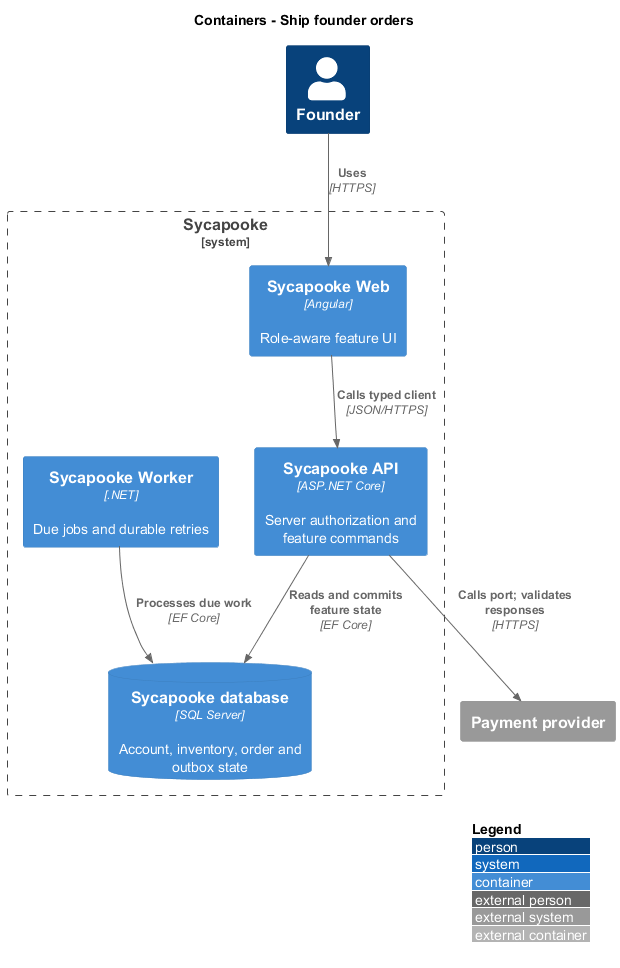
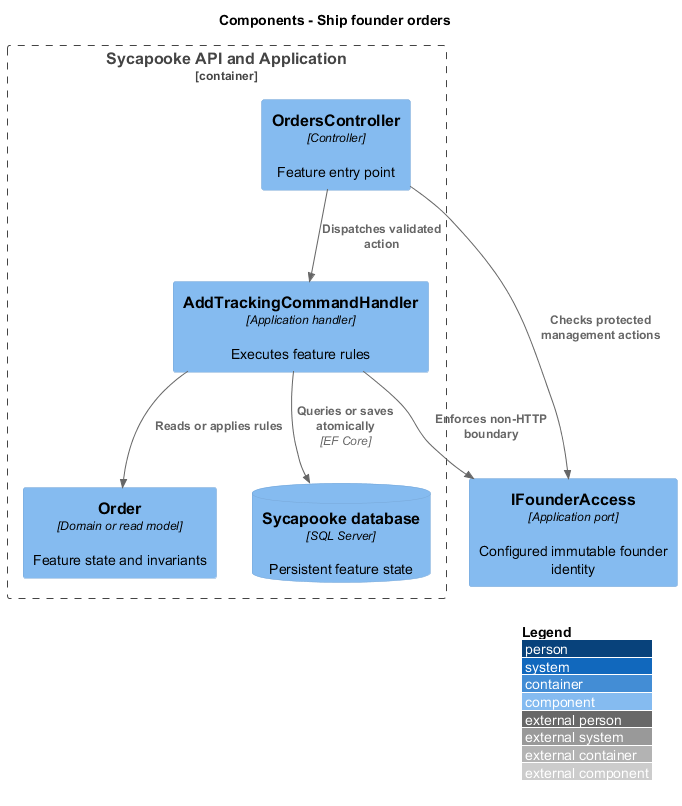
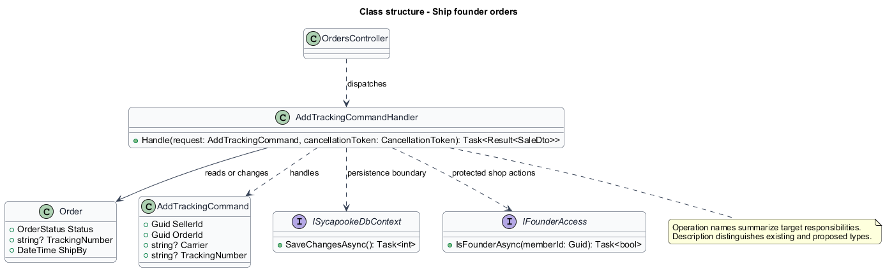
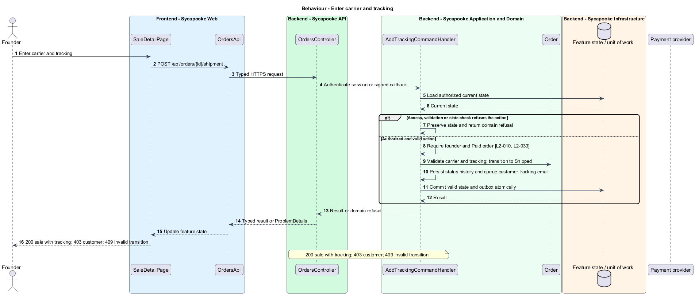
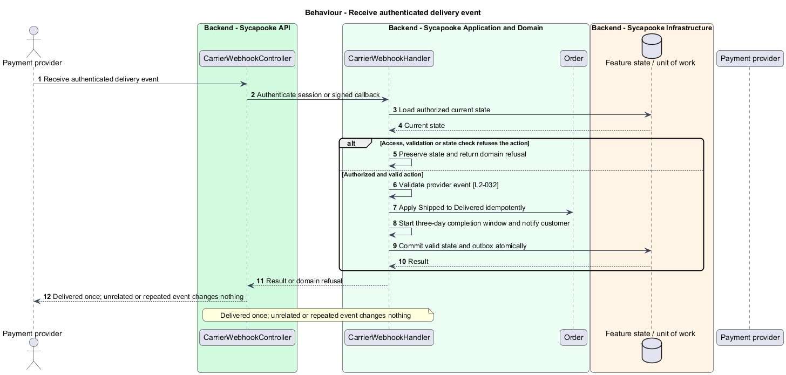
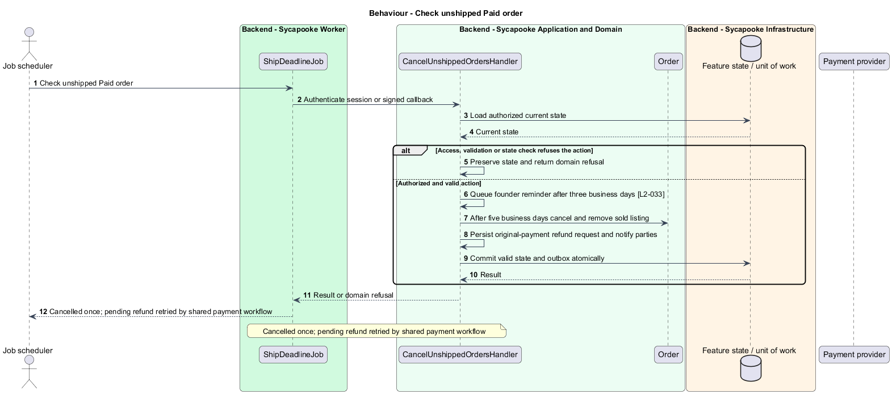

# Ship founder orders

## Overview

The founder fulfils paid orders and supplies tracking. Shipment deadlines provide reminders and a full-refund path for unshipped orders.

Sycapooke is the shop of one older Caribbean woman, its sole seller. Her jewelry, clothing, housewares and electronics are at least 20 years old. This design refines [ADR general/0010](../../../adr/general/0010-founder-only-shop.md). Existing names identify reusable code; Description identifies target additions.

## Description

### Fulfilment boundary

`SaleDetailPage`, `AddTrackingDialog`, `OrdersApi`, `OrdersController`, `Order` and `AddTrackingCommandHandler` remain. `GET /api/sales/{id}` and `POST /api/orders/{id}/shipment` require founder access in both controller and application handler. Customers use their own purchase view and cannot update tracking. The request retains `{ carrier, trackingNumber }`; the server validates carrier and tracking before applying Paid to Shipped.

The founder sees the customer's shipping address for fulfilment within the L2-037 window. Tracking confirmation updates the order history and queues the customer email. `CarrierWebhookController` retains its provider-authenticated delivery flow; customer input cannot impersonate a carrier. The carrier integration and production holiday calendar remain `<TO SUPPLY>` under existing decisions.

### Deadlines and shared state machine

`ShipReminders` and the existing deadline worker use the five-business-day ship deadline. After three business days they queue a founder reminder. At five business days without tracking, the cancellation path changes the order to Cancelled, removes it from sale, and requests one full refund using the original payment. Provider-confirmation handling follows checkout; no payout release is involved.

The shared state model allows Paid to Shipped or Cancelled, Shipped to Delivered, and Delivered to Completed when no problem remains. Founder support may complete a Shipped or Delivered problem without refund, or produce Refunded after provider confirmation. Every transition records time and actor. Invalid or repeated transitions return 409 without duplicating emails or refunds.

Tests exercise founder versus customer requests, address visibility at 30 and 31 days after order end, tracking validation, carrier callbacks, reminders, deadline cancellation and duplicate job execution.

### Implementation and verification boundary

Application code and HTML mocks still require alignment with the revised requirements. UI implementation first aligns mocks, design-system components and screen composition. Backend verification uses fake ports and in-memory substitutes. Browser verification uses the built Angular app and intercepted API responses. No external system runs in tests.

### Implementation evidence

Completed behavior evidence: `record-delivery` in `src/backend/Sycapooke.Application/Orders/ShipOrder.cs` and `tests/Sycapooke.Api.Tests/ShipOrderTests.cs`. 1 of 3 target behaviors are counted. Remaining target behavior and acceptance checks are not counted merely because older marketplace tests pass.

Effort in the matching estimate is the full target feature effort in developer-days, not remaining work. Completion counts whole verified behaviors and rounds to the nearest ten percent. Source and existing acceptance tests supply the evidence; this documentation refresh does not execute new target tests.

## Requirements

| L2 ID | Refines (L1) | Requirement |
| --- | --- | --- |
| `L2-010` | `L1-002` | Every API endpoint shall enforce the caller's permissions on the server. Customers shall change only their own private account and access only their own purchases, addresses and support submissions. Only the configured founder (L2-003) shall manage inventory, view shop sales, fulfil orders and resolve customer problems. There is no separate administrator decision-maker. Anonymous browsing and the public registration, verification, authentication, password-recovery and signed provider-callback flows remain available under their own validation rules. |
| `L2-032` | `L1-008` | An order shall move through the statuses Paid, Shipped, Delivered and Completed, or end as Cancelled or Refunded. Only the transitions in this requirement shall be allowed, and every transition shall be recorded with its time and the actor.  \| From \| To \| Triggered by \| \| --- \| --- \| --- \| \| Paid \| Shipped \| Founder adds tracking \| \| Paid \| Cancelled \| Founder cancels, or ship deadline passes \| \| Shipped \| Delivered \| Carrier reports delivery, or buyer confirms receipt \| \| Delivered \| Completed \| Buyer confirms receipt, or 3 days pass with no open problem \| \| Shipped, Delivered \| Completed \| Founder closes an open customer problem without a refund and supplies an explanation \| \| Shipped, Delivered \| Refunded \| Provider confirms a full refund authorized by the founder for a customer problem \| |
| `L2-033` | `L1-008` | The founder shall ship within 5 business days of payment and enter a carrier and tracking number. If no tracking is added in that time, the order shall be cancelled and the buyer fully refunded. The founder shall be able to see the buyer's shipping address for their order. |
| `L2-037` | `L1-008` | Customers shall have a private "Purchases" page listing only their own orders, newest first, with item, total, status and date. Only the founder shall have a "Sales" page listing the shop's orders with the buyer and sale detail. Customers shall have no sales page or sales API access. The customer may view their own order address; the founder may view it only for fulfilment until 30 days after the order ends. |

## Diagrams

### System context

The context identifies the founder and the systems used by this feature.

### Containers

The container view separates the delivery surface, application boundary and feature storage. External integrations remain behind their ports.

### Components

The component view connects `OrdersController` with `AddTrackingCommandHandler` and the relevant feature state.

### Class structure

The class view identifies the relevant fields, operation responsibilities and dependencies. It is a target responsibility model, not a claim that each addition already exists.

### Behaviour - Enter carrier and tracking

200 sale with tracking; 403 customer; 409 invalid transition. The sequence shows the boundary that enforces this outcome and the significant failure alternative.

### Behaviour - Receive authenticated delivery event

Delivered once; unrelated or repeated event changes nothing. The sequence shows the boundary that enforces this outcome and the significant failure alternative.

### Behaviour - Check unshipped Paid order

Cancelled once; pending refund retried by shared payment workflow. The sequence shows the boundary that enforces this outcome and the significant failure alternative.

