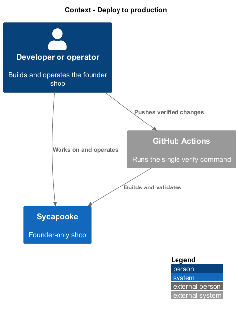
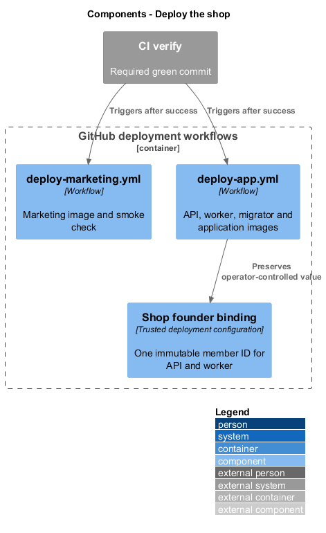
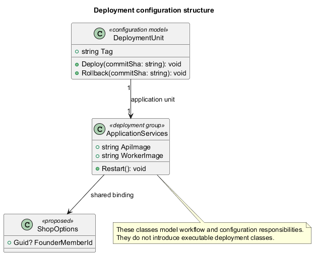

# Deploy to production

## Overview

Sycapooke is the founder's shop for antiques and vintage treasures jewelry, clothing, housewares and electronics, used by only a few members. This
feature, part of the `platform` subsystem, takes every push to `main` that passes CI live
with no manual step, on one low-cost Azure Linux VM running Docker Compose, Caddy and an
Azure SQL Basic database: the marketing site at `https://sycapooke.canadacentral.cloudapp.azure.com/welcome/` and the full
application at `https://sycapooke.canadacentral.cloudapp.azure.com`, each from its own image and its own workflow.
It mirrors 12L's pipeline (12L commits `dac2085` and `56e2df9`) and refines `L1-018` and
`L1-019` through `L2-084` to `L2-087` ([ADR platform/0012](../../../adr/platform/0012-low-cost-single-vm-continuous-deployment.md),
[ADR platform/0015](../../../adr/platform/0015-separate-marketing-and-application-deployments.md)).

Terms used below:

- **CI** — `.github/workflows/ci.yml`, whose `verify` job runs `npm run verify` (`L2-071`)
- **Deploy marketing** — `.github/workflows/deploy-marketing.yml`, which owns the
  `marketing` service and `MARKETING_TAG`
- **Deploy app** — `.github/workflows/deploy-app.yml`, which owns `api`, `worker`,
  `migrator`, `app` and `APP_TAG`
- **the edge** — the `edge` service: the official Caddy image with `deploy/edge/Caddyfile`,
  terminating TLS and routing by path
- **the VM** — the B1s or B1ms Ubuntu host built by `deploy/cloud-init.yaml`
- **the stack** — `deploy/docker-compose.yml` in `/opt/sycapooke` on the VM
- **deploy SHA** — the commit deployed: the `ref` input when run by hand, otherwise the
  CI run's `head_sha`

Who uses it: the owner, who merges to `main` and, rarely, rolls back one unit or the
other. It adds no API endpoint. The only application code it touches is the application
origin the marketing build uses for its links. Deliberately left out: staging, blue-green or
zero-downtime deploys, autoscaling, a second VM, Terraform or Bicep, and any load or
performance gate ([ADR general/0002](../../../adr/general/0002-no-load-or-scale-tests.md)).

## Description

This design targets the founder-only shop under [ADR general/0010](../../../adr/general/0010-founder-only-shop.md). Existing descriptions identify reusable parts, not evidence that revised acceptance criteria pass. The configured founder alone manages inventory, fulfilment and support; customers have private buying accounts.

### Trigger and gate (`L2-084`)

Both workflows run on `workflow_run` of `CI` (`types: [completed]`, `branches: [main]`)
and on `workflow_dispatch` with an optional `ref` input. The build job runs only when
the event is `workflow_dispatch`, or the CI run's `event` is `push` and its `conclusion`
is `success`, so a red CI run or a pull request run never deploys. Every job checks out
and tags with `DEPLOY_SHA = inputs.ref || github.event.workflow_run.head_sha || github.sha`.
Each workflow has its own concurrency group (`deploy-marketing`, `deploy-app`) with
`cancel-in-progress: false`: runs of one workflow queue, and the two workflows run side by
side (`L2-087`).

### Two builds (`L2-084`, `L2-085`, `L2-087`)

Deploy marketing builds `sycapooke-marketing` from `deploy/marketing/Dockerfile`
(`npm run build:marketing`, the `marketing` configuration, copied to `/srv/marketing` and
served by `deploy/marketing/Caddyfile`, which only serves files). Deploy app runs a
four-way matrix: `api`, `worker` and `migrator` from `deploy/backend.Dockerfile` and `app`
from `deploy/app/Dockerfile` (`npm run build:all`, the `production` configuration, copied
to `/srv/app` and served by `deploy/app/Caddyfile`, which proxies `/api/*` and `/photos/*`
to `api:8080`). Every build uses Buildx with the GitHub Actions cache (one scope per image)
and pushes `ghcr.io/quinntynebrown/sycapooke-{name}:{DEPLOY_SHA}` and `:latest`. In each
workflow the build job is the only one with `packages: write`.

### Two deploys (`L2-084`, `L2-085`, `L2-087`)

Each deploy job uses `environment: production` (`contents: read`, `packages: read`) and
shares the first three steps:

1. **SSH key** — under `umask 077` the key is written from an environment variable with
   `printf`, never `echo`; the host key is added with `ssh-keyscan`, as in 12L.
2. **Compose file and edge config** — `scp deploy/docker-compose.yml` to `/opt/sycapooke/`
   and `deploy/edge/Caddyfile` to `/opt/sycapooke/edge/`.
3. **Registry login** — the job token is piped over SSH to
   `docker login ghcr.io --password-stdin`; it never appears in the script text.

Then each runs one `bash -s` script under `set -euo pipefail` that rewrites `SITE_ADDRESS`
in `.env` from the Azure DNS name `SITE_HOST`, so no custom domain is needed. Each
script takes the shared `.deploy.lock` with `flock` and uses a run-specific Docker registry
configuration so concurrent workflow logins cannot interfere:

- **Deploy marketing** sets `MARKETING_TAG` in `.env`, `docker compose pull marketing edge`,
  `docker compose up -d --no-deps marketing edge`, prunes images older than 72 hours and
  logs out. It never writes `APP_TAG`, never names the migrator and never restarts `api`,
  `worker` or `app`. **Smoke test**: poll `https://$SITE_HOST/welcome/` 20 times, 6 seconds
  apart, until it answers 200 and contains "Sycapooke"; otherwise the run fails.
- **Deploy app** sets `APP_TAG` in `.env`, pulls `api worker migrator app edge`, runs
  `docker compose run --rm -T migrator < /dev/null` (without `-T` and `/dev/null` the
  migrator swallows the rest of the script and the restart never runs), then
  `docker compose up -d --no-deps api worker app edge`, prunes and logs out. A failed
  migration exits the script before `up -d`, so the old containers keep running. It never
  writes `MARKETING_TAG` and never restarts `marketing`. **Smoke tests**: poll
  `https://$SITE_HOST/api/health` 20 times, 6 seconds apart; no 200 fails the run; then
  the same for `https://$SITE_HOST/`. The health endpoint needs no database
  ([ADR platform/0004](../../../adr/platform/0004-health-check-without-database.md)).

`edge` is in both `up -d` lists so that a changed compose definition of the edge is applied
by either workflow; with nothing changed, `up -d --no-deps` leaves it running. A change to
`edge/Caddyfile` alone does not recreate the container and Caddy does not watch the file, so
both scripts end with `caddy reload` inside the edge container, which applies it gracefully.

### The edge and the application origin (`L2-087`)

`deploy/edge/Caddyfile` has one HTTPS site block for the Azure `SITE_ADDRESS`. It redirects
`/welcome` to `/welcome/`, strips that prefix with `handle_path /welcome/*` and proxies to
`marketing:80`; all other paths proxy to `app:80`. The marketing build uses base href
`/welcome/`. Only the app service proxies `/api` and `/photos` to the backend.

The marketing environment sets `appOrigin` to `https://sycapooke.canadacentral.cloudapp.azure.com`.
`provideAppOrigin` makes application links absolute, so Shop and search leave the marketing
base path and load the full application. In the application build the origin is empty,
so the same components use router links. See ADR platform/0016.

### Stack on a small VM (`L2-084`)

| Service | Memory limit | Notes |
|---------|-------------:|-------|
| `edge` (Caddy, official image) | 64 MB | Ports 80/443, Let's Encrypt for every host in `SITE_ADDRESS`; routes by path; `edge/Caddyfile` mounted read-only |
| `marketing` (Caddy) | 64 MB | `sycapooke-marketing:${MARKETING_TAG}`; `/srv/marketing`; `Cache-Control: no-cache` for `index.html` and SPA routes |
| `app` (Caddy) | 64 MB | `sycapooke-app:${APP_TAG}`; `/srv/app`; proxies `/api` and `/photos` to `api`; same `no-cache` rule; `depends_on: api` |
| `api` | 512 MB | `sycapooke-api:${APP_TAG}`; TCP health check on 8080; photos on the `photos` volume |
| `worker` | 384 MB | `sycapooke-worker:${APP_TAG}`; shares `photos` |
| `migrator` | 384 MB | `sycapooke-migrator:${APP_TAG}`; `profiles: [migrate]`, run once per app deploy |

The long-running services total just over 1 GB, which fits a 1 GB B1s with the 2 GB swap
file and is comfortable on a 2 GB B1ms. Every service logs through `json-file` with
`max-size: 10m` and `max-file: 3`. One replica each; no load balancer.

### Secrets (`L2-085`)

| Secret | Where |
|--------|-------|
| `DEPLOY_HOST`, `DEPLOY_SSH_KEY`, `SITE_HOST` | GitHub `production` environment, read by both workflows |
| Connection string, signing keys, `App__BaseUrl`, the Google client, `MARKETING_TAG`, `APP_TAG`, `SITE_ADDRESS` | `/opt/sycapooke/.env` on the VM (from `deploy/.env.example`) |

### Rollback (`L2-086`)

Run Deploy marketing or Deploy app by hand with `ref` set to an older full SHA: it rebuilds
that unit's images (mostly from cache), migrates (app only; a no-op when the schema is
already newer) and restarts that unit's services on that tag, leaving the other unit alone.
On the VM, setting `MARKETING_TAG=<sha>` or `APP_TAG=<sha>` in `.env` and running
`docker compose up -d --no-deps` for that unit's services does the same without CI.
Migrations are forward-only; going back past a breaking schema change needs a compatible
migration first.

### Tests (`tests/Sycapooke.Api.Tests/DeploymentPipelineTests.cs`)

The testing rules forbid Docker and a live database in tests, so the checks are static:
an xUnit test reads both workflows, `docker-compose.yml`, the three Caddyfiles and the two
web Dockerfiles from the repository and asserts, for each workflow, the trigger and gate,
the `workflow_dispatch` `ref` input and `DEPLOY_SHA`, the permissions, `umask 077`, no
`echo` of a secret, the `SITE_ADDRESS` line and the edge Caddyfile copy; that each workflow
writes only its own tag, restarts only its own services and has its own concurrency group;
the `-T migrator < /dev/null` line before `up -d` in the app workflow; the four smoke tests;
the memory limits and log rotation of all six services; the per-tag images; the two build
commands and output folders; the `no-cache` rule in both web Caddyfiles; and the edge's
path routing, trailing-slash redirect and the absence of `reverse_proxy` in the marketing Caddyfile
(`L2-084` to `L2-087`). `HealthEndpointTests` keeps covering `/api/health` without a database.

### Founder-only target boundary

Deployment supplies one `Shop:FounderMemberId` (`Shop__FounderMemberId` in the environment) to API and worker. Configuration changes require a controlled restart. Public requests cannot change the binding. Invalid or missing binding grants no management access. Payment credentials identify the shop merchant account. The demo CLI never provisions production or runs in deployment.

### Implementation evidence

Completed behavior evidence: `sequence-rollback` in `.github/workflows/deploy-app.yml` and `tests/Sycapooke.Api.Tests/DeploymentPipelineTests.cs`. 1 of 2 target behaviors are counted. Remaining target behavior and acceptance checks are not counted merely because older marketplace tests pass.

Effort in the matching estimate is the full target feature effort in developer-days, not remaining work. Completion counts whole verified behaviors and rounds to the nearest ten percent. Source and existing acceptance tests supply the evidence; this documentation refresh does not execute new target tests.

### Remaining implementation considerations

- The host key is trusted on first contact by `ssh-keyscan`, as in 12L. Pinning it in a
  `DEPLOY_HOST_KEY` secret would be stricter; deferred while the VM keeps its static IP.
- `L2-066` asks for failover between API instances; one VM cannot give it. Accepted for a
  few users by ADR platform/0012.
- Both workflows share one VM and the edge. Remote mutations use a shared file lock.
  Configuration copies for the same commit have identical content.
- `actionlint` was not available where this was built; the workflows are checked by the
  static test, a YAML parse and by GitHub on push.

## Requirements

| L2 ID | Refines (L1) | Requirement |
| --- | --- | --- |
| `L2-052` | `L1-013` | Passwords shall be stored only as salted hashes using Argon2id or PBKDF2-HMAC-SHA512 with at least 210,000 iterations. Secrets (connection strings, API keys, signing keys) shall not be stored in source control and shall be loaded from a secret store at runtime. |
| `L2-060` | `L1-015` | The API shall be stateless so service processes can be replaced without losing account, order or reservation state. Sessions, rate limits and reservations shall work across instances. |
| `L2-070` | `L1-018` | The API shall expose a liveness endpoint (`/health/live`) and a readiness endpoint (`/health/ready`). Readiness shall report unhealthy when the database or photo storage cannot be reached. Health endpoints shall not reveal version numbers or internal hostnames. |
| `L2-071` | `L1-019` | One command, run from a fresh clone, shall restore, build, lint and test the backend solution (`src/backend`) and the frontend workspace (`src/frontend`), and shall fail when any step fails. The API shall answer `GET /api/health` with HTTP 200 without a database or any other external dependency. The frontend command shall build every library and the application. The same command shall pass on Windows and on Linux CI. Statelessness is checked by the architecture test of L2-060; breakpoints follow L2-061; the shell's accessibility follows L2-064 and L2-065; dependency scanning (L2-053) is not part of this command. |
| `L2-084` | `L1-018` | Every push to `main` shall be deployed to production with no manual step, and only after the `CI` workflow's `verify` job for that commit has passed (`L2-071`). Two workflows shall deploy it independently (`L2-087`): `deploy-marketing.yml` shall build and push the `sycapooke-marketing` image and `deploy-app.yml` shall build and push the `sycapooke-api`, `sycapooke-worker`, `sycapooke-migrator` and `sycapooke-app` images, each tagged with the commit SHA. The application deploy shall apply database migrations before its services restart and then poll `https://<SITE_HOST>/api/health` (`L2-070`) and `https://<SITE_HOST>/`; the marketing deploy shall poll `https://<SITE_HOST>/welcome/`. Runs of the same workflow shall never overlap. The stack shall fit one small Linux VM (1 to 2 GB RAM with a 2 GB swap file): one instance of each service (`edge`, `marketing`, `app`, `api`, `worker` and the one-off `migrator`), a memory limit and rotated logs per service, and old images pruned. `index.html` and SPA routes of both web services shall be served with `Cache-Control: no-cache`. |
| `L2-085` | `L1-013` | Deployment secrets (`DEPLOY_HOST`, `DEPLOY_SSH_KEY`, `SITE_HOST`) shall be stored only in the GitHub `production` environment and shared by both deploy workflows, and application secrets only in `/opt/sycapooke/.env` on the VM; neither shall be committed or printed to a log. Each workflow job shall hold the least `permissions` it needs; in each workflow only the image build job may write packages. The SSH private key shall be written with mode 600 under `umask 077`. |
| `L2-086` | `L1-018` | An operator shall be able to return the marketing site or the application to any earlier commit that passed CI, independently of the other, by running that unit's deploy workflow by hand with the commit's SHA, or by setting `MARKETING_TAG` or `APP_TAG` in `/opt/sycapooke/.env` and running `docker compose up -d --no-deps` for that unit's services on the VM. Both paths shall be documented in `docs/deployment.md`. |
| `L2-087` | `L1-018` | The marketing site at `https://<SITE_HOST>/welcome/` and the full application at `https://<SITE_HOST>/` shall be separate images and deploy workflows on the same Azure VM. `SITE_HOST` shall be the Azure public IP DNS name; publishing shall require no custom domain or registrar access (ADR platform/0016). The edge shall terminate HTTPS for that name, redirect `/welcome` to `/welcome/`, strip `/welcome/` before proxying marketing requests, and proxy all other requests to the application service. Only the application service shall proxy `/api/*` and `/photos/*` to the API. The marketing build shall use base href `/welcome/` and absolute application links to the Azure origin. Each workflow shall move only its own image tag and restart only its own services. Shared VM mutations shall be serialized and registry credentials isolated per run. |

## Diagrams

### Containers

The view shows the feature boundary and the behavior described in this design.

### Behaviour — deploy on push

The view shows the feature boundary and the behavior described in this design.

### Behaviour — rollback

The view shows the feature boundary and the behavior described in this design.

### System context

The system context view makes the feature boundary and its dependencies explicit. The structure represents the target responsibilities described in this feature.

### Components

The components view makes the feature boundary and its dependencies explicit. The structure represents the target responsibilities described in this feature.

### Class structure

The class structure view makes the feature boundary and its dependencies explicit. The structure represents the target responsibilities described in this feature.

