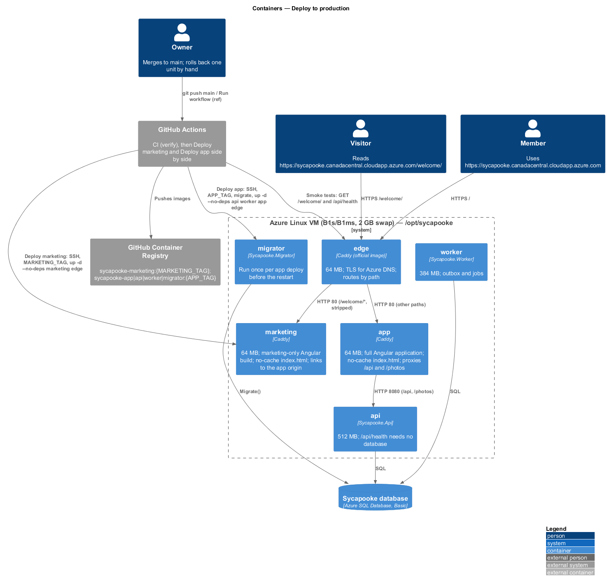
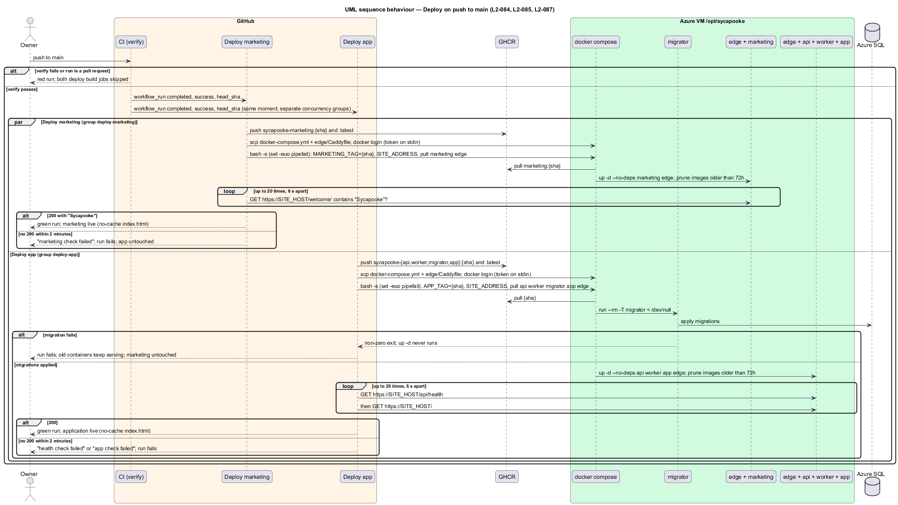
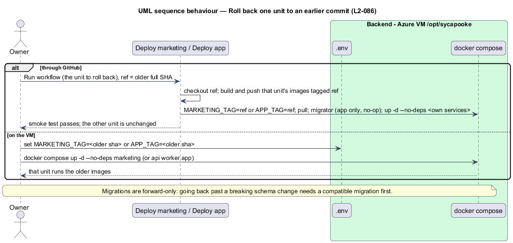

# Deploy to production

## Overview

Sycapooke is a marketplace made only for vintage jewelry, clothing, housewares and electronics, used by only a few members. This
feature, part of the `platform` subsystem, takes every push to `main` that passes CI live
with no manual step, on one low-cost Azure Linux VM running Docker Compose, Caddy and an
Azure SQL Basic database: the marketing site at `https://sycapooke.canadacentral.cloudapp.azure.com/welcome/` and the full
application at `https://sycapooke.canadacentral.cloudapp.azure.com`, each from its own image and its own workflow.
It mirrors 12L's pipeline (12L commits `dac2085` and `56e2df9`) and refines `L1-018` and
`L1-019` through `L2-084` to `L2-087` ([ADR platform/0012](../../../adr/platform/0012-low-cost-single-vm-continuous-deployment.md),
[ADR platform/0015](../../../adr/platform/0015-separate-marketing-and-application-deployments.md)).

Terms used below:

- **CI** — `.github/workflows/ci.yml`, whose `verify` job runs `npm run verify` (`L2-071`)
- **Deploy marketing** — `.github/workflows/deploy-marketing.yml`, which owns the
  `marketing` service and `MARKETING_TAG`
- **Deploy app** — `.github/workflows/deploy-app.yml`, which owns `api`, `worker`,
  `migrator`, `app` and `APP_TAG`
- **the edge** — the `edge` service: the official Caddy image with `deploy/edge/Caddyfile`,
  terminating TLS and routing by path
- **the VM** — the B1s or B1ms Ubuntu host built by `deploy/cloud-init.yaml`
- **the stack** — `deploy/docker-compose.yml` in `/opt/sycapooke` on the VM
- **deploy SHA** — the commit deployed: the `ref` input when run by hand, otherwise the
  CI run's `head_sha`

Who uses it: the owner, who merges to `main` and, rarely, rolls back one unit or the
other. It adds no API endpoint. The only application code it touches is the application
origin the marketing build uses for its links. Deliberately left out: staging, blue-green or
zero-downtime deploys, autoscaling, a second VM, Terraform or Bicep, and any load or
performance gate ([ADR general/0002](../../../adr/general/0002-no-load-or-scale-tests.md)).

## Description

### Trigger and gate (`L2-084`)

Both workflows run on `workflow_run` of `CI` (`types: [completed]`, `branches: [main]`)
and on `workflow_dispatch` with an optional `ref` input. The build job runs only when
the event is `workflow_dispatch`, or the CI run's `event` is `push` and its `conclusion`
is `success`, so a red CI run or a pull request run never deploys. Every job checks out
and tags with `DEPLOY_SHA = inputs.ref || github.event.workflow_run.head_sha || github.sha`.
Each workflow has its own concurrency group (`deploy-marketing`, `deploy-app`) with
`cancel-in-progress: false`: runs of one workflow queue, and the two workflows run side by
side (`L2-087`).

### Two builds (`L2-084`, `L2-085`, `L2-087`)

Deploy marketing builds `sycapooke-marketing` from `deploy/marketing/Dockerfile`
(`npm run build:marketing`, the `marketing` configuration, copied to `/srv/marketing` and
served by `deploy/marketing/Caddyfile`, which only serves files). Deploy app runs a
four-way matrix: `api`, `worker` and `migrator` from `deploy/backend.Dockerfile` and `app`
from `deploy/app/Dockerfile` (`npm run build:all`, the `production` configuration, copied
to `/srv/app` and served by `deploy/app/Caddyfile`, which proxies `/api/*` and `/photos/*`
to `api:8080`). Every build uses Buildx with the GitHub Actions cache (one scope per image)
and pushes `ghcr.io/quinntynebrown/sycapooke-{name}:{DEPLOY_SHA}` and `:latest`. In each
workflow the build job is the only one with `packages: write`.

### Two deploys (`L2-084`, `L2-085`, `L2-087`)

Each deploy job uses `environment: production` (`contents: read`, `packages: read`) and
shares the first three steps:

1. **SSH key** — under `umask 077` the key is written from an environment variable with
   `printf`, never `echo`; the host key is added with `ssh-keyscan`, as in 12L.
2. **Compose file and edge config** — `scp deploy/docker-compose.yml` to `/opt/sycapooke/`
   and `deploy/edge/Caddyfile` to `/opt/sycapooke/edge/`.
3. **Registry login** — the job token is piped over SSH to
   `docker login ghcr.io --password-stdin`; it never appears in the script text.

Then each runs one `bash -s` script under `set -euo pipefail` that rewrites `SITE_ADDRESS`
in `.env` from the Azure DNS name `SITE_HOST`, so no custom domain is needed. Each
script takes the shared `.deploy.lock` with `flock` and uses a run-specific Docker registry
configuration so concurrent workflow logins cannot interfere:

- **Deploy marketing** sets `MARKETING_TAG` in `.env`, `docker compose pull marketing edge`,
  `docker compose up -d --no-deps marketing edge`, prunes images older than 72 hours and
  logs out. It never writes `APP_TAG`, never names the migrator and never restarts `api`,
  `worker` or `app`. **Smoke test**: poll `https://$SITE_HOST/welcome/` 20 times, 6 seconds
  apart, until it answers 200 and contains "Sycapooke"; otherwise the run fails.
- **Deploy app** sets `APP_TAG` in `.env`, pulls `api worker migrator app edge`, runs
  `docker compose run --rm -T migrator < /dev/null` (without `-T` and `/dev/null` the
  migrator swallows the rest of the script and the restart never runs), then
  `docker compose up -d --no-deps api worker app edge`, prunes and logs out. A failed
  migration exits the script before `up -d`, so the old containers keep running. It never
  writes `MARKETING_TAG` and never restarts `marketing`. **Smoke tests**: poll
  `https://$SITE_HOST/api/health` 20 times, 6 seconds apart; no 200 fails the run; then
  the same for `https://$SITE_HOST/`. The health endpoint needs no database
  ([ADR platform/0004](../../../adr/platform/0004-health-check-without-database.md)).

`edge` is in both `up -d` lists so that a changed compose definition of the edge is applied
by either workflow; with nothing changed, `up -d --no-deps` leaves it running. A change to
`edge/Caddyfile` alone does not recreate the container and Caddy does not watch the file, so
both scripts end with `caddy reload` inside the edge container, which applies it gracefully.

### The edge and the application origin (`L2-087`)

`deploy/edge/Caddyfile` has one HTTPS site block for the Azure `SITE_ADDRESS`. It redirects
`/welcome` to `/welcome/`, strips that prefix with `handle_path /welcome/*` and proxies to
`marketing:80`; all other paths proxy to `app:80`. The marketing build uses base href
`/welcome/`. Only the app service proxies `/api` and `/photos` to the backend.

The marketing environment sets `appOrigin` to `https://sycapooke.canadacentral.cloudapp.azure.com`.
`provideAppOrigin` makes application links absolute, so Shop and search leave the marketing
base path and load the full application. In the application build the origin is empty,
so the same components use router links. See ADR platform/0016.

### Stack on a small VM (`L2-084`)

| Service | Memory limit | Notes |
|---------|-------------:|-------|
| `edge` (Caddy, official image) | 64 MB | Ports 80/443, Let's Encrypt for every host in `SITE_ADDRESS`; routes by path; `edge/Caddyfile` mounted read-only |
| `marketing` (Caddy) | 64 MB | `sycapooke-marketing:${MARKETING_TAG}`; `/srv/marketing`; `Cache-Control: no-cache` for `index.html` and SPA routes |
| `app` (Caddy) | 64 MB | `sycapooke-app:${APP_TAG}`; `/srv/app`; proxies `/api` and `/photos` to `api`; same `no-cache` rule; `depends_on: api` |
| `api` | 512 MB | `sycapooke-api:${APP_TAG}`; TCP health check on 8080; photos on the `photos` volume |
| `worker` | 384 MB | `sycapooke-worker:${APP_TAG}`; shares `photos` |
| `migrator` | 384 MB | `sycapooke-migrator:${APP_TAG}`; `profiles: [migrate]`, run once per app deploy |

The long-running services total just over 1 GB, which fits a 1 GB B1s with the 2 GB swap
file and is comfortable on a 2 GB B1ms. Every service logs through `json-file` with
`max-size: 10m` and `max-file: 3`. One replica each; no load balancer.

### Secrets (`L2-085`)

| Secret | Where |
|--------|-------|
| `DEPLOY_HOST`, `DEPLOY_SSH_KEY`, `SITE_HOST` | GitHub `production` environment, read by both workflows |
| Connection string, signing keys, `App__BaseUrl`, the Google client, `MARKETING_TAG`, `APP_TAG`, `SITE_ADDRESS` | `/opt/sycapooke/.env` on the VM (from `deploy/.env.example`) |

### Rollback (`L2-086`)

Run Deploy marketing or Deploy app by hand with `ref` set to an older full SHA: it rebuilds
that unit's images (mostly from cache), migrates (app only; a no-op when the schema is
already newer) and restarts that unit's services on that tag, leaving the other unit alone.
On the VM, setting `MARKETING_TAG=<sha>` or `APP_TAG=<sha>` in `.env` and running
`docker compose up -d --no-deps` for that unit's services does the same without CI.
Migrations are forward-only; going back past a breaking schema change needs a compatible
migration first.

### Tests (`tests/Sycapooke.Api.Tests/DeploymentPipelineTests.cs`)

The testing rules forbid Docker and a live database in tests, so the checks are static:
an xUnit test reads both workflows, `docker-compose.yml`, the three Caddyfiles and the two
web Dockerfiles from the repository and asserts, for each workflow, the trigger and gate,
the `workflow_dispatch` `ref` input and `DEPLOY_SHA`, the permissions, `umask 077`, no
`echo` of a secret, the `SITE_ADDRESS` line and the edge Caddyfile copy; that each workflow
writes only its own tag, restarts only its own services and has its own concurrency group;
the `-T migrator < /dev/null` line before `up -d` in the app workflow; the four smoke tests;
the memory limits and log rotation of all six services; the per-tag images; the two build
commands and output folders; the `no-cache` rule in both web Caddyfiles; and the edge's
path routing, trailing-slash redirect and the absence of `reverse_proxy` in the marketing Caddyfile
(`L2-084` to `L2-087`). `HealthEndpointTests` keeps covering `/api/health` without a database.

## Requirements

| L2 ID | Refines (L1) | Requirement |
|-------|--------------|-------------|
| `L2-084` | `L1-018`, `L1-019` | Deploy every green push to `main` through both workflows; migrate before the application restart; health and page checks fail the run; small-VM limits for all six services; `no-cache` entry page. |
| `L2-085` | `L1-013`, `L1-018` | Secrets only in the `production` environment and the VM `.env`; least permissions in each workflow. |
| `L2-086` | `L1-018` | Roll back either unit by redeploying an older SHA or setting `MARKETING_TAG` or `APP_TAG`. |
| `L2-087` | `L1-018`, `L1-019` | Separate marketing and application images, workflows and tags; the edge routes by path; `SITE_ADDRESS` is the Azure DNS name; the marketing build links to the application origin. |

Related requirements applied without restating them: `L2-052` (secrets), `L2-060`
(stateless API), `L2-070` (health checks), `L2-071` (verify command).

## Diagrams

### Containers

### Behaviour — deploy on push

### Behaviour — rollback

## Open questions

- The host key is trusted on first contact by `ssh-keyscan`, as in 12L. Pinning it in a
  `DEPLOY_HOST_KEY` secret would be stricter; deferred while the VM keeps its static IP.
- `L2-066` asks for failover between API instances; one VM cannot give it. Accepted for a
  few users by ADR platform/0012.
- Both workflows share one VM and the edge. Remote mutations use a shared file lock.
  Configuration copies for the same commit have identical content.
- `actionlint` was not available where this was built; the workflows are checked by the
  static test, a YAML parse and by GitHub on push.
