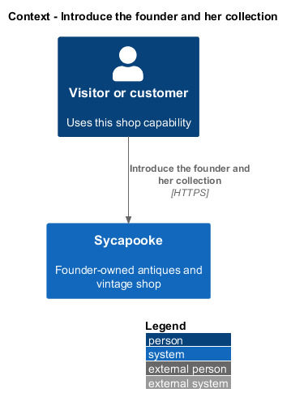
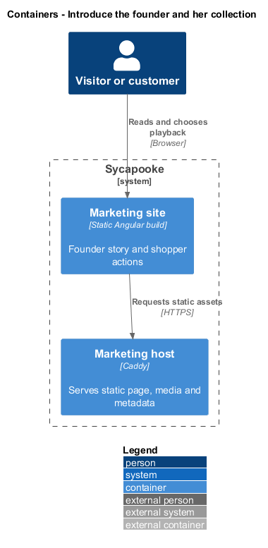
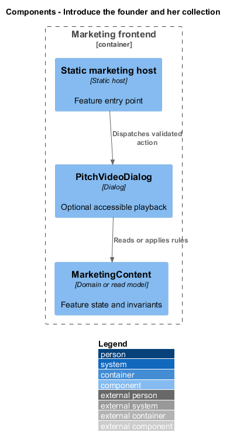
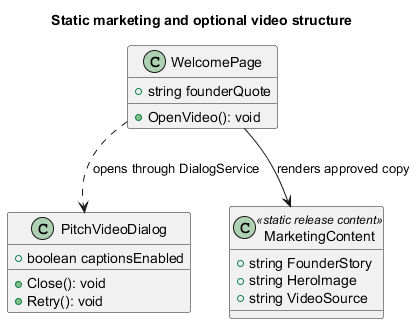
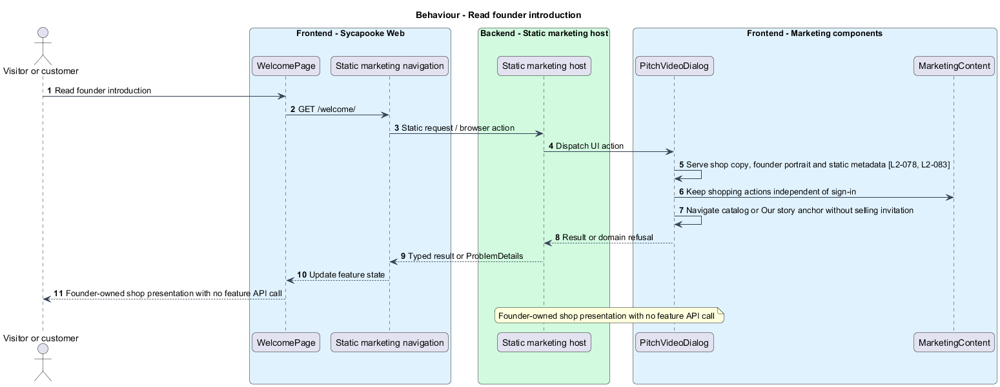
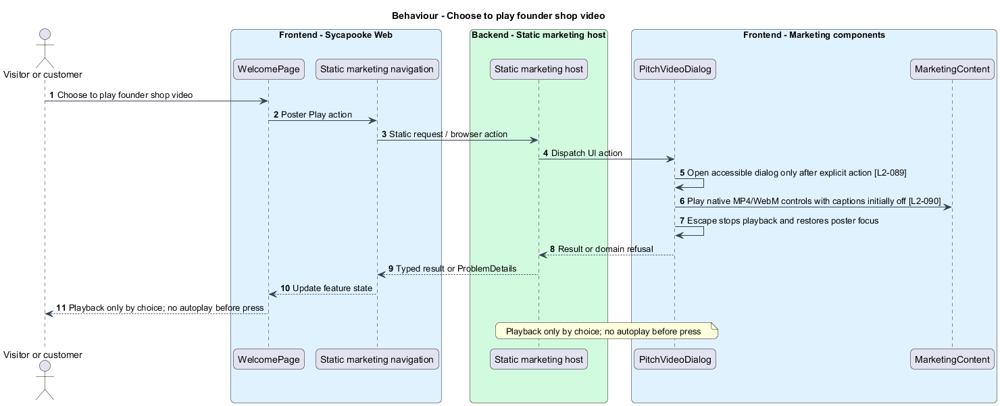
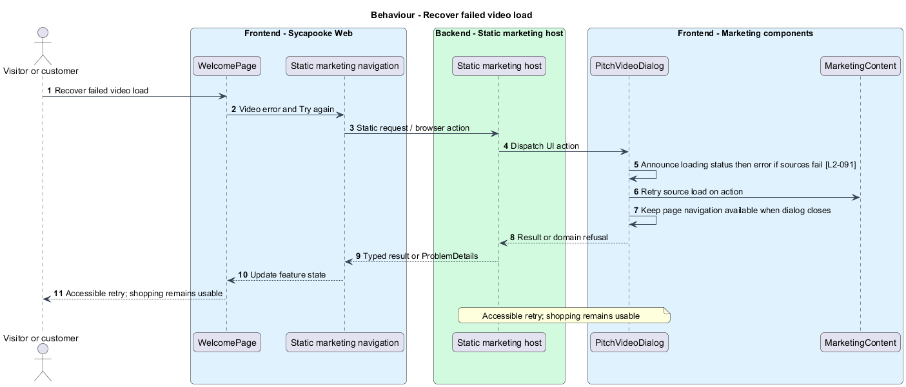

# Introduce the founder and her collection

## Overview

The public introduction presents the older Caribbean founder and her own collection. Static content and an optional pitch video invite shopping.

Sycapooke is the shop of one older Caribbean woman, its sole seller. Her jewelry, clothing, housewares and electronics are at least 20 years old. This design refines [ADR general/0010](../../../adr/general/0010-founder-only-shop.md). Existing names identify reusable code; Description identifies target additions.

## Description

### Existing composition and target copy

`WelcomePage` in `@sycapooke/marketing` and `PitchVideoDialog` remain. The page composes `sy-marketing-hero`, `sy-feature-band`, `sy-steps`, `sy-quote`, `sy-video-poster` and `sy-video-player`. Heirloom tokens supply all appearance. The marketing feature calls no Sycapooke API. Shared shell authentication does not change its public shopping actions.

The exact hero, bands, founder attribution, steps and actions are specified by L2-078 in the Requirements table. Shop the collection and Browse the collection lead to the catalog; Meet the founder uses the `Our story` anchor. The terracotta band introduces her own collection instead of recruiting sellers. The portrait and text introduce an older Caribbean woman, with no invented precise age or family history. The shell omits the obsolete payout banner and offers founder management only from the server-derived capability.

### Static media and accessibility

The hero photo remains the video poster. Its Play button opens the shared dialog; no sound or video plays before that action. MP4 and WebM sources stay between 26 and 30 seconds. Captions are English WebVTT, off initially. Keyboard controls, Escape, focus return, spinner, error alert and Try again remain. The revised video story and captions describe shopping from the founder. Media regeneration is separate implementation work, not an output of this design refresh.

The founder story shown here is approved static release content; public story editing updates the dynamic collection page and does not silently introduce API fetching to marketing. Served metadata uses L2-083 shop wording and the existing 1200 by 630 share image. Image licences remain in the media attribution file.

Tests route navigation and authentication with fakes, verify the absence of selling invitations and assert keyboard/video failure states. A 320-pixel viewport has no horizontal scroll. Mocks and screen-composition entries require later alignment before frontend implementation.

### Implementation and verification boundary

Application code and HTML mocks still require alignment with the revised requirements. UI implementation first aligns mocks, design-system components and screen composition. Backend verification uses fake ports and in-memory substitutes. Browser verification uses the built Angular app and intercepted API responses. No external system runs in tests.

### Implementation evidence

Completed behavior evidence: `retry-video` in `src/frontend/projects/marketing/src/lib/welcome/pitch-video-dialog.ts` and `src/frontend/e2e/tests/marketing-page.spec.ts`. 1 of 3 target behaviors are counted. Remaining target behavior and acceptance checks are not counted merely because older marketplace tests pass.

Effort in the matching estimate is the full target feature effort in developer-days, not remaining work. Completion counts whole verified behaviors and rounds to the nearest ten percent. Source and existing acceptance tests supply the evidence; this documentation refresh does not execute new target tests.

## Requirements

| L2 ID | Refines (L1) | Requirement |
| --- | --- | --- |
| `L2-078` | `L1-020` | `/welcome` shall render a public shop introduction for signed-in and signed-out visitors without making Sycapooke API calls of its own. Keep the Heirloom flat bands, hero photograph `/media/sycapooke-hero.jpg` and founder photograph `/media/sycapooke-founder.jpg`. The hero shall use the eyebrow "Jewelry · Clothing · Housewares · Electronics", h1 "A home for the things that mattered.", supporting line "Antiques and vintage treasures from one Caribbean woman's own collection. Every piece is at least 20 years old.", and actions "Shop the collection" to `/` and "Meet the founder" to `#our-story`.  The shopper band shall say "Every piece is at least 20 years old." with the points "Four focused categories", "From the founder's own collection" and "Honest condition". Replace the seller-recruitment band with "From my collection" and "Treasures I have kept, ready for their next home.". How it works shall describe buying in three steps: "Find a treasure", "Pay securely", "Receive its story". The Our story band shall have the anchor `our-story`, introduce the founder as an older Caribbean woman and the sole seller, show her portrait and founder-approved story, and attribute her words to "Founder of Sycapooke". It shall not invent a precise age, family history or biography. The closing band shall read "Treasures with a story." and "Explore her collection. Every piece is at least 20 years old.", with "Browse the collection" to `/`.  Public copy shall use a warm, respectful voice and invite customers to shop, without public selling invitations or unsupported promises of daily new inventory. Navigation shall show shop-management links only to the configured founder under L2-003 and L2-010; customer sign-in shall never turn a shopping call to action into a selling action. `/` shall remain the catalog. The marketing wording in this requirement supersedes the inherited seller-recruitment wording under ADR general/0010. |
| `L2-079` | `L1-020` | The footer shall have an "About Sycapooke" link to `/welcome` on every page with the app or marketing shell. Navigation shall follow L2-003 and L2-010 so public visitors and customers see no selling or management links. |
| `L2-083` | `L1-020` | The page shall meet `L2-064` and `L2-065` and in addition: every band is one flat colour (paper, cream, terracotta or ink, as on the landing page) with no gradient and no decorative shape, and text on it keeps a contrast of 4.5:1 or more (3:1 for display text); headings go h1, h2, h3 without skipping; the founder photograph carries descriptive alternative text while the hero photograph, as the video poster, is decorative (`alt=""`) because its button is named "Play"; nothing decorative is animated, so `prefers-reduced-motion: reduce` has nothing to stop beyond the shared transitions; the document title is "Treasures with a story · Sycapooke" and the meta description is "Shop the founder's own antiques and vintage treasures: jewelry, clothing, housewares and electronics, every piece at least 20 years old, with a story to share.". The description and link-preview tags (Open Graph `og:title` "Sycapooke · Treasures with a story", `og:description`, `og:type`, `og:url`, `og:image` with its width, height and alt, and the `summary_large_image` Twitter card) are in the served HTML, not added by script, so a link shared in a chat or social post shows the 1200×630 share image `/media/sycapooke-share.jpg`. |
| `L2-089` | `L1-020` | The hero photograph of `/welcome` shall be the pitch video's poster: one button, named "Play", drawn as a cream pill reading "Play · 0:29" over the photograph in the same 4:5 frame, and the page shall never play video or sound before the visitor presses it. Pressing it opens a dialog with no visible heading (its accessible name is "Sycapooke video"), which plays the video with native controls and a Play/Pause button that works by keyboard, and returns focus to the poster when it closes. The video is MP4 (H.264/AAC) with a WebM (VP9/Opus) fallback at `/media/sycapooke-pitch.mp4` and `/media/sycapooke-pitch.webm`, 26 to 30 seconds long, built from `docs/mocks/_build/video/` with its narration and music credited in `public/media/ATTRIBUTION.md` ([ADR platform/0014](../../../adr/platform/0014-pitch-video.md)). |
| `L2-090` | `L1-020` | The video shall have English WebVTT captions at `/media/sycapooke-pitch.vtt`. By default no captions show; the Captions toggle (`aria-pressed`) turns them on. There is no transcript. |
| `L2-091` | `L1-020` | While the video loads, the dialog shall show a spinner over the poster. When the video cannot load, the dialog shall show "The video didn’t load" with "Check your connection and try again." and a Try again button, and the rest of the page shall keep working once the dialog is closed. |

## Diagrams

### System context

The context identifies the visitor or customer and the systems used by this feature.

### Containers

The container view separates the delivery surface, application boundary and feature storage. External integrations remain behind their ports.

### Components

The component view connects `Static marketing host` with `PitchVideoDialog` and the relevant feature state.

### Class structure

The class view identifies the relevant fields, operation responsibilities and dependencies. It is a target responsibility model, not a claim that each addition already exists.

### Behaviour - Read founder introduction

Founder-owned shop presentation with no feature API call. The sequence shows the boundary that enforces this outcome and the significant failure alternative.

### Behaviour - Choose to play founder shop video

Playback only by choice; no autoplay before press. The sequence shows the boundary that enforces this outcome and the significant failure alternative.

### Behaviour - Recover failed video load

Accessible retry; shopping remains usable. The sequence shows the boundary that enforces this outcome and the significant failure alternative.

