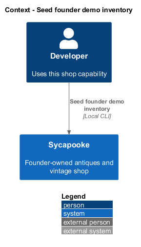
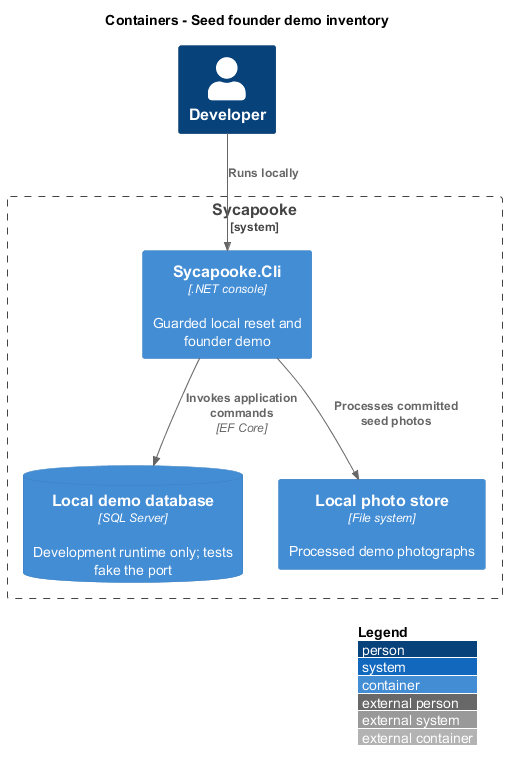
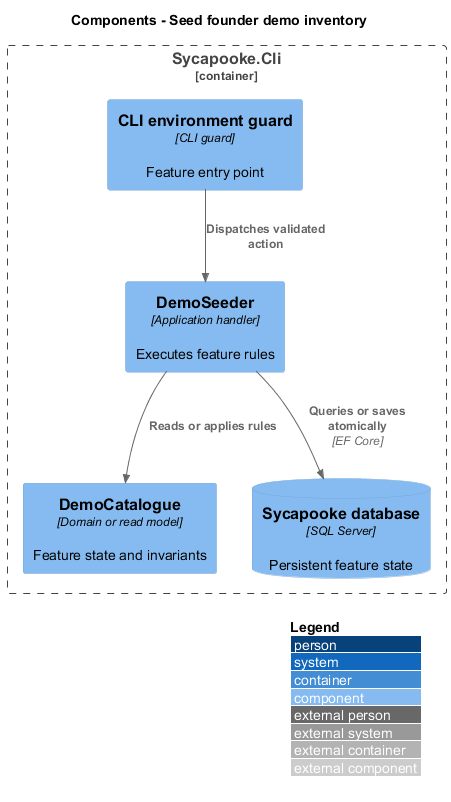
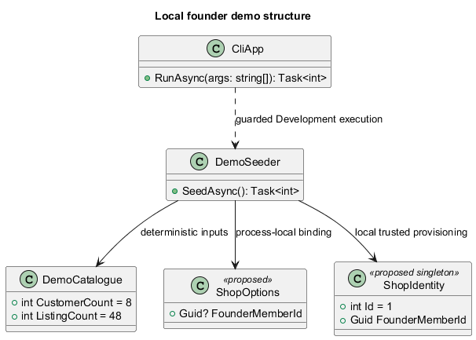
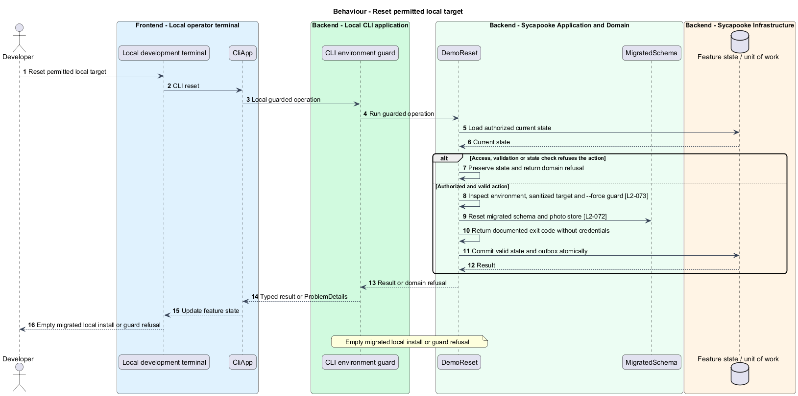
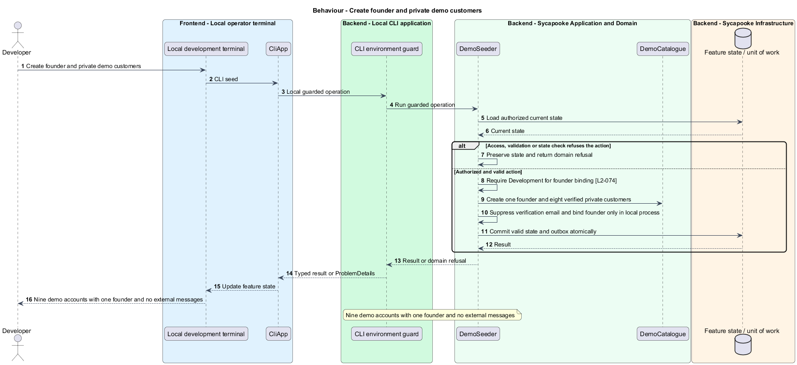
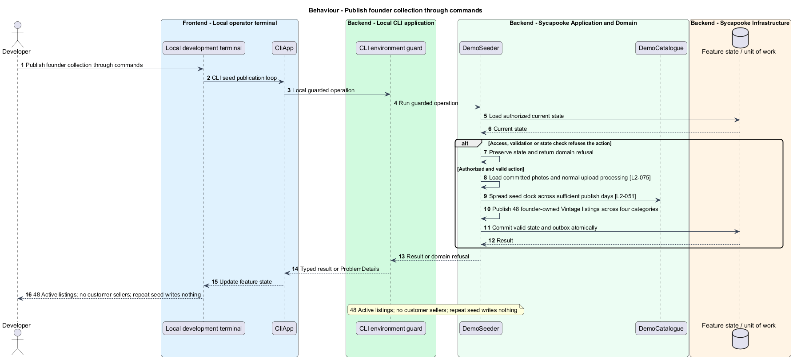

# Seed founder demo inventory

## Overview

The local CLI produces a repeatable founder shop demonstration. One founder owns every treasure and eight private customers demonstrate shopping.

Sycapooke is the shop of one older Caribbean woman, its sole seller. Her jewelry, clothing, housewares and electronics are at least 20 years old. This design refines [ADR general/0010](../../../adr/general/0010-founder-only-shop.md). Existing names identify reusable code; Description identifies target additions.

## Description

### Existing developer tool

`Sycapooke.Cli`, `CliApp`, `CliArguments`, `ResetGuard`, `DemoReset`, `DemoSeeder`, `DemoCatalogue` and the seed clock remain. The tool supports reset, seed and seed --reset for local development. Existing reset guards, sanitized target preview, documented exit codes and idempotent no-op on an existing demo set remain. It is never run by deployment or CI against a database.

### Target account set and local founder binding

`DemoCatalogue` defines one founder and eight private customers, each with a verified reserved `.test` email and the documented local-only password. Customer accounts use registration and verification commands with email dispatch suppressed. The founder uses the trusted operator binding through process-local `ShopOptions` and the local singleton `ShopIdentity`. This local override cannot rewrite production configuration and is refused outside Development, even when the reset-only --force flag is supplied.

### Inventory and publish clock

Seed 48 Active founder listings, twelve in each of the existing four categories, with 1 to 4 committed category photographs. All inventory belongs to the founder; no customer owns listings or has a public page. The founder public rating remains No reviews yet. No real payment account or order is created.

Draft, upload and publication commands enforce the same founder, Vintage, condition, photo and price rules as the application. The seed clock spaces publication across enough UTC days to respect `Selling:PublishesPerDay`, including one listing per day. A fixed thirty-day window no longer distributes inventory between multiple sellers or bypasses the limit.

Reset completes before founder provisioning. A second seed returns exit 0 without mutations; seed --reset reproduces the same identities, titles, categories, prices and photographs. Tests use in-memory database substitutes and fake ports, not a real database, Redis or payment provider.

### Implementation and verification boundary

Application code and HTML mocks still require alignment with the revised requirements. UI implementation first aligns mocks, design-system components and screen composition. Backend verification uses fake ports and in-memory substitutes. Browser verification uses the built Angular app and intercepted API responses. No external system runs in tests.

### Implementation evidence

Completed behavior evidence: `reset-local-demo` in `src/backend/Sycapooke.Cli/DemoReset.cs` and `tests/Sycapooke.Cli.Tests/ResetTests.cs`. 1 of 3 target behaviors are counted. Remaining target behavior and acceptance checks are not counted merely because older marketplace tests pass.

Effort in the matching estimate is the full target feature effort in developer-days, not remaining work. Completion counts whole verified behaviors and rounds to the nearest ten percent. Source and existing acceptance tests supply the evidence; this documentation refresh does not execute new target tests.

## Requirements

| L2 ID | Refines (L1) | Requirement |
| --- | --- | --- |
| `L2-003` | `L1-001` | Public registration shall create customer accounts only. A trusted operator shall provision one founder account through a protected deployment or operator process outside public registration. The server shall bind management access to that account's immutable identity, never a display name, email supplied by the client or Google claim. Provisioning shall not create a second founder. Only the verified founder shall manage listings, photos, sales, shipping and customer problems. Customers shall have no selling links, public profile creation or management navigation. |
| `L2-011` | `L1-003` | Sycapooke shall accept only the categories and sizes in this table. The list is held on the server and served to the client.  \| Category \| Subcategories \| Accepted size \| \| --- \| --- \| --- \| \| Jewelry \| Necklaces, Brooches and pins, Earrings, Bracelets, Rings, Watches \| Vintage \| \| Clothing \| Dresses, Coats and jackets, Knitwear, Shirts and blouses, Skirts and trousers, Hats and accessories \| Vintage \| \| Housewares \| Tableware, Glassware, Ceramics and pottery, Lighting, Linens, Decor \| Vintage \| \| Electronics \| Radios, Cameras, Audio, Telephones, Clocks, Typewriters and office \| Vintage \|  Vintage is a vintage lock, not a fit: every piece is at least 20 years old, whatever its category ([ADR general/0006](../../../adr/general/0006-vintage-only.md)). |
| `L2-013` | `L1-003` | Only authorised founder requests may reach listing validation (L2-010). The API shall be the source of truth for the size rule. It shall reject any listing create or update request whose size does not match the accepted size for its category, whatever the client sends. The stored size shall always be set by the server from the category. |
| `L2-017` | `L1-004` | A listing shall have 1 to 8 photos. Each photo shall be JPEG, PNG or WebP, at most 10 MB, and at least 800 pixels on its shortest side. The file type shall be checked from the file's content, not its name. The server shall strip all metadata (including GPS location), re-encode the image and produce thumbnail (400px), medium (800px) and large (1600px) versions. The first photo is the cover and the founder can reorder photos. |
| `L2-019` | `L1-004` | A listing shall have one of these statuses: Draft, Active, Reserved, Sold or Removed. The founder shall be able to save an incomplete listing as a Draft and publish it later. Only Active and Reserved listings appear in the catalog. Validation rules L2-015 to L2-018 apply when publishing; drafts only need a category, and any field a draft does contain must be within its limits. |
| `L2-040` | `L1-009` | Only the founder shall have a public rating summary. It and the public reviews section shall show "No reviews yet" under the existing deferral. Customers shall have no public ratings or review sections. No sample reviews or calculated star rating shall imply reviews already exist. |
| `L2-051` | `L1-013` | The API shall limit requests to 120 per minute per IP address for anonymous callers and 300 per minute per member, with stricter limits for sign-in (L2-007), registration (5 per hour per IP) and listing creation (20 published listings by the founder per UTC day; saving drafts is not limited). Callers over a limit shall receive HTTP 429 with a `Retry-After` header. |
| `L2-072` | `L1-019` | A developer tool, `Sycapooke.Cli`, shall offer a `reset` command that drops the database named by `ConnectionStrings__Sycapooke`, recreates it by applying every EF Core migration through the same migration code `Sycapooke.Migrator` runs, and deletes every file in the photo store (`PhotoStorage:RootPath`, originals and versions). The tool is for a developer's own machine; no deployment, worker, API or CI job runs it against a database. Its tests use an in-memory substitute only, as for every backend test (`L2-071`). |
| `L2-073` | `L1-019` | `reset`, and `seed --reset`, shall refuse to run unless the environment (`DOTNET_ENVIRONMENT`, `Production` when unset) is `Development` or `--force` is passed. Before acting, and also when refusing, the tool shall print the target server and database read from the connection string, never the password or any other credential. |
| `L2-074` | `L1-019` | In a local Development install only, `seed` shall create exactly one demo founder through the trusted operator provisioning path of L2-003 and between 6 and 10 private demo customers through the registration and verification commands of L2-001 and L2-002. Every demo email shall be verified, use the reserved `.test` domain and have its queued verification email suppressed. All demo accounts shall use the documented local-only demo password in `src/backend/Sycapooke.Cli/README.md`. The founder alone shall have management access and a public story; customers shall have neither. No real payment-provider account or order shall be created, and the founder summary shall say "No reviews yet" (L2-040). Demo provisioning shall never run in deployment or CI against a database. |
| `L2-075` | `L1-019` | In local Development, `seed` shall create between 48 and 80 Active listings, all belonging to the demo founder, with at least 8 in each category of L2-011. It shall use the founder-authorised draft and publish commands so L2-013 and L2-015 to L2-018 apply. Every listing shall have 1 to 4 photos uploaded from `src/backend/Sycapooke.Cli/SeedPhotos/{category}/` through the normal photo command and served by `/photos/{hash}/{file}` (L2-017, L2-059). Brands shall come from `Selling:SuggestedBrands`. Publish timestamps shall be spread across as many days before seeding as required to respect `Selling:PublishesPerDay` for the single founder, including when that limit is 1; no fixed 30-day window shall force a rate-limit bypass. No customer shall own any seeded listing. |
| `L2-076` | `L1-019` | `seed` shall be safe to run twice: when the demo data already exists, it shall print that it exists, suggest `seed --reset`, write nothing and exit 0. `seed --reset` shall run `reset` (with its guard, `L2-073`) and then `seed`, so it always gives the same fresh demo: the same members, listing titles, categories, prices and photo files. |
| `L2-077` | `L1-019` | `Sycapooke.Cli` shall print usage for `help`, `--help` or no command and exit 0, and shall exit non-zero with a one-line message naming the problem on failure: 1 for an unknown command or option, 2 when `ConnectionStrings__Sycapooke` is not set, 3 when the reset guard refuses (`L2-073`), 4 when a seed photo folder or file is missing, and 5 when the database cannot be reached or a migration or seed step fails. |

## Diagrams

### System context

The context identifies the developer and the systems used by this feature.

### Containers

The container view separates the delivery surface, application boundary and feature storage. External integrations remain behind their ports.

### Components

The component view connects `CLI environment guard` with `DemoSeeder` and the relevant feature state.

### Class structure

The class view identifies the relevant fields, operation responsibilities and dependencies. It is a target responsibility model, not a claim that each addition already exists.

### Behaviour - Reset permitted local target

Empty migrated local install or guard refusal. The sequence shows the boundary that enforces this outcome and the significant failure alternative.

### Behaviour - Create founder and private demo customers

Nine demo accounts with one founder and no external messages. The sequence shows the boundary that enforces this outcome and the significant failure alternative.

### Behaviour - Publish founder collection through commands

48 Active listings; no customer sellers; repeat seed writes nothing. The sequence shows the boundary that enforces this outcome and the significant failure alternative.

