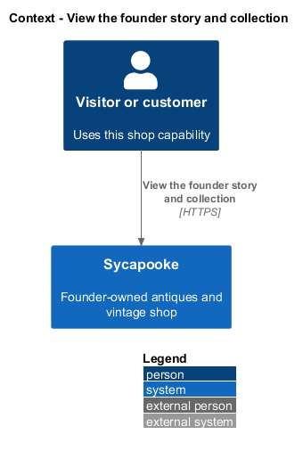
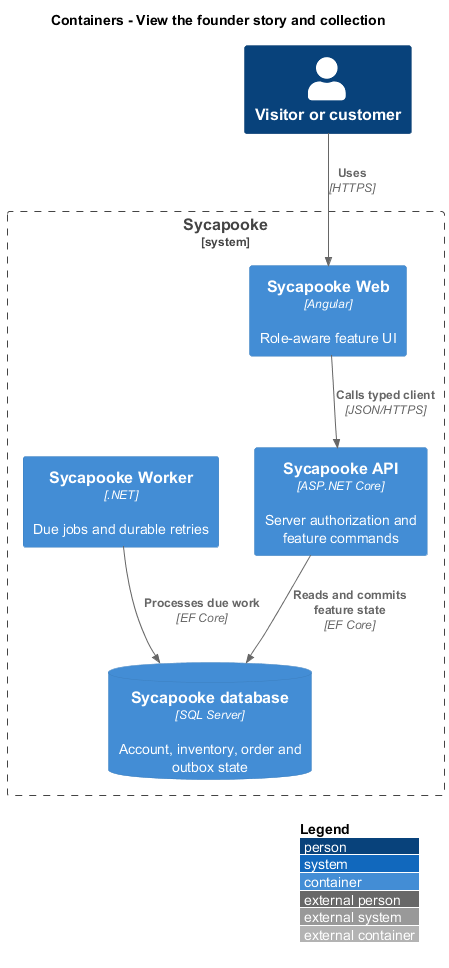
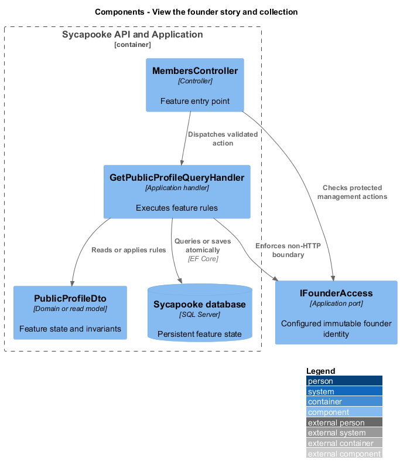
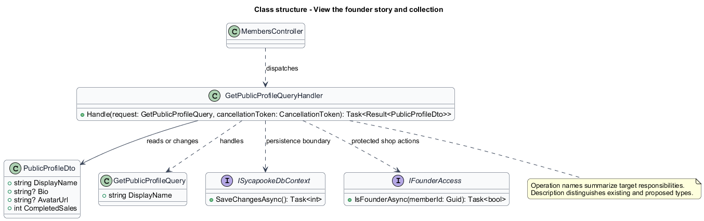
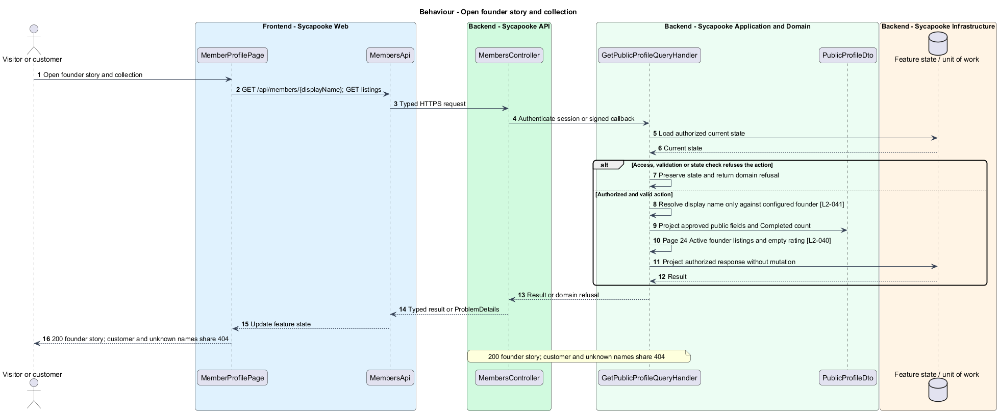
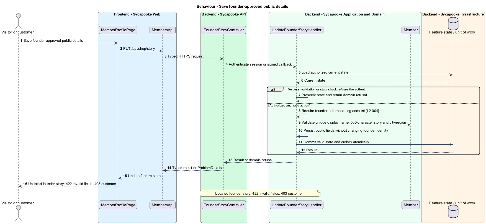
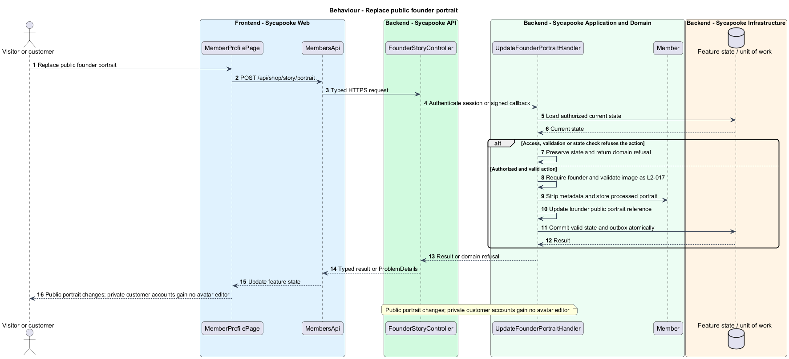

# View the founder story and collection

## Overview

Visitors meet the older Caribbean founder and browse her collection. The founder alone has a public story page; customers have no public profiles or ratings.

Sycapooke is the shop of one older Caribbean woman, its sole seller. Her jewelry, clothing, housewares and electronics are at least 20 years old. This design refines [ADR general/0010](../../../adr/general/0010-founder-only-shop.md). Existing names identify reusable code; Description identifies target additions.

## Description

### Public read boundary

The existing `MemberProfilePage`, `MemberProfileStore`, `MembersApi`, `MembersController`, `GetPublicProfileQueryHandler`, `GetMemberListingsQueryHandler` and `PublicMembers.FindAsync` remain the starting points. Their target behavior resolves only the configured founder, never every open member. Public routing remains `/members/{displayName}`. Existing `GET /api/members/{displayName}` and `/listings?page=N` paths remain.

`PublicMembers` matches the normalized display name and configured immutable founder ID together. Customers, closed accounts and unknown names all return 404 `MEMBER_UNAVAILABLE` with the same body. The response allow-list contains the founder's portrait, display name, approved story, optional city/region, member-since date, Active listing count and Completed sales count. It contains no customer identity, purchase data, private email, phone or street address.

The collection pages 24 Active listings at a time, newest first. `RatingSummaryDto` remains nullable-average/zero-count; the UI summary and reviews section both show `No reviews yet`, without invented stars or review authoring. The story identifies the founder as the older Caribbean woman selling her own collection without inventing precise age or family biography.

### Founder editing and target persistence

Proposed `FounderStoryController` and `UpdateFounderStoryHandler` and `UpdateFounderPortraitHandler` expose `PUT /api/shop/story` with `{ displayName, bio, publicLocation }`, and `POST /api/shop/story/portrait` for an image. They require founder access. Story length is at most 500 characters; name uniqueness and portrait content validation follow L2-004 and L2-017. Persist approved public fields on the founder member and store the processed portrait through the photo port. Private customer settings use a separate endpoint.

Current profile queries return null story fields; story editing and the founder-only predicate are target changes. The static marketing story is founder-approved release content and does not silently become an API-driven page. Tests cover founder edits, customer 403, uniform public 404, public-field privacy, empty rating and collection paging.

### Implementation and verification boundary

Application code and HTML mocks still require alignment with the revised requirements. UI implementation first aligns mocks, design-system components and screen composition. Backend verification uses fake ports and in-memory substitutes. Browser verification uses the built Angular app and intercepted API responses. No external system runs in tests.

### Implementation evidence

No complete target behavior is counted. Reusable implementation exists where identified, but the revised founder, privacy or infrastructure boundary and its acceptance coverage remain unfinished.

Effort in the matching estimate is the full target feature effort in developer-days, not remaining work. Completion counts whole verified behaviors and rounds to the nearest ten percent. Source and existing acceptance tests supply the evidence; this documentation refresh does not execute new target tests.

## Requirements

| L2 ID | Refines (L1) | Requirement |
| --- | --- | --- |
| `L2-004` | `L1-001` | Customers shall be able to change their private display name under the rules of L2-001. Customer details shall not be published, and customers shall have no bio, avatar, public location or public profile editor. Only the founder shall edit the portrait, display name, story (up to 500 characters) and optional city and state or region shown on her public story page (L2-041). Her portrait shall follow the upload validation and metadata-stripping rules of L2-017. Account edits shall not change founder privileges. |
| `L2-040` | `L1-009` | Only the founder shall have a public rating summary. It and the public reviews section shall show "No reviews yet" under the existing deferral. Customers shall have no public ratings or review sections. No sample reviews or calculated star rating shall imply reviews already exist. |
| `L2-041` | `L1-010` | Only the founder shall have a public page, retaining `/members/{displayName}` for her display name, with her portrait, display name, story, optional public city and state or region, member-since date, completed-sales count, Active listings and the "No reviews yet" summary and reviews section (L2-040). It shall introduce her as the older Caribbean woman whose own collection is for sale. Customer accounts shall not resolve to public profiles. The public page and its API shall never expose private email, phone, full account name, street address, customer identity or purchase history. |
| `L2-054` | `L1-014` | Email addresses, shipping addresses and phone numbers shall never appear in public pages or public API responses. Shipping addresses shall be encrypted at rest at the field level, and all databases, backups and photo storage shall be encrypted at rest. |

## Diagrams

### System context

The context identifies the visitor or customer and the systems used by this feature.

### Containers

The container view separates the delivery surface, application boundary and feature storage. External integrations remain behind their ports.

### Components

The component view connects `MembersController` with `GetPublicProfileQueryHandler` and the relevant feature state.

### Class structure

The class view identifies the relevant fields, operation responsibilities and dependencies. It is a target responsibility model, not a claim that each addition already exists.

### Behaviour - Open founder story and collection

200 founder story; customer and unknown names share 404. The sequence shows the boundary that enforces this outcome and the significant failure alternative.

### Behaviour - Save founder-approved public details

Updated founder story; 422 invalid fields; 403 customer. The sequence shows the boundary that enforces this outcome and the significant failure alternative.

### Behaviour - Replace public founder portrait

Public portrait changes; private customer accounts gain no avatar editor. The sequence shows the boundary that enforces this outcome and the significant failure alternative.

